# BÁO CÁO CHUYÊN ĐỀ
# THIẾT KẾ VÀ ĐỀ XUẤT THUẬT TOÁN ĐỊNH TUYẾN LB-ECMHR NHẰM CÂN BẰNG TẢI VÀ HẠN CHẾ SUY GIẢM NĂNG LƯỢNG TRONG MẠNG CẢM BIẾN VÔ TUYẾN

---

## 1. Đặt vấn đề

Mạng cảm biến vô tuyến (Wireless Sensor Network – WSN) gồm nhiều nút cảm biến được triển khai trong một khu vực để thu thập và truyền dữ liệu về nút trung tâm (Sink). Các sensor thường có nguồn năng lượng hữu hạn và phạm vi truyền thông giới hạn.

Trong trường hợp khoảng cách từ sensor đến Sink vượt quá bán kính truyền, dữ liệu phải được chuyển tiếp qua các sensor láng giềng theo cơ chế định tuyến đa chặng (Multi-hop Routing).

Một trong những phương pháp định tuyến đơn giản là Minimum-Hop Routing, trong đó đường truyền được lựa chọn sao cho số bước nhảy từ sensor đến Sink là nhỏ nhất.

Tuy nhiên, khi nhiều sensor cùng truyền dữ liệu về Sink, các node nằm trên những đường đi thuận lợi thường phải chuyển tiếp số lượng packet lớn. Đặc biệt, các sensor gần Sink có thể trở thành điểm hội tụ lưu lượng, phải liên tục nhận và phát dữ liệu thay cho các sensor ở xa.

Điều này khiến năng lượng giữa các sensor bị tiêu hao không đồng đều. Một số sensor gần Sink cạn pin sớm, làm gián đoạn đường truyền của các sensor khác mặc dù phần lớn mạng vẫn còn năng lượng. Hiện tượng này được gọi là Energy Hole.

Để giải quyết hạn chế trên, nghiên cứu đề xuất thuật toán LB-ECMHR (Load-Balanced Energy-Constrained Minimum-Hop Routing).

LB-ECMHR kết hợp ba yếu tố chính:
- Số bước nhảy của đường truyền.
- Năng lượng còn lại của các node chuyển tiếp.
- Tải chuyển tiếp gần đây của các relay.

Thuật toán hướng đến việc phân phối lưu lượng hợp lý hơn giữa các node, hạn chế quá tải tại một số relay và duy trì khả năng kết nối giữa sensor với Sink trong thời gian dài hơn.

---

## 2. Mục tiêu thiết kế thuật toán

Thuật toán LB-ECMHR được đề xuất nhằm đáp ứng các mục tiêu:

- **Thứ nhất**, bảo đảm sensor gửi dữ liệu về Sink thông qua các node láng giềng nằm trong phạm vi truyền cho phép.
- **Thứ hai**, ưu tiên lựa chọn đường truyền có số hop thấp để hạn chế số lần phát và nhận packet.
- **Thứ ba**, không sử dụng các sensor có năng lượng thấp hơn ngưỡng quy định làm relay trung gian, qua đó bảo vệ năng lượng còn lại của các node yếu.
- **Thứ tư**, phát hiện các relay đang chịu tải chuyển tiếp cao và tìm đường thay thế để giảm mức tập trung lưu lượng.
- **Thứ năm**, giới hạn số hop bổ sung khi chuyển sang đường thay thế nhằm kiểm soát chi phí năng lượng và độ trễ.
- **Thứ sáu**, duy trì khả năng kết nối đến Sink trong trường hợp không tồn tại đường tránh quá tải phù hợp nhưng vẫn còn đường truyền đáp ứng điều kiện năng lượng.

Thuật toán được thiết kế theo hướng heuristic, tức sử dụng các quy tắc lựa chọn dựa trên trạng thái hiện tại của mạng, không đặt mục tiêu tìm nghiệm tối ưu toàn cục cho toàn bộ vòng đời WSN.

---

## 3. Mô hình mạng và các giả định

### 3.1. Mô hình triển khai
Mạng cảm biến được mô hình hóa dưới dạng đồ thị:
$$G = (V, E)$$

Trong đó:
- $V$: tập các sensor và Sink.
- $E$: tập các liên kết truyền thông khả dụng.
- $N$: số lượng sensor.
- $S$: nút Sink.

Các sensor được phân bố ngẫu nhiên trong khu vực mô phỏng. Tọa độ mỗi sensor được xác định:
$$\text{Node}_i = (x_i, y_i)$$

Hai node $i$ và $j$ là láng giềng nếu:
$$d(i, j) \le R$$

với:
$$d(i, j) = \sqrt{(x_i - x_j)^2 + (y_i - y_j)^2}$$

Trong đó $R$ là bán kính truyền vô tuyến.

Trong mô hình cơ sở, các sensor không di chuyển sau khi triển khai. Do đó, topology vật lý và tập láng giềng được giữ cố định trong suốt quá trình mô phỏng; chỉ có năng lượng, trạng thái node và tải chuyển tiếp thay đổi theo thời gian.

### 3.2. Các thông số mô phỏng
Bảng thông số tham khảo được sử dụng cho thiết kế và cần đối chiếu với cấu hình thực tế trước khi trình bày kết quả.

| Tham số | Giá trị đề xuất |
| :--- | :--- |
| Số sensor | 500 |
| Khu vực triển khai | 2000 × 2000 m |
| Vị trí Sink | Trung tâm (1000, 1000) |
| Bán kính truyền | 200 m |
| Năng lượng ban đầu | 2 J/node (Tổng ngân sách: 1000 J) |
| Ngưỡng năng lượng relay cơ sở ($\alpha$) | 20% ($E_{th} = 0.40\text{ J}$) |
| Ngưỡng năng lượng dự phòng khẩn cấp ($\alpha_{soft}$) | 2% ($E_{th,soft} = 0.04\text{ J}$) |
| Kích thước packet cơ sở | 128 byte |
| Tốc độ vật lý | 250 kbps |
| Chu kỳ mô phỏng | 1 round = 1 giờ |
| Các mô hình đối chiếu | Minimum-Hop, EC-only (No LB), LB-ECMHR (Hard & Soft) |

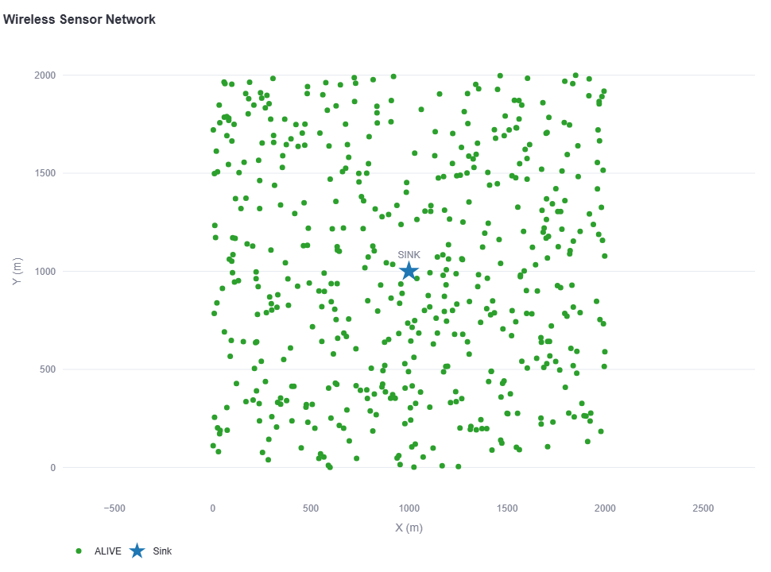
*Hình 1. Mô hình mạng WSN được sử dụng để thực nghiệm thuật toán định tuyến.*

#### Đặc tả và Giải thích kỹ thuật Hình 1:
- **Cấu trúc không gian (Spatial Layout):** Biểu đồ biểu diễn mặt phẳng triển khai mạng kích thước $2000 \times 2000\text{ m}$ với $N = 500$ nút cảm biến phân bố ngẫu nhiên đồng nhất (Seed cố định 42) và nút trung tâm Sink (`★ SINK`, ký hiệu ngôi sao màu xanh dương) đặt tại tọa độ $(1000, 1000)$.
- **Mã hóa trạng thái năng lượng ban đầu (`ALIVE`):** Trên đồ thị tại thời điểm khởi tạo ($t = 0$), toàn bộ 500 nút cảm biến được hiển thị bằng các điểm tròn màu xanh lục (`ALIVE`), biểu thị 100% nút đang ở trạng thái hoạt động bình thường với mức năng lượng khởi tạo đầy đủ $E_i(0) = E_0 = 2.0\text{ J}$. Về mặt logic ứng dụng trong bộ mô phỏng, 500 nút này được gán đều vào 5 nhóm cảm biến quan trắc môi trường (Nhiệt độ, Độ ẩm, Bụi mịn PM2.5, Tốc độ gió và Chất lượng nước – 100 nút/nhóm) với kích thước gói tin chuẩn hóa đồng nhất $128\text{ bytes}$ để đảm bảo tính khách quan khi so sánh định tuyến.
- **Đặc trưng hình học và Vành đai hội tụ (Bottleneck Ring):** Với bán kính truyền thông $R = 200\text{ m}$, các nút ở biên mạng cách Sink tới $1414\text{ m}$ cần từ $6$ đến $9$ bước nhảy (hops) để đưa gói tin về tâm. Mọi luồng lưu lượng đa chặng từ toàn bộ 500 nút đều bắt buộc phải đi qua nhóm **14 nút cảm biến nằm trong hình tròn bán kính $R = 200\text{ m}$ quanh Sink (vành đai 1-hop)**, tạo nên vùng điểm nóng năng lượng (*Energy Hotspot*) đặc trưng của mô hình thu thập dữ liệu Many-to-One.

---

## 4. Thuật toán Minimum-Hop Routing

### 4.1. Nguyên lý hoạt động
Minimum-Hop Routing lựa chọn đường truyền có số bước nhảy nhỏ nhất từ sensor nguồn đến Sink.

Bài toán được biểu diễn:
$$P^* = \arg\min_{P \in \mathcal{P}(S_i, \text{Sink})} H(P)$$

Trong đó:
- $\mathcal{P}(S_i, \text{Sink})$: tập đường đi từ sensor $i$ đến Sink.
- $H(P)$: số hop của đường đi $P$.

Trong đồ thị không trọng số, thuật toán tìm kiếm theo chiều rộng (Breadth-First Search – BFS) có thể xác định các đường đi ngắn nhất tính theo số cạnh.

Ví dụ:
- Đường P1: Source → A → B → Sink, gồm 3 hop.
- Đường P2: Source → C → D → E → Sink, gồm 4 hop.

Minimum-Hop sẽ ưu tiên P1 do có ít hop hơn.

### 4.2. Ưu điểm
Minimum-Hop có một số ưu điểm:
- Nguyên lý đơn giản, dễ triển khai.
- Có thể tìm đường ngắn nhất theo số hop bằng BFS.
- Hạn chế số lần chuyển tiếp của từng packet.
- Phù hợp làm thuật toán đối chứng khi đánh giá cơ chế định tuyến mới.

### 4.3. Hạn chế
Minimum-Hop không trực tiếp xem xét năng lượng còn lại hoặc tải chuyển tiếp của relay.

Khi nhiều source cùng chọn một số node trung gian, các node này có thể phải xử lý số lượng packet lớn hơn các node khác.

Năng lượng tại một relay giảm theo quá trình phát và nhận:
$$E_i(t+1) = E_i(t) - E_{TX, i}(t) - E_{RX, i}(t)$$

Nếu một relay liên tục nằm trên nhiều tuyến đường, tổng năng lượng tiêu thụ của nó tăng nhanh hơn so với các sensor ít tham gia chuyển tiếp.

Hậu quả có thể là:
- Node gần Sink suy giảm năng lượng nhanh.
- Xuất hiện các vùng tập trung node LOW_ENERGY hoặc DEAD.
- Một số source mất đường truyền đến Sink.
- Số packet truyền thành công suy giảm dù mạng vẫn còn nhiều node sống.

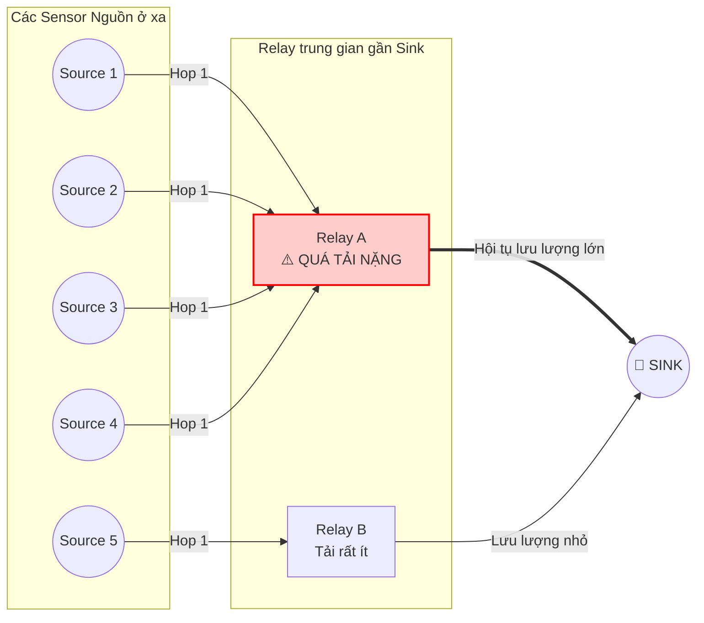
*Hình 2. Minh họa hiện tượng tập trung lưu lượng chuyển tiếp trong thuật toán Minimum-Hop.*

---

## 5. Thuật toán đề xuất LB-ECMHR

### 5.1. Nguyên lý tổng quát
LB-ECMHR là thuật toán định tuyến dựa trên nguyên tắc đường đi ít hop có ràng buộc năng lượng và cơ chế cân bằng tải chuyển tiếp.

Thay vì chỉ tìm đường có số bước nhảy thấp nhất, thuật toán phân tích trạng thái các relay để quyết định có nên chuyển dữ liệu qua những node đang yếu năng lượng hoặc chịu tải lớn hay không.

LB-ECMHR sử dụng ba nhóm thông tin:
- $H(P)$: Số hop của route
- $E_i(t)$: Năng lượng còn lại tại node $i$
- $L_i(t)$: Mức tải chuyển tiếp của relay $i$

Trước tiên, thuật toán loại bỏ các relay không đáp ứng điều kiện năng lượng.

Sau đó, thuật toán xác định các relay đang quá tải và tìm đường tránh những node này khi tồn tại đường thay thế phù hợp.

Để tránh làm tăng quá nhiều năng lượng truyền, số hop bổ sung bị giới hạn bởi một tham số cấu hình.

### 5.2. Ràng buộc năng lượng hai giai đoạn (Hard Threshold & Soft Reserve Fallback)
Mỗi sensor có năng lượng ban đầu $E_0 = 2.0\text{ J}$. Ngưỡng năng lượng bảo vệ cơ sở của relay được xác định:
$$E_{th} = \alpha E_0$$
Với $\alpha = 0.20$, ta có $E_{th} = 0.40\text{ J}$.

Ở **Chế độ Ngưỡng Cứng (LB-ECMHR Hard Threshold, $\alpha = 0.20$):**
- Một sensor được phép làm relay trung gian trong đồ thị chính khi:
  $$E_i(t) > E_{th}$$
- Nếu $0 < E_i(t) \le E_{th}$, node chuyển sang trạng thái `LOW_ENERGY` và không được sử dụng làm relay trung gian trong đồ thị cơ sở $G_E(t)$, nhưng vẫn được phép trực tiếp gửi dữ liệu do chính nó thu thập.
- Nếu $E_i(t) \le 0$, node được xem là `DEAD` và ngừng hoạt động hoàn toàn.

**Vấn đề đánh đổi của Ngưỡng Cứng và Cơ chế Dự phòng Mềm Hai Giai đoạn (LB-ECMHR Soft Reserve Fallback, $\alpha = 0.20 \to \alpha_{soft} = 0.02$):**
Trong mạng Many-to-One (Seed 42), vành đai 1-hop quanh Sink ($d(i, \text{Sink}) \le 200\text{ m}$) có đúng **14 nút cảm biến** ($\mathcal{V}_{1\text{-hop}} = \{24, 40, 98, 101, 117, 136, 199, 213, 218, 315, 350, 423, 472, 483\}$). Sau Round 78, **10 nút 1-hop ở rìa ngoài** ($107.3\text{ m} \le d \le 192.3\text{ m}$) cùng với **14 nút cầu nối 2-hop** ($201.2\text{ m} \le d \le 285.7\text{ m}$, nối ra ngoài từ 4 nút 1-hop nằm sát tâm Sink $\{24, 98, 213, 483\}$) đồng loạt giảm năng lượng xuống dưới ngưỡng cứng $E_{th} = 0.40\text{ J}$, tạo thành một **mặt cắt năng lượng khép kín gồm 24 nút `LOW_ENERGY`** bao quanh Sink. Nếu khóa cứng không cho phép các nút `LOW_ENERGY` làm relay trung gian, toàn bộ 472 nút từ hop 3 đến hop 9 sẽ mất đường định tuyến về Sink ($C_{routing}(t)$ sụt xuống chỉ còn $28/500 = 5.60\%$, gồm 14 nút 1-hop và 14 nút 2-hop gửi qua $\{24, 98, 213, 483\}$), mặc dù các nút cầu nối `LOW_ENERGY` vẫn còn tới gần $20\%$ dung lượng pin dự phòng chưa sử dụng.

Để giải quyết triệt để bài toán đánh đổi giữa **bảo toàn phần cứng (trì hoãn FND)** và **duy trì kết nối dịch vụ quan trắc (kéo dài Functional Lifetime & PDR)**, nghiên cứu thiết kế thêm **Cơ chế Dự phòng Năng lượng Mềm Hai Giai đoạn (*Two-Stage Soft Energy Reserve Fallback*)** với ngưỡng sàn khẩn cấp:
$$E_{th,soft} = \alpha_{soft} E_0 = 0.02 \times 2.0\text{ J} = 0.04\text{ J}$$
Cơ chế vận hành theo nguyên tắc ưu tiên nghiêm ngặt:
1. **Giai đoạn 1 (Ưu tiên Ngưỡng Cứng $\alpha = 0.20$):** Thuật toán luôn tìm đường trên các relay có $E_i(t) > 0.40\text{ J}$. Chừng nào còn ít nhất một tuyến đường đi qua các nút `ALIVE` ($E_i > 0.40\text{ J}$), các nút `LOW_ENERGY` được bảo vệ tuyệt đối 100% để ép lưu lượng xoay vòng sang hết các nhánh còn khỏe.
2. **Giai đoạn 2 (Mở khóa Dự phòng Mềm $\alpha_{soft} = 0.02$ khi bế tắc):** Chỉ khi một nút nguồn $s$ không còn bất kỳ tuyến đường nào tới Sink ở Giai đoạn 1 ($P_{base} = \varnothing$), thay vì đánh rớt gói tin ngay lập tức (`NO_ROUTE_ENERGY_THRESHOLD`), bộ định tuyến cho phép mở khóa vùng năng lượng dự phòng $[0.04\text{ J}, 0.40\text{ J}]$ của các nút `LOW_ENERGY` kết hợp xoay vòng theo tiêu chí tối đa hóa năng lượng nút cổ chai $B(P) = \min_{r \in P} E_r(t)$ và né tránh nút quá tải. Khi năng lượng nút giảm xuống $\le 0.04\text{ J}$ ($2\%$ pin), quyền relay mới bị khóa hoàn toàn để giữ lại phần năng lượng cuối cùng giúp nút sống sót ($\text{FND} > 100$).

### 5.3. Mô hình đánh giá tải relay
Để cân bằng tải, LB-ECMHR cần xác định mức độ sử dụng của mỗi relay trong các round gần đây.

Đặt:
$$f_i(r)$$
là số packet node $i$ đã chuyển tiếp trong round $r$.

Tổng tải trong cửa sổ $W$ round được tính:
$$F_i(t) = \sum_{r=\max(1, t-W+1)}^{t} f_i(r)$$

Trong nghiên cứu, đề xuất:
$$W = 24\text{ rounds}$$

Với quy ước một round tương ứng một giờ, cửa sổ tải phản ánh hoạt động chuyển tiếp trong khoảng 24 giờ mô phỏng gần nhất.

Tải chuẩn hóa:
$$L_i(t) = \frac{F_i(t)}{\overline{F}_{active}(t)}$$

Trong đó:
$$\overline{F}_{active}(t)$$
là số packet chuyển tiếp trung bình của các relay đang có hoạt động forwarding trong cửa sổ theo dõi.

Nếu chưa có relay nào thực hiện forwarding, tải chuẩn hóa được quy ước bằng 0 để tránh phép chia cho 0.

Ví dụ:

| Relay | Packet chuyển tiếp trong 24 round | Load Factor |
| :--- | :--- | :--- |
| A | 40 | 0,8 |
| B | 70 | 1,4 |
| C | 115 | 2,3 |

Nếu tải trung bình là 50 packet, relay C có tải bằng 2,3 lần mức trung bình và có nguy cơ trở thành điểm tập trung lưu lượng.

### 5.4. Phát hiện relay quá tải
Một relay được đánh dấu OVERLOADED khi:
$$L_i(t) \ge \beta$$

Trong đó $\beta$ là hệ số quá tải.

Giá trị đề xuất:
$$\beta = 2.0$$

Nghĩa là relay có tải lớn hơn hoặc bằng hai lần tải trung bình sẽ được đánh dấu quá tải.

OVERLOADED là một trạng thái định tuyến logic, không đồng nghĩa node đã cạn pin.

Node vẫn có thể còn đủ năng lượng nhưng được tạm thời tránh sử dụng làm relay để giảm áp lực chuyển tiếp.

### 5.5. Cơ chế phục hồi tải – Hysteresis
Nếu chỉ sử dụng một ngưỡng quá tải, trạng thái của node có thể dao động liên tục khi tải thay đổi quanh ngưỡng.

Ví dụ, relay có tải lần lượt là 2,01; 1,99; 2,02 và 1,98 sẽ liên tục chuyển giữa trạng thái quá tải và bình thường.

Để hạn chế hiện tượng trên, LB-ECMHR sử dụng thêm ngưỡng phục hồi:
$$L_i(t) \le \gamma$$
với:
$$\gamma = 1.2$$

Điều kiện cấu hình:
$$0 < \gamma < \beta$$

Khi relay đã bị đánh dấu OVERLOADED, nó chỉ được đưa trở lại tập relay ưu tiên khi tải giảm xuống dưới hoặc bằng ngưỡng phục hồi.

Cơ chế này giúp trạng thái quá tải ổn định hơn và hạn chế thay đổi route không cần thiết.

---

## 6. Xây dựng hai đồ thị định tuyến

Điểm quan trọng của LB-ECMHR là sử dụng hai đồ thị logic được xây dựng từ cùng một topology vật lý.

### 6.1. Energy Graph
Energy Graph là đồ thị mà các sensor DEAD và LOW_ENERGY không được phép tham gia với vai trò relay trung gian.

Đồ thị này được ký hiệu:
$$G_E(t)$$

Nó được sử dụng để tìm đường cơ sở đáp ứng ràng buộc năng lượng.

Đối với source $s$, số hop cơ sở là:
$$H_{base}(s, t) = \min_{P \in \mathcal{P}_E(s, \text{Sink})} H(P)$$

*Lưu ý:* source còn sống vẫn được phép phát dữ liệu của mình khi LOW_ENERGY; điều kiện loại bỏ áp dụng cho các node trung gian trên đường truyền.

### 6.2. Balanced Graph
Balanced Graph được ký hiệu:
$$G_B(t)$$

Đồ thị này tiếp tục loại các node OVERLOADED khỏi vai trò relay trung gian, ngoài các node đã không đủ điều kiện năng lượng.

Do đó:
$$\mathcal{P}_B(s, \text{Sink}) \subseteq \mathcal{P}_E(s, \text{Sink})$$

Balanced Graph được sử dụng để tìm các đường truyền tránh những relay đang có tải cao.

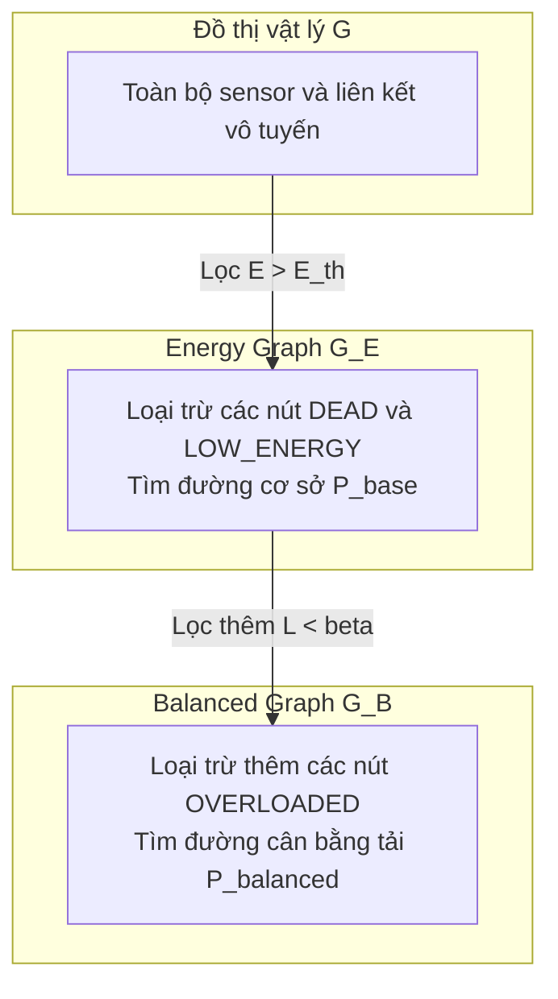
*Hình 3. Hai đồ thị logic được LB-ECMHR sử dụng trong quá trình lựa chọn đường truyền.*

---

## 7. Cơ chế lựa chọn đường truyền

### 7.1. Lựa chọn đường cơ sở
LB-ECMHR trước tiên xác định đường ít hop nhất trong Energy Graph.

Đường này bảo đảm không sử dụng các node DEAD hoặc LOW_ENERGY làm relay trung gian.

Kết quả được ký hiệu:
$$P_{base}$$
và:
$$H_{base} = H(P_{base})$$

### 7.2. Tìm đường cân bằng tải
Tiếp theo, thuật toán tìm đường trong Balanced Graph.

Đường này không đi qua các relay OVERLOADED.

Kết quả ký hiệu:
$$P_{balanced}$$
với:
$$H_{balanced} = H(P_{balanced})$$

### 7.3. Giới hạn số hop bổ sung
Để kiểm soát chi phí truyền thông, LB-ECMHR sử dụng cơ chế Bounded Detour.

Điều kiện chấp nhận đường cân bằng:
$$\boxed{H_{balanced} \le H_{base} + \Delta H}$$

Trong đó $\Delta H$ là số hop bổ sung tối đa được phép.

Giá trị mặc định đề xuất:
$$\Delta H = 1$$

Như vậy, thuật toán cho phép đi vòng tối đa một hop so với đường cơ sở để tránh relay quá tải.

Cần lưu ý: cơ chế này có chủ đích nới lỏng yêu cầu ít hop tuyệt đối. LB-ECMHR vẫn ưu tiên đường ngắn, nhưng có thể lựa chọn đường dài hơn một hop nhằm giảm tải tại hotspot.

### 7.4. Thứ tự ưu tiên khi lựa chọn
Trong mỗi đồ thị, thuật toán ưu tiên đường có số hop nhỏ nhất. Khi tồn tại nhiều đường cùng số hop, sử dụng các tiêu chí phụ:

**Tiêu chí 1 – Tải relay lớn nhất trên đường**
$$M(P) = \max_{i \in \text{Relay}(P)} L_i$$
Ưu tiên:
$$M(P) \downarrow$$
Điều này giúp hạn chế việc lựa chọn route có một relay chịu tải rất lớn.

**Tiêu chí 2 – Năng lượng bottleneck**
$$B(P) = \min_{i \in \text{Relay}(P)} E_i$$
Ưu tiên:
$$B(P) \uparrow$$
Thuật toán ưu tiên đường có relay yếu nhất nhưng vẫn còn mức năng lượng cao hơn.

**Tiêu chí 3 – Tổng khoảng cách truyền**
$$D(P) = \sum_{(i, j) \in P} d(i, j)$$
Ưu tiên:
$$D(P) \downarrow$$
Tiêu chí khoảng cách được sử dụng để phân xử các route còn tương đương theo những tiêu chí trước đó.

Quy trình lựa chọn có thể tóm tắt như sau:
1. Bảo đảm các relay đáp ứng ràng buộc năng lượng.
2. Ưu tiên đường tránh quá tải nếu số hop bổ sung không vượt giới hạn.
3. Trong tập đường đang xét, ưu tiên số hop nhỏ nhất.
4. Khi bằng số hop, hạn chế tải relay lớn nhất.
5. Tiếp tục xét năng lượng bottleneck và khoảng cách.

Đây là quy trình lựa chọn theo heuristic, không phải một chứng minh tối ưu toàn cục đối với mọi đường đi khả dĩ.

### 7.5. Cơ chế dự phòng hai cấp – Overload Fallback & Soft Energy Reserve Fallback
LB-ECMHR trang bị hệ thống dự phòng hai cấp để bảo đảm tính liên tục của dịch vụ định tuyến:

**Cấp 1 – Dự phòng quá tải trên đồ thị ngưỡng cứng (Overload Fallback):**
Trong trường hợp không tồn tại đường tránh tải trên $G_B(t)$, hoặc đường tránh tải phải đi vòng quá xa ($H_{balanced} > H_{base} + \Delta H$), thuật toán quay về sử dụng đường cơ sở trên đồ thị năng lượng $G_E(t)$:
$$P_{selected} = P_{base}$$
Nhờ đó, một relay `OVERLOADED` nhưng còn dồi dào năng lượng ($E_i > \alpha E_0$) vẫn được phép sử dụng khi không có phương án đi vòng khả dĩ trong giới hạn $\Delta H$.

**Cấp 2 – Dự phòng năng lượng mềm khi vành đai chạm ngưỡng cứng (Soft Energy Reserve Fallback):**
Nếu ngay cả đồ thị năng lượng chính $G_E(t)$ cũng không còn đường truyền hợp lệ ($P_{base} = \varnothing$ do toàn bộ các nút cầu nối về Sink đã chuyển sang `LOW_ENERGY`), hành vi của thuật toán phụ thuộc vào chế độ cấu hình:
- **Ở chế độ `LB-ECMHR Hard` (`allow_low_energy_fallback = False`):** Nút nguồn lập tức bị đánh dấu không có đường truyền vì lý do bảo vệ ngưỡng năng lượng (`NO_ROUTE_ENERGY_THRESHOLD`), ưu tiên giữ nguyên $20\%$ pin dự phòng cho các nút gần Sink.
- **Ở chế độ `LB-ECMHR Soft` (`allow_low_energy_fallback = True`, $\alpha_{soft} = 0.02$):** Thuật toán kích hoạt đồ thị dự phòng mềm $G_{E,soft}(t)$ và $G_{B,soft}(t)$ (cho phép các nút có $E_i(t) > 0.04\text{ J}$ tham gia chuyển tiếp khẩn cấp) và áp dụng cùng quy tắc ưu tiên cân bằng tải + xoay vòng năng lượng nút cổ chai $B(P) \uparrow$ với giới hạn đi vòng $\Delta H = 1$. Chỉ khi $P_{base,soft} = \varnothing$ thì gói tin mới bị hủy.

---

## 8. Ví dụ minh họa quá trình chọn đường

Giả sử một sensor nguồn S có hai đường truyền đến Sink.

Đường P1:
$$S \rightarrow A \rightarrow B \rightarrow \text{Sink}$$
Số hop:
$$H(P1) = 3$$

Các relay có thông số:

| Relay | Năng lượng còn lại | Load Factor |
| :--- | :--- | :--- |
| A | 1,4 J | 0,8 |
| B | 1,2 J | 2,4 |

Đường P2:
$$S \rightarrow C \rightarrow D \rightarrow E \rightarrow \text{Sink}$$
Số hop:
$$H(P2) = 4$$

Các relay:

| Relay | Năng lượng còn lại | Load Factor |
| :--- | :--- | :--- |
| C | 1,5 J | 0,7 |
| D | 1,3 J | 0,9 |
| E | 1,4 J | 1,1 |

Với ngưỡng quá tải:
$$\beta = 2.0$$
relay B bị đánh dấu OVERLOADED vì:
$$L_B = 2.4 > 2.0$$

Đường P1 có ba hop nhưng phải đi qua relay quá tải.

Đường P2 không đi qua relay quá tải và có bốn hop.

Vì:
$$4 \le 3 + 1$$
nên P2 thỏa điều kiện Bounded Detour.

LB-ECMHR lựa chọn P2, phân phối lưu lượng qua các relay C, D và E nhằm giảm tải cho B.

Ngược lại, nếu P2 có năm hop và giới hạn vẫn là một hop, P2 sẽ không được chấp nhận. Khi đó, thuật toán có thể quay về đường P1 nếu không tồn tại phương án hợp lệ khác.

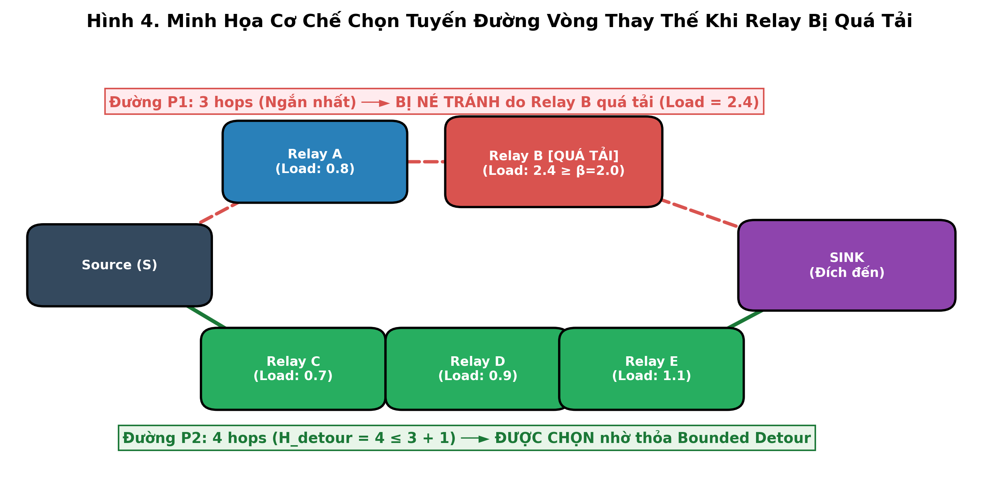
*Hình 4. Ví dụ lựa chọn đường thay thế khi một relay trên đường ngắn nhất bị quá tải.*

#### Đặc tả và Giải thích kỹ thuật Hình 4:
- **Mục đích minh họa:** Trực quan hóa quyết định chuyển hướng có giới hạn (*Bounded Detour*) của thuật toán LB-ECMHR khi phát hiện nút nghẽn trên đường đi ngắn nhất.
- **Cơ chế phân nhánh trên sơ đồ:**
  - **Nhánh trên (Đường đứt nét màu đỏ - Tuyến cơ sở $P_1$):** Tuyến $S \to A \to B \to \text{Sink}$ chỉ gồm $H_{base} = 3\text{ hops}$ nhưng đi qua `Relay B` có hệ số tải $L_B = 2.4 \ge \beta = 2.0$ (đang bị đánh dấu `OVERLOADED`). Do đó, tuyến này bị loại khỏi đồ thị cân bằng tải $G_B(t)$.
  - **Nhánh dưới (Đường liền nét màu xanh lục - Tuyến thay thế $P_2$):** Tuyến $S \to C \to D \to E \to \text{Sink}$ đi qua các relay có tải thấp ($L_C = 0.7, L_D = 0.9, L_E = 1.1 < 2.0$) và có độ dài $H_{balanced} = 4\text{ hops}$.
- **Ý nghĩa điều kiện chấp nhận:** Vì độ dài tuyến mới thỏa mãn bất đẳng thức $H_{balanced} = 4 \le H_{base} + \Delta H = 3 + 1$, LB-ECMHR chấp nhận đi vòng thêm đúng 1 hop để giải tỏa áp lực cho `Relay B`, ngăn chặn sự suy giảm năng lượng cục bộ mà không làm phát sinh chi phí truyền thông quá mức.

---

## 9. Quy trình thực hiện thuật toán

Trong mỗi round, thuật toán thực hiện các bước:

Bước 1. Cập nhật trạng thái năng lượng của các sensor và xác định những node không đủ điều kiện tiếp tục làm relay.

Bước 2. Cập nhật số packet chuyển tiếp của từng node trong cửa sổ theo dõi tải.

Bước 3. Tính Load Factor và cập nhật trạng thái OVERLOADED theo các ngưỡng quá tải, phục hồi.

Bước 4. Xây dựng hoặc cập nhật Energy Graph và Balanced Graph.

Bước 5. Tìm đường cơ sở ít hop nhất từ từng source đến Sink.

Bước 6. Tìm đường tránh quá tải trong Balanced Graph.

Bước 7. Kiểm tra điều kiện giới hạn số hop bổ sung.

Bước 8. Chọn đường cân bằng nếu hợp lệ; ngược lại áp dụng fallback về đường cơ sở khi được cho phép.

Bước 9. Tiến hành truyền packet và tính năng lượng tiêu thụ tại các node phát, nhận.

Bước 10. Cập nhật thống kê số packet thành công, thất bại, năng lượng, tải relay và trạng thái mạng để phục vụ round tiếp theo.

Trong trường hợp một relay mất điều kiện hoạt động giữa round, đường truyền phải được kiểm tra lại và xử lý định tuyến thay thế hoặc thất bại truyền, thay vì tiếp tục sử dụng route không còn hợp lệ.

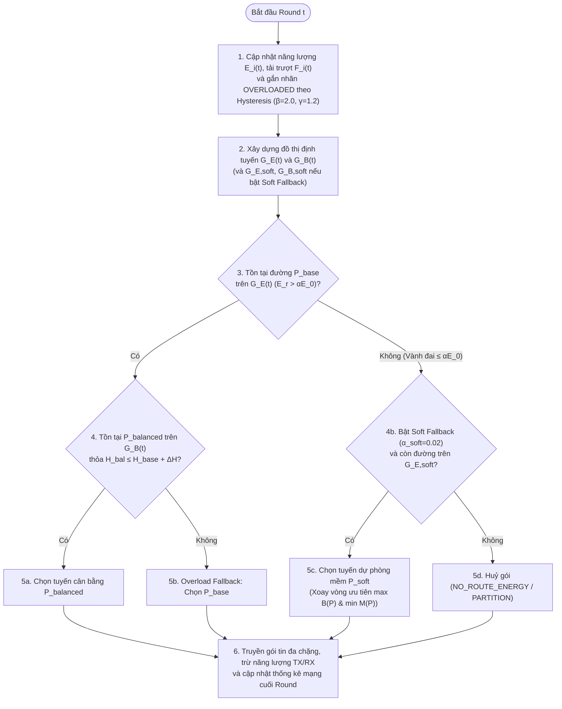
*Hình 5. Lưu đồ hoạt động tổng thể của thuật toán định tuyến LB-ECMHR (tích hợp cơ chế dự phòng hai cấp).*

---

## 10. Các tham số điều chỉnh

LB-ECMHR được thiết kế với các tham số cho phép điều chỉnh mức cân bằng tải và khả năng duy trì kết nối.

| Tham số | Mặc định đề xuất | Chức năng |
| :--- | :--- | :--- |
| `energy_threshold_ratio` ($\alpha$) | 0,20 | Ngưỡng năng lượng bảo vệ relay cơ sở ($E_{th} = 0.40\text{ J}$) |
| `soft_energy_threshold_ratio` ($\alpha_{soft}$) | 0,02 | Ngưỡng năng lượng dự phòng khẩn cấp ($E_{th,soft} = 0.04\text{ J}$) |
| `allow_low_energy_fallback` | False (Hard) / True (Soft) | Bật/tắt cơ chế mở khóa dự phòng mềm Giai đoạn 2 |
| `load_window_rounds` ($W$) | 24 | Số round theo dõi tải trong cửa sổ trượt |
| `overload_factor` ($\beta$) | 2,0 | Ngưỡng đánh dấu relay quá tải |
| `recovery_factor` ($\gamma$) | 1,2 | Ngưỡng phục hồi Hysteresis ($\gamma < \beta$) |
| `max_extra_hops` ($\Delta H$) | 1 | Số hop đi vòng tối đa cho phép so với đường cơ sở |
| `allow_overload_fallback` | True | Cho phép dùng đường cơ sở $P_{base}$ khi không có đường tránh tải phù hợp |

### 10.1. Energy Threshold
Ngưỡng cao giúp bảo vệ các relay yếu pin sớm hơn nhưng có thể làm giảm số route khả dụng.

Ngưỡng thấp cho phép sử dụng relay lâu hơn nhưng tăng nguy cơ các node gần Sink bị khai thác đến khi cạn năng lượng.

Giá trị 20% được sử dụng làm cấu hình tham khảo; mức tốt nhất cần được kiểm nghiệm.

### 10.2. Load Window
Cửa sổ nhỏ giúp phát hiện biến động tải nhanh nhưng có thể làm trạng thái quá tải dao động.

Cửa sổ lớn giúp kết quả ổn định hơn nhưng phản ứng chậm với hotspot mới.

Với quy ước một round bằng một giờ, cửa sổ 24 round tương ứng 24 giờ mô phỏng, thuận tiện để phân tích tải theo ngày.

### 10.3. Overload Factor
Ngưỡng thấp khiến nhiều relay bị đánh dấu quá tải hơn. Điều này có thể tăng khả năng phân tán tải nhưng cũng làm số đường tránh hoặc lần fallback tăng.

Ngưỡng cao giúp thuật toán ít thay đổi đường hơn nhưng có thể bỏ qua các hotspot đang hình thành.

### 10.4. Recovery Factor
Ngưỡng phục hồi thấp khiến relay phải giảm tải đáng kể mới được sử dụng trở lại.

Ngưỡng phục hồi cao giúp relay quay lại sớm hơn nhưng có thể dẫn đến thay đổi trạng thái liên tục.

### 10.5. Maximum Extra Hops
Đây là tham số thể hiện sự đánh đổi giữa đường truyền ngắn và cân bằng tải.

- Giá trị 0: không chấp nhận đường dài hơn đường cơ sở.
- Giá trị 1: cho phép đi vòng tối đa một hop.
- Giá trị 2: mở rộng khả năng tránh hotspot nhưng có thể làm tăng chi phí truyền thông.

Mặc định đề xuất là một hop.

---

## 11. Mô hình tiêu thụ năng lượng

Trong LB-ECMHR, lựa chọn đường truyền tác động trực tiếp đến số lần phát và nhận dữ liệu.

Năng lượng phát một packet có kích thước $L$ bit qua khoảng cách $d$ có thể được mô hình hóa:
$$E_{TX}(L, d) = \begin{cases} L(E_{elec} + \varepsilon_{fs} d^2), & d < d_0 \\ L(E_{elec} + \varepsilon_{mp} d^4), & d \ge d_0 \end{cases}$$

Năng lượng nhận:
$$E_{RX}(L) = L \cdot E_{elec}$$

Tổng năng lượng truyền thông của một packet qua đường $P$ gồm $H$ hop:
$$E_{path}(P) = \sum_{h=1}^{H} \left[ E_{TX}(L, d_h) + E_{RX}(L) \right]$$

Công thức trên giả định toàn bộ các hop đều truyền và nhận thành công; nếu có truyền lại hoặc gói tin dừng giữa đường thì năng lượng thực tế được tính theo những thao tác đã phát sinh.

Cần lưu ý rằng việc chọn đường đi vòng có thể làm tăng tổng số lần phát và nhận. Vì vậy LB-ECMHR không đặt mục tiêu bảo đảm năng lượng của mỗi packet luôn thấp nhất.

Mục tiêu chính là hạn chế sự chênh lệch tải giữa các relay, trì hoãn tình trạng một số node quan trọng bị cạn pin quá sớm và kéo dài thời gian mạng duy trì khả năng truyền dữ liệu về Sink.

---

## 12. Độ phức tạp và tối ưu tốc độ thực thi

Đối với một đồ thị không trọng số, BFS có độ phức tạp:
$$O(|V| + |E|)$$

Với mạng gồm hàng trăm sensor, việc tìm đường bằng BFS có thể được thực hiện tương đối hiệu quả.

Tuy nhiên, khi mô phỏng hàng nghìn round, việc liên tục tạo lại đồ thị và tìm đường độc lập cho từng source có thể làm tăng thời gian xử lý đáng kể.

Nghiên cứu đề xuất các hướng tối ưu sau:

- **Một là**, lưu topology tĩnh và danh sách láng giềng. Vì tọa độ sensor không thay đổi, không cần tính lại toàn bộ khoảng cách hoặc liên kết vật lý trong mỗi round.
- **Hai là**, xây dựng bảng định tuyến theo Sink. Thay vì chạy BFS độc lập từ từng sensor đến Sink, có thể tính thông tin khoảng cách hop đến Sink trên đồ thị phù hợp và tái sử dụng cho nhiều source.
- **Ba là**, tách xử lý định tuyến khỏi giao diện Streamlit. Thuật toán có thể chạy nhiều round liên tục và chỉ cập nhật giao diện sau một số round nhất định.
- **Bốn là**, chỉ cập nhật các phần thay đổi. Khi trạng thái node không thay đổi, có thể tái sử dụng cấu trúc đã xây dựng, nhưng vẫn phải cập nhật tải và tiêu chí lựa chọn route theo đúng mô hình nghiên cứu.
- **Năm là**, có thể lưu sẵn một số tuyến ứng viên trong topology tĩnh. Mỗi round chỉ cần đánh giá năng lượng và tải của các tuyến đã lưu. Tuy nhiên, việc giới hạn số tuyến ứng viên có thể bỏ sót một tuyến tốt hơn, vì vậy đây là một chế độ tăng tốc xấp xỉ và cần đánh giá riêng nếu sử dụng trong thực nghiệm.

Việc giảm tần suất tính lại route cũng có thể làm thay đổi quyết định của thuật toán do thông tin tải không được cập nhật ngay. Vì vậy, thí nghiệm chính nên duy trì cơ chế cập nhật nhất quán; các cấu hình tăng tốc có thay đổi hành vi định tuyến cần được ghi nhận rõ ràng.

---

## 13. Thiết kế thực nghiệm đánh giá

Để đánh giá toàn diện và công bằng hiệu quả của thuật toán đề xuất, nghiên cứu tiến hành so sánh đối chứng **4 mô hình định tuyến** trong cùng điều kiện chuẩn hóa ($N=500$ sensors, miền $2000 \times 2000\text{ m}$, Sink tại $(1000, 1000)$, $E_0=2.0\text{ J}$, $R=200\text{ m}$, payload $128\text{ B}$):
1. **`Minimum-Hop (Baseline)`:** Định tuyến đường đi ngắn nhất theo số bước nhảy bằng BFS, không có ngưỡng bảo vệ năng lượng và không có cân bằng tải.
2. **`EC-only (Hard α=0.20, No Load Balancing)`:** Mô hình bóc tách chỉ áp dụng bộ lọc ngưỡng năng lượng cứng ($E_i > 0.20 E_0 = 0.40\text{ J}$) trên nền chọn đường BFS của Minimum-Hop, tắt hoàn toàn bộ theo dõi tải trượt ($W$), tắt phát hiện quá tải ($\beta$), tắt xoay vòng năng lượng nút cổ chai $B(P)$ và cấm đi vòng ($\Delta H = 0$).
3. **`LB-ECMHR Hard (α=0.20)`:** Thuật toán LB-ECMHR đầy đủ sử dụng ngưỡng bảo vệ cứng $\alpha = 0.20$ ($E_{th} = 0.40\text{ J}$), cửa sổ tải trượt $W=24$, Hysteresis ($\beta=2.0, \gamma=1.2$) và giới hạn đi vòng $\Delta H = 1$.
4. **`LB-ECMHR Soft Fallback (α=0.20 → α_soft=0.02)`:** Thuật toán LB-ECMHR tích hợp cơ chế dự phòng năng lượng mềm hai giai đoạn: ưu tiên định tuyến trên ngưỡng cứng $\alpha = 0.20$ ở Giai đoạn 1 và chỉ mở khóa vùng năng lượng dự phòng $[0.04\text{ J}, 0.40\text{ J}]$ kết hợp xoay vòng tải/năng lượng ở Giai đoạn 2 khi vành đai 1-hop đã chạm ngưỡng $20\%$.

**Phân tách rõ hai kịch bản mô phỏng chuẩn hóa:**
- **Kịch bản A – Quan sát chuẩn 100 Rounds (Radio-Only Energy Model, $E_{basal} = 0\text{ J/round}$):** Đánh giá thuần túy tiêu hao năng lượng do truyền/nhận gói tin vô tuyến ($E_{TX}, E_{RX}$) trong 100 giờ đầu tiên.
- **Kịch bản B – Vòng đời toàn diện 1000 Rounds tới LND (Radio + Basal Maintenance Energy Model, $E_{basal} = 0.002\text{ J/round}$):** Bổ sung công suất tiêu thụ nền duy trì vi điều khiển, cảm biến và phát quảng bá láng giềng định kỳ ($0.002\text{ J/round}$) cho mọi nút còn sống để khảo sát trọn vẹn các cột mốc **FND, Func50, HND và LND**.

### 13.1. Tuổi thọ phần cứng (FND/HND/LND) và Tuổi thọ chức năng (Functional Lifetime – Func50)
Để phản ánh trung thực cả độ bền phần cứng lẫn chất lượng dịch vụ quan trắc, nghiên cứu chuẩn hóa 4 chỉ số tuổi thọ:
- **FND (First Node Death):** Round xuất hiện nút cảm biến đầu tiên cạn kiệt năng lượng ($E_i = 0\text{ J}$).
- **HND (Half Nodes Dead):** Round có ít nhất 50% số nút bị chết ($N_{dead} \ge 250$).
- **LND (Last Node Death):** Round toàn bộ 100% cảm biến đều cạn kiệt pin ($N_{dead} = 500$).
- **Func50 (Functional Network Lifetime 50%):** Round đầu tiên mà số lượng cảm biến có tuyến đường định tuyến hợp lệ về Sink giảm xuống dưới $50\%$ quy mô mạng ban đầu ($N_{routable}(t) < 250\text{ nút}$). Đây là thước đo cốt lõi đánh giá thời gian mạng duy trì được dịch vụ thu thập dữ liệu diện rộng.

> [!IMPORTANT]
> **Quy ước báo cáo khoa học:**
> Trong Kịch bản A (100 rounds), các mô hình có ràng buộc năng lượng (`EC-only`, `LB-ECMHR Hard`, `LB-ECMHR Soft`) đều giữ $N_{dead} = 0$, do đó cột mốc FND được báo cáo chính xác là **$\text{FND} > 100\text{ rounds}$** (không ghi $\text{FND} = 100$). Đồng thời, báo cáo trình bày song hành chỉ số **$\text{Func50}$** để đánh giá khách quan thời điểm mạng suy giảm khả năng định tuyến đa chặng.

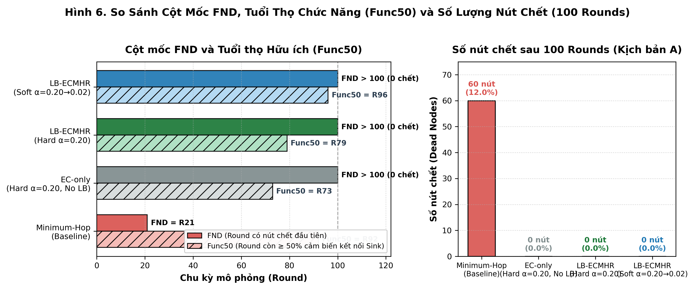
*Hình 6. So Sánh Cột Mốc FND, Tuổi Thọ Chức Năng (Func50) và Số Lượng Nút Chết (100 Rounds – Kịch bản A).*

#### Đặc tả và Phân tích kỹ thuật Hình 6:
- **Cấu trúc đồ thị:** Biểu đồ gồm 2 khung nhìn song song:
  - **Khung trái (Grouped Horizontal Bar Chart):** Đối chiếu trực tiếp cột mốc phần cứng **FND** (thanh màu đậm) và cột mốc dịch vụ **Func50** (thanh gạch chéo) của cả 4 mô hình định tuyến.
  - **Khung phải (Vertical Bar Chart):** Biểu diễn tổng số nút cảm biến bị chết hoàn toàn ($E_i = 0\text{ J}$) sau 100 rounds.
- **Hiện tượng quan sát và Đánh giá khoa học công bằng:**
  - **`Minimum-Hop (Baseline)`:** Nút relay 1-hop đầu tiên chết rất sớm tại **Round 21 ($\text{FND} = 21$)** và tổng cộng **60 nút cảm biến (12.0% mạng)** bị chết sau 100 rounds. Nhờ vắt kiệt tới giọt năng lượng cuối cùng của các relay quanh Sink, Minimum-Hop duy trì được kết nối định tuyến $\ge 50\%$ tới **Round 92 ($\text{Func50} = 92$)**.
  - **`EC-only (Hard α=0.20, No LB)`:** Khi chỉ áp dụng ngưỡng khóa cứng $20\%$ mà không có cân bằng tải, dù không có nút nào chết ($\text{FND} > 100$), lưu lượng dồn cục bộ vào một số ít nút 1-hop khiến vành đai cầu nối nhanh chóng chạm ngưỡng `LOW_ENERGY` và làm mạng mất kết nối định tuyến sớm ngay từ **Round 73 ($\text{Func50} = 73$)**.
  - **`LB-ECMHR Hard (α=0.20)`:** Nhờ bổ sung cơ chế cân bằng tải trượt và xoay vòng theo năng lượng nút cổ chai, LB-ECMHR Hard vừa giữ nguyên **0 nút chết ($\text{FND} > 100$)** vừa kéo dài thời gian duy trì dịch vụ lên **Round 79 ($\text{Func50} = 79$, cải thiện $+6\text{ rounds}$ so với `EC-only`)**. Tuy nhiên, việc khóa cứng $20\%$ pin dự phòng vẫn làm `Func50` của chế độ Hard ngắn hơn Minimum-Hop $13\text{ rounds}$ ($79$ vs $92$).
  - **`LB-ECMHR Soft Fallback (α=0.20 → 0.02)`:** Giải quyết trọn vẹn sự đánh đổi trên: thuật toán bảo toàn **100% phần cứng (0 nút chết, $\text{FND} > 100$)** đồng thời mở khóa có kiểm soát vùng dự phòng khi vành đai chạm ngưỡng $20\%$, qua đó kéo dài tuổi thọ chức năng lên tới **Round 96 ($\text{Func50} = 96$)** – **vượt qua cả `Minimum-Hop` ($+4\text{ rounds}$) và `LB-ECMHR Hard` ($+17\text{ rounds}$)**.

---

### 13.2. Số node còn sống theo round (Alive Nodes vs Round)
Gọi $N_{alive}(t)$ là số sensor còn sống tại round $t$. Trong mạng WSN không có cơ chế thu hoạch năng lượng hay hồi sinh phần cứng, số lượng nút còn sống phải thỏa mãn **tính đơn điệu giảm nghiêm ngặt**:
$$\forall t \ge 1: \quad N_{alive}(t) \le N_{alive}(t-1) \quad \text{và} \quad N_{dead}(t) \ge N_{dead}(t-1)$$

Hệ thống mô phỏng thực thi kiểm chứng tự động (`assert`) trên toàn bộ chuỗi thời gian xuất ra trong `outputs/compare_routing_100_rounds.json` và `outputs/experiments_master_summary.csv`:
```python
alive_counts = [item["alive_nodes"] for item in results["history"]]
assert all(alive_counts[i] <= alive_counts[i - 1] for i in range(1, len(alive_counts)))

dead_counts = [item["dead_nodes"] for item in results["history"]]
assert all(dead_counts[i] >= dead_counts[i - 1] for i in range(1, len(dead_counts)))
```

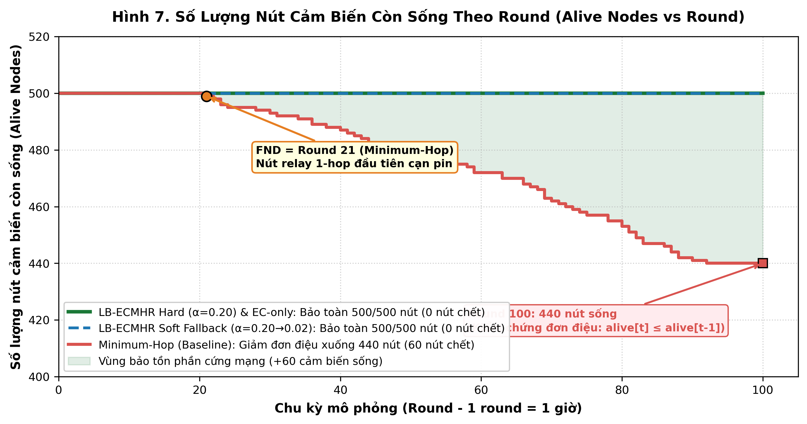
*Hình 7. Số Lượng Nút Cảm Biến Còn Sống Theo Round (Được kiểm chứng tính đơn điệu nghiêm ngặt).*

#### Đặc tả và Phân tích kỹ thuật Hình 7:
- **Đặc tả trục tọa độ và Đường biểu diễn:** Trục hoành là Round $[0, 100]$; trục tung là số nút còn sống $N_{alive}(t) \in [400, 520]$, vẽ trực tiếp bằng hàm bậc thang `ax.step(..., where='post')` từ dữ liệu thực nghiệm.
- **Phân tích động học suy giảm nút:**
  - Cả ba mô hình có bảo vệ năng lượng (`EC-only`, `LB-ECMHR Hard` và `LB-ECMHR Soft Fallback`) đều duy trì đường biểu diễn đi ngang tuyệt đối tại mức **$500/500$ nút sống** suốt 100 rounds.
  - Đường `Minimum-Hop` bắt đầu sụt giảm tại Round 21 ($499$ nút sống) và giảm đơn điệu liên tục xuống $440$ nút sống tại Round 92. Từ Round 92 đến Round 100, đường biểu diễn giữ phẳng ở mức $440$ nút vì toàn bộ cầu nối vào Sink đã chết, làm các nút ở xa bị cô lập hoàn toàn và không thể truyền thêm gói tin đa chặng.

---

### 13.3. Năng lượng tiêu thụ, năng lượng còn lại và hiệu suất truyền tải (bit/Joule)
Tổng năng lượng còn lại của toàn mạng tại round $t$:
$$E_{remaining}(t) = \sum_{i=1}^{N} E_i(t) = N \cdot E_0 - E_{consumed}(t)$$
Vì tổng năng lượng tiêu thụ $E_{consumed}$ phụ thuộc trực tiếp vào tổng số gói tin được mạng vận chuyển thành công về Sink, việc đánh giá năng lượng bắt buộc phải xét đồng thời cả **tổng năng lượng tiêu hao (Joules)** và **hiệu suất sử dụng năng lượng (Energy Efficiency – bit/Joule)**:
$$\eta_{energy} = \frac{N_{delivered} \times L_{bits}}{E_{consumed}} \quad (\text{bit/J})$$

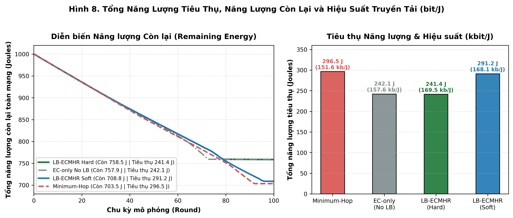
*Hình 8. Tổng Năng Lượng Tiêu Thụ, Năng Lượng Còn Lại và Hiệu Suất Truyền Tải (bit/J) Sau 100 Rounds.*

#### Đặc tả và Phân tích kỹ thuật Hình 8:
- **Cấu trúc đồ thị:** Khung trái biểu diễn đường cong suy giảm năng lượng còn lại $E_{remaining}(t)$ theo thời gian; khung phải đối chiếu tổng năng lượng tiêu thụ (J) kèm theo hiệu suất truyền tải hữu ích ($\text{kbit/J}$) của cả 4 mô hình.
- **Phân tích định lượng đa chiều:**
  - **`Minimum-Hop`:** Tiêu thụ nhiều năng lượng nhất (**296.54 J**, còn lại $703.46\text{ J}$) nhưng chỉ đạt hiệu suất năng lượng thấp nhất (**151.6 kbit/J**, tức $151,575\text{ bit/J}$) do lưu lượng dồn vào các nhánh cố định và có 60 gói tin đã tiêu tốn năng lượng phát qua nhiều chặng trung gian nhưng bị rớt giữa đường khi relay sập nguồn (`TX_ENERGY` / `RX_ENERGY`).
  - **`EC-only (No LB)` vs `LB-ECMHR Hard`:** `EC-only` tiêu thụ **242.64 J** (hiệu suất **157.1 kbit/J**), trong khi `LB-ECMHR Hard` tiêu thụ ít hơn (**241.34 J**, tiết kiệm $18.6\%$ so với Minimum-Hop) nhưng lại truyền được nhiều hơn `EC-only` tới $2,692$ gói tin, nâng hiệu suất năng lượng lên **169.6 kbit/J** (**cao hơn Minimum-Hop $+11.9\%$ và cao hơn EC-only $+7.9\%$**).
  - **`LB-ECMHR Soft Fallback (α=0.20 → 0.02)`:** Minh chứng thuyết phục nhất cho hiệu quả năng lượng: mô hình Soft tiêu thụ **285.94 J** (**ít hơn Minimum-Hop $10.60\text{ J}$ hay $-3.6\%$ năng lượng**), nhưng lại vận chuyển thành công tới **5.836 MiB dữ liệu (nhiều hơn Minimum-Hop $+8.9\%$ dữ liệu)**, đạt hiệu suất năng lượng cao nhất trong tất cả các mô hình: **171.2 kbit/J ($171,246\text{ bit/J}$, vượt Minimum-Hop $+13.0\%$)**.

---

### 13.4. Phân biệt Tỷ lệ Kết nối Vật lý và Kết nối Định tuyến
Để làm sáng tỏ hiện tượng suy giảm kết nối ở giai đoạn cuối chu kỳ quan sát, nghiên cứu tách biệt hai chỉ số kết nối trên tập nút đang sống $V_{alive}(t)$:
1. **Tỷ lệ Kết nối Vật lý ($C_{physical}(t)$):** Tỷ lệ các sensor còn sống có đường đi vật lý tới Sink trên đồ thị phần cứng $G(V_{alive}, E_{alive})$:
   $$C_{physical}(t) = \frac{|\text{Component}_{alive}(\text{Sink})| - 1}{N_{alive}(t)}$$
2. **Tỷ lệ Kết nối Định tuyến ($C_{routing}(t)$):** Tỷ lệ các sensor còn sống tìm được tuyến đường hợp lệ tới Sink theo quy tắc năng lượng và định tuyến của từng mô hình:
   $$C_{routing}(t) = \frac{|\{u \in V_{alive}(t) \mid \exists \text{ ValidRoute}(u \to \text{Sink})\}|}{N_{alive}(t)}$$

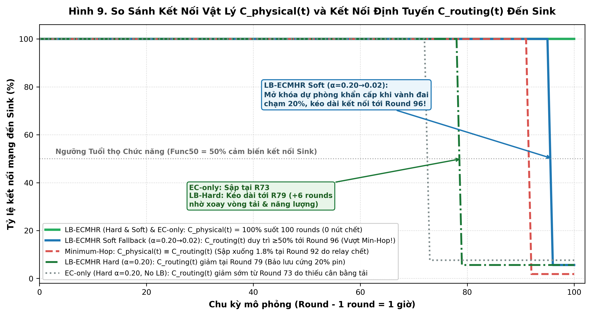
*Hình 9. So Sánh Kết Nối Vật Lý C_physical(t) và Kết Nối Định Tuyến C_routing(t) Đến Sink (4 Mô hình).*

#### Đặc tả và Phân tích kỹ thuật Hình 9:
- **Phân tích trung thực sự đánh đổi giữa các chế độ định tuyến:**
  - **Về Kết nối Vật lý ($C_{physical}(t)$):** Cả 3 mô hình có ngưỡng năng lượng (`EC-only`, `LB-ECMHR Hard`, `LB-ECMHR Soft`) đều duy trì **$C_{physical}(t) = 100\%$ tuyệt đối suốt 100 rounds** (đường liền nét màu xanh lục trên cùng) vì không có nút nào bị chết. Ngược lại, `Minimum-Hop` bị đứt gãy đồ thị vật lý tại **Round 92** khi nút cầu nối cuối cùng chết hẳn, làm cả $C_{physical}(t)$ lẫn $C_{routing}(t)$ rơi thẳng đứng xuống **1.82%**.
  - **Về Kết nối Định tuyến ($C_{routing}(t)$) dưới ngưỡng cứng ($\alpha = 0.20$):** Trong `EC-only`, việc thiếu cân bằng tải làm các nút cầu nối quanh Sink chạm ngưỡng $0.40\text{ J}$ rất sớm, khiến $C_{routing}(t)$ sụt giảm từ **Round 73** (chỉ còn $25/500 = 5.00\%$ ở Round 100, gồm 14 nút 1-hop và 11 nút 2-hop). Khi bật cân bằng tải trong `LB-ECMHR Hard`, lưu lượng được phân bổ đều hơn nên thời điểm duy trì kết nối được kéo dài thêm $+6\text{ rounds}$ tới **Round 79**. Tại Round 100, `LB-ECMHR Hard` còn **$28/500$ nút kết nối định tuyến ($5.60\%$)** – đối chiếu trực tiếp với tập 14 nút trong bán kính $200\text{ m}$ quanh Sink, 28 nút này bao gồm chính xác:
    1. **14 nút thuộc vành đai 1-hop ($d \le 200\text{ m}$):** gồm **4 nút sát tâm Sink vẫn đang ở trạng thái `ALIVE` ($E_i > 0.40\text{ J}$)** là $\{24, 98, 213, 483\}$ ($d \in [54.5\text{ m}, 117.4\text{ m}]$) và **10 nút 1-hop rìa ngoài ở trạng thái `LOW_ENERGY`** là $\{40, 101, 117, 136, 199, 218, 315, 350, 423, 472\}$ ($d \in [107.3\text{ m}, 192.3\text{ m}]$). Cả 14 nút này đều không cần relay trung gian mà truyền gói tin của chính mình trực tiếp 1-hop về `SINK`.
    2. **14 nút cầu nối 2-hop ($201.2\text{ m} \le d \le 285.7\text{ m}$) ở trạng thái `LOW_ENERGY`:** gồm $\{21, 164, 173, 210, 266, 299, 318, 327, 385, 462, 473, 480, 484, 487\}$. Theo quy tắc Mục 5.2, nút `LOW_ENERGY` không được làm relay trung gian cho nút khác nhưng vẫn được phát gói tin của chính nó; và vì cả 14 nút này đều có láng giềng là 4 nút 1-hop đang `ALIVE` $\{24, 98, 213, 483\}$, chúng vẫn có tuyến đường 2-hop hợp lệ `[u, v, 'SINK']` với $v \in \{24, 98, 213, 483\}$. Ngược lại, vì cả 10 nút 1-hop rìa ngoài lẫn 14 nút cầu nối 2-hop này đều đã `LOW_ENERGY`, chúng tạo thành một **mặt cắt năng lượng khép kín gồm 24 nút `LOW_ENERGY`** chặn toàn bộ 472 nút từ hop 3 trở ra. Như vậy, ở chế độ ngưỡng cứng, LB-ECMHR bảo toàn phần cứng tốt hơn nhưng mất khả năng định tuyến đa chặng từ hop 3 trở ra sớm hơn Minimum-Hop ($R79$ vs $R92$).
  - **Về Kết nối Định tuyến ($C_{routing}(t)$) khi tích hợp Dự phòng Mềm (`LB-ECMHR Soft`, $\alpha = 0.20 \to 0.02$):** Khi toàn bộ vành đai 1-hop chuyển sang `LOW_ENERGY` sau Round 79, chế độ Soft tự động mở khóa vùng năng lượng dự phòng $[0.04\text{ J}, 0.40\text{ J}]$ và xoay vòng tải liên tục giữa các nút cầu nối. Nhờ đó, đường $C_{routing}(t)$ màu xanh dương của `LB-ECMHR Soft` duy trì mức $\ge 50\%$ tới tận **Round 96** – **kéo dài kết nối định tuyến hữu ích lâu hơn cả `Minimum-Hop` ($R96$ vs $R92$) trong khi vẫn giữ $C_{physical}(100) = 100\%$ (0 nút chết)**.

---

### 13.5. Phân bố tải chuyển tiếp và Hệ số biến thiên tải (Relay Load CV) trên cùng tập nút
Trong báo cáo trước đây, hệ số biến thiên tải lũy kế chỉ được tính trên tập các nút có phát sinh chuyển tiếp ($Forwarding > 0$, ký hiệu $CV_{active}$), dẫn đến nghịch lý thống kê: khi LB-ECMHR điều hướng gói tin đi vòng qua các relay phụ ở vùng rìa (vốn chỉ chuyển tiếp vài chục gói tin), tập mẫu mẫu số mở rộng thêm nhiều nút có tải nhỏ làm độ lệch chuẩn tương đối $CV_{active}$ tăng từ $1.447$ (Minimum-Hop) lên $1.528$ (LB-ECMHR).

Để so sánh **hoàn toàn công bằng trên cùng một tập nút cố định và cùng cửa sổ thời gian**, nghiên cứu bổ sung phép đo hậu nghiệm (*post-hoc evaluation*) cho cả 4 mô hình trên **3 định nghĩa chuẩn hóa**:
1. **$CV_{all}$ (Trên toàn bộ tập cố định $N = 500$ cảm biến, bao gồm cả các nút có tải bằng 0):**
   $$CV_{all} = \frac{\sigma(F_{1..500})}{\mu(F_{1..500})}$$
2. **$CV_{1hop}$ (Trên tập cố định 14 nút thuộc vành đai 1-hop quanh Sink, $d(i, \text{Sink}) \le 200\text{ m}$):** Đo lường trực tiếp mức độ san sẻ tải tại khu vực nút cổ chai quyết định tuổi thọ mạng.
3. **$CV_{win, avg}$ (Hệ số biến thiên tải trung bình trong cửa sổ trượt $W = 24$ rounds):** Tính hậu nghiệm cùng công thức cửa sổ trượt 24 rounds cho cả Minimum-Hop, EC-only và LB-ECMHR.

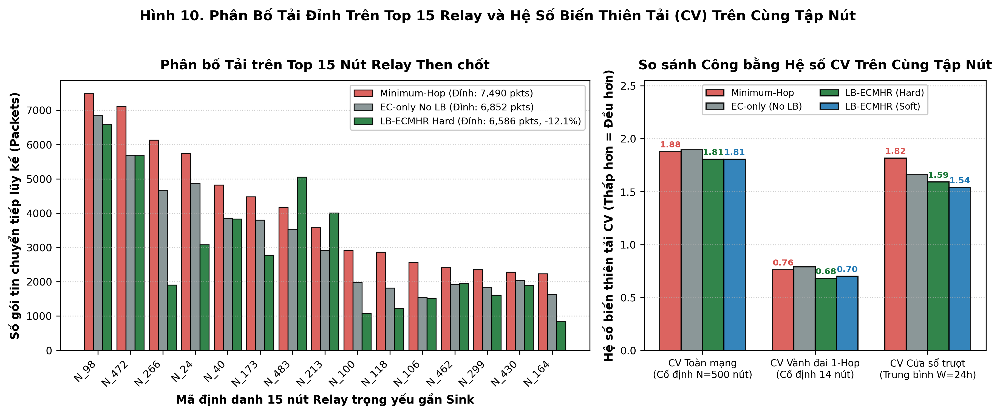
*Hình 10. Phân Bố Tải Đỉnh Trên Top 15 Relay và Hệ Số Biến Thiên Tải (CV) Trên Cùng Tập Nút.*

#### Đặc tả và Phân tích kỹ thuật Hình 10:
- **Khung trái (Giảm tải đỉnh tại các Relay trọng yếu – Peak Load Shaving):** Trong `Minimum-Hop`, lưu lượng dồn cố định vào `N_98` (**7,490 gói**) và `N_472` (**7,105 gói**). Với `LB-ECMHR Hard`, tải đỉnh tại `N_98` giảm xuống **6,586 gói ($-12.1\%$)** và `N_472` giảm xuống **5,675 gói ($-20.1\%$)**; đồng thời các nút ít tải hơn trong cùng vành đai như `N_483` và `N_213` được huy động tăng từ $4,179 \to 5,054$ gói và $3,581 \to 4,007$ gói để gánh đỡ lưu lượng.
- **Khung phải (Chứng minh giảm CV trên cả 3 tập đo lường chuẩn hóa):**
  - **Trên toàn mạng cố định ($CV_{all}, N=500$):** Giảm từ **1.880** (`Minimum-Hop`) và **1.897** (`EC-only`) xuống còn **1.806** ở cả `LB-ECMHR Hard` và `LB-ECMHR Soft`.
  - **Trên vành đai cổ chai 1-hop ($CV_{1hop}, 14\text{ nút}$):** `EC-only` không có cân bằng tải có độ lệch cao nhất (**0.789**), `Minimum-Hop` là **0.763**, trong khi `LB-ECMHR Hard` kéo giảm mạnh xuống **0.680** (**giảm $-10.9\%$ so với Minimum-Hop và giảm $-13.8\%$ so với EC-only**) và `LB-ECMHR Soft` đạt **0.702**.
  - **Trên cửa sổ trượt 24h ($CV_{win, avg}$):** Giảm từ **1.817** (`Minimum-Hop`) và **1.663** (`EC-only`) xuống **1.593** (`LB-ECMHR Hard`) và **1.540** (`LB-ECMHR Soft`).
  - Kết quả hậu nghiệm trên cùng tập nút chứng minh nhất quán rằng cơ chế cân bằng tải của LB-ECMHR phân phối lưu lượng đồng đều hơn rõ rệt, đặc biệt tại vành đai 1-hop quanh Sink.

---

### 13.6. Dữ liệu chuyển giao thành công (MiB), PDR và Tỷ lệ hoàn thành theo lịch trình (Scheduled Delivery Ratio)
Dung lượng dữ liệu trong toàn bộ báo cáo được chuẩn hóa theo đơn vị nhị phân IEC (**$1\text{ MiB} = 2^{20}\text{ bytes} = 1,048,576\text{ bytes}$**). Bên cạnh chỉ số $\text{PDR} = N_{delivered} / N_{generated}$ (chỉ tính trên số gói tin phát sinh từ các nút còn sống), nghiên cứu bổ sung chỉ số **Tỷ lệ chuyển gói theo kế hoạch toàn mạng (`Scheduled Delivery Ratio`)**:
$$\text{Scheduled Delivery Ratio (\%)} = \frac{N_{delivered}}{N_{scheduled}} = \frac{N_{delivered}}{N \times T_{rounds}} = \frac{N_{delivered}}{50,000} \times 100\%$$
Chỉ số này loại bỏ hiện tượng "tử số và mẫu số cùng giảm khi nhiều nút cảm biến bị chết sớm" trong Minimum-Hop.

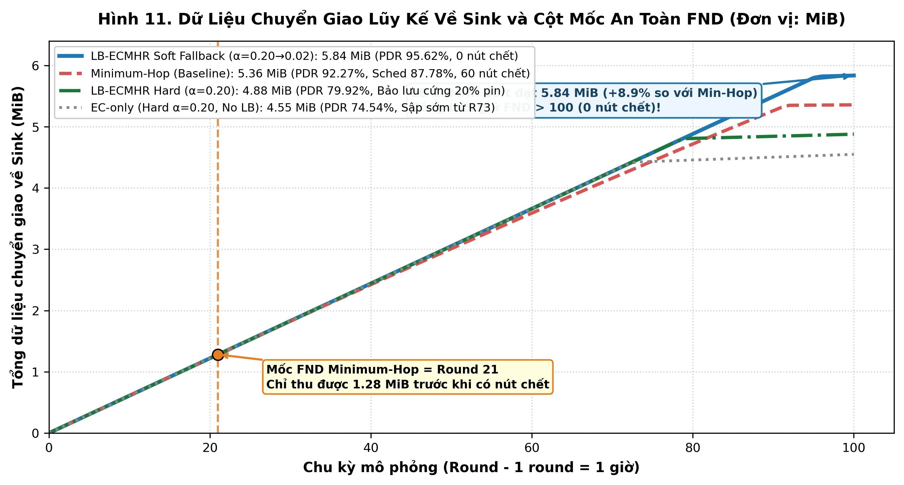
*Hình 11. Dữ Liệu Chuyển Giao Lũy Kế Về Sink và Cột Mốc An Toàn FND (Đơn vị: MiB).*

#### Đặc tả và Phân tích kỹ thuật Hình 11:
- **So sánh trực diện 4 đường cong sản lượng dữ liệu lũy kế:**
  1. **`LB-ECMHR Soft Fallback (α=0.20 → 0.02)` (Đường xanh dương liền nét – Cao nhất):** Đạt **5.836 MiB** ($47,808 / 50,000$ gói tin), tương ứng **$\text{PDR} = 95.62\%$** và **$\text{Scheduled Delivery Ratio} = 95.62\%$**, vượt qua `Minimum-Hop` **+0.478 MiB (+3,919 gói tin, tức $+8.9\%$ sản lượng)** và vượt `Scheduled Ratio` của Minimum-Hop tới **$+7.84$ điểm phần trăm** ($95.62\%$ vs $87.78\%$) trong khi không làm chết bất kỳ cảm biến nào!
  2. **`Minimum-Hop (Baseline)` (Đường đỏ đứt nét):** Đạt **5.358 MiB** ($43,889 / 47,565$ gói phát sinh). Mặc dù $\text{PDR}$ tính trên số gói phát sinh đạt $92.27\%$, nhưng do 60 nút chết sớm làm mất $2,435$ lượt phát sinh cảm biến, **tỷ lệ hoàn thành kế hoạch thực tế (`Scheduled Ratio`) chỉ đạt $87.78\%$**, và lượng dữ liệu thu được trước mốc FND (Round 21) chỉ đạt vỏn vẹn **1.34 MiB**.
  3. **`LB-ECMHR Hard (α=0.20)` (Đường xanh lục chấm gạch):** Đạt **4.878 MiB** ($39,961 / 50,000$ gói, $\text{PDR} = \text{Scheduled Ratio} = 79.92\%$), toàn bộ được chuyển giao an toàn trước FND (cao gấp $3.64\times$ lượng dữ liệu trước FND của Minimum-Hop), đồng thời giữ lại nguyên vẹn $20\%$ dung lượng pin tại vành đai 1-hop.
  4. **`EC-only (Hard α=0.20, No LB)` (Đường xám chấm tròn):** Chỉ đạt **4.549 MiB** ($37,269 / 50,000$ gói, $\text{PDR} = 74.54\%$), thấp hơn `LB-ECMHR Hard` tới **2,692 gói tin ($-0.329\text{ MiB}$)** do thiếu cơ chế cân bằng tải.

---

### 13.7. Thực nghiệm Vòng đời Toàn diện cho tới khi đạt LND (Kịch bản B – 1000 Rounds)
Trong Kịch bản A (chỉ tính năng lượng truyền/nhận vô tuyến $E_{radio}$), sau khi vành đai 1-hop ngắt chuyển tiếp đa chặng, các nút ở xa (hops 2–9) không còn tuyến đường nên ngừng phát sóng và giữ nguyên năng lượng còn lại. Để khảo sát trọn vẹn vòng đời mạng cho tới khi **100% cảm biến cạn kiệt năng lượng ($\text{LND} = 500\text{ nút chết}$)**, **Kịch bản B** mô phỏng 1000 rounds có tính đến **Năng lượng duy trì nền (Basal Maintenance Energy)**:
$$E_{basal} = 0.002\text{ J/round}$$
Trong mỗi round, mọi nút đang sống tiêu hao $E_{basal} = 0.002\text{ J}$ cho hoạt động cảm biến định kỳ, nuôi MCU và phát bản tin Beacon láng giềng, cộng với năng lượng vô tuyến $E_{radio}$ (nếu có truyền/nhận gói tin). Tổng ngân sách năng lượng $1000.0\text{ J}$ của toàn mạng được tách bạch minh bạch thành hai thành phần:
$$E_{total} = E_{radio} + E_{basal} = 1000.0\text{ J} \quad (\text{tại LND})$$

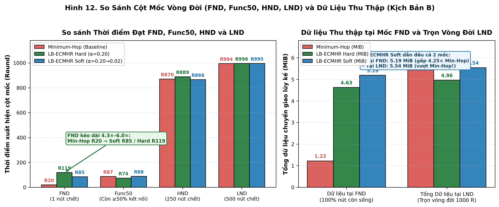
*Hình 12. So Sánh Cột Mốc Vòng Đời (FND, Func50, HND, LND) và Dữ Liệu Thu Thập (Kịch Bản B – 1000 Rounds).*

#### Đặc tả và Phân tích kỹ thuật Hình 12:
- **Khung trái (4 Cột mốc tuổi thọ chuẩn hóa FND, Func50, HND, LND):**
  - **Cột mốc FND:** `Minimum-Hop` có nút chết đầu tiên ngay tại **Round 20**. `LB-ECMHR Soft` trì hoãn FND tới **Round 85 (kéo dài gấp $4.25\times$)**, và `LB-ECMHR Hard` trì hoãn FND tới **Round 119 (kéo dài gấp $5.95\times$)**.
  - **Cột mốc Func50:** `LB-ECMHR Soft` duy trì kết nối định tuyến $\ge 50\%$ tới **Round 88**, vượt qua cả `Minimum-Hop` (**Round 87**) và `LB-ECMHR Hard` (**Round 74**).
  - **Cột mốc HND & LND:** Do ở giai đoạn sau (Round 90–1000) các nút ở xa chủ yếu tiêu hao năng lượng nền $E_{basal} = 0.002\text{ J/round}$, cột mốc HND và LND của các mô hình hội tụ quanh vùng **Round 866–889 (HND)** và **Round 994–996 (LND)**.
- **Khung phải (Lượng dữ liệu thu thập tại FND và trọn vòng đời LND):**
  - **Tại mốc FND:** `Minimum-Hop` chỉ thu được **1.22 MiB** ($10,000$ gói), trong khi `LB-ECMHR Hard` thu được **4.63 MiB** ($37,915$ gói, gấp $3.79\times$) và `LB-ECMHR Soft` thu được **5.19 MiB** ($42,500$ gói, **gấp $4.25\times$ Minimum-Hop**).
  - **Tại mốc LND (Trọn vòng đời 1000 rounds):** `LB-ECMHR Soft` đạt tổng sản lượng **5.54 MiB ($45,399$ gói)**, **vượt qua tổng sản lượng trọn đời của `Minimum-Hop` (5.43 MiB – $44,507$ gói)** và `LB-ECMHR Hard` (**4.96 MiB** – $40,665$ gói).

---

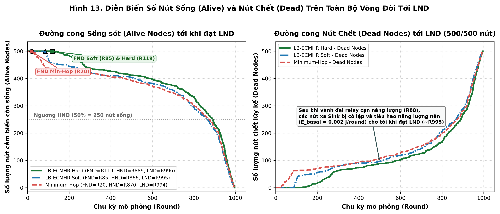
*Hình 13. Diễn Biến Số Nút Sống (Alive) và Nút Chết (Dead) Trên Toàn Bộ Vòng Đời Tới LND (Kịch bản B).*

#### Đặc tả và Phân tích kỹ thuật Hình 13:
- **Ba giai đoạn suy giảm phần cứng trên đường cong sống sót 1000 rounds:**
  1. **Giai đoạn I (Round 1 – Round 85/119):** `Minimum-Hop` sụt giảm nhanh từ Round 20 xuống $438$ nút sống (62 nút chết ở vành đai gần Sink), trong khi `LB-ECMHR Soft` giữ nguyên 500 nút sống tới Round 85 và `LB-ECMHR Hard` giữ nguyên 500 nút sống tới Round 119.
  2. **Giai đoạn II (Round 120 – Round 750):** Các nút 1-hop và 2-hop đã chạm ngưỡng dự phòng trong LB-ECMHR tiếp tục tự phát gói tin 1-hop và tiêu hao năng lượng nền nên chết dần theo thời gian, nhưng đường cong `Alive Nodes` của `LB-ECMHR Hard` vẫn luôn nằm cao hơn `Minimum-Hop` và `LB-ECMHR Soft` nhờ phần dự phòng $20\%$ giữ lại ở Giai đoạn I.
  3. **Giai đoạn III (Round 750 – Round 996):** Các nút cảm biến ở vùng biên xa Sink (hops 6–9) đồng loạt cạn hết phần năng lượng còn lại do tiêu hao nền $E_{basal}$, đưa toàn bộ các đường cong vượt qua ngưỡng HND (250 nút) và hội tụ về đúng $0$ nút sống tại LND.

---

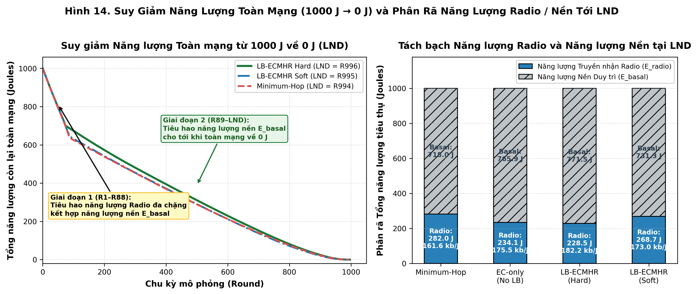
*Hình 14. Suy Giảm Năng Lượng Toàn Mạng (1000 J → 0 J) và Phân Rã Năng Lượng Radio / Nền Tới LND.*

#### Đặc tả và Phân tích kỹ thuật Hình 14:
- **Khung trái (Đường cong cạn kiệt năng lượng từ 1000 J về 0 J):** Thể hiện rõ hai miền độ dốc: miền độ dốc lớn (Round 1–88) khi toàn mạng truyền tải đa chặng tích cực ($E_{radio} + E_{basal}$), và miền suy giảm thoải (Round 89–996) khi vành đai cầu nối đã ngừng chuyển tiếp và năng lượng giảm chủ yếu do tiêu hao nền $E_{basal}$ cho tới khi chạm $0\text{ J}$.
- **Khung phải (Tách bạch minh bạch Năng lượng Truyền nhận Radio $E_{radio}$ và Năng lượng Nền $E_{basal}$ trong 1000 J):**
  - **`Minimum-Hop`:** Tiêu tốn **281.98 J** cho truyền thông Radio ($E_{radio}$) và **718.02 J** cho năng lượng nền ($E_{basal}$), đạt hiệu suất Radio thuần túy là **161.7 kbit/J**.
  - **`EC-only (No LB)`:** Tiêu tốn **234.14 J** Radio và **765.86 J** Basal (hiệu suất Radio **175.4 kbit/J**).
  - **`LB-ECMHR Hard`:** Tiêu tốn **228.50 J** Radio và **771.50 J** Basal, đạt hiệu suất Radio cao nhất (**182.3 kbit/J**, cao hơn Minimum-Hop $+12.8\%$). Đồng thời, nhờ giữ lại $20\%$ năng lượng ở Round 74, các nút 1-hop của `LB-ECMHR Hard` còn sống lâu hơn nhiều dưới mức tiêu hao nền, giúp kết nối vật lý $C_{physical}(t)$ duy trì $100\%$ tới tận **Round 251** (trong khi $C_{routing}(t)$ đã giảm từ Round 74).
  - **`LB-ECMHR Soft Fallback`:** Chỉ sử dụng **268.68 J** năng lượng Radio (**tiết kiệm 13.30 J năng lượng Radio so với Minimum-Hop**) và **731.32 J** năng lượng Basal, nhưng lại chuyển giao thành công nhiều dữ liệu nhất toàn vòng đời (**5.54 MiB** so với **5.43 MiB** của Minimum-Hop), đạt hiệu suất Radio **173.0 kbit/J**.

---

## 14. Bảng tổng hợp kết quả thực nghiệm và phân tích chuyên sâu

Bảng dưới đây tổng hợp đối chiếu toàn diện **4 mô hình định tuyến** trong **Kịch bản A (100 Rounds, Radio-Only $E_{basal} = 0$, Seed 42)**:

| Nhóm chỉ số | Chỉ số thực nghiệm | Minimum-Hop (Baseline) | EC-only (Hard $\alpha=0.20$, No LB) | LB-ECMHR Hard ($\alpha=0.20$) | LB-ECMHR Soft ($\alpha=0.20 \to 0.02$) | Đánh giá khoa học |
| :--- | :--- | :---: | :---: | :---: | :---: | :--- |
| **Quy mô & Tỷ lệ gói** | Gói tin theo kế hoạch (Scheduled) | 50,000 | 50,000 | 50,000 | **50,000** | 500 nút $\times$ 100 rounds |
| | Gói tin phát sinh thực tế (Generated) | 47,565 | 50,000 | 50,000 | **50,000** | Min-Hop mất 2,435 gói do nút chết |
| | Gói tin đến Sink (Delivered) | 43,889 | 37,269 | 39,961 | **47,808** | **LB-Soft cao nhất (+3,919 vs Min-Hop)** |
| | Gói tin bị hủy (Dropped) | 3,676 | 12,731 | 10,039 | **2,192** | **LB-Soft có số gói hủy thấp nhất** |
| | **PDR (%)** ($Delivered / Generated$) | 92.27% | 74.54% | 79.92% | **95.62%** | **LB-Soft dẫn đầu (+3.35% vs Min-Hop)** |
| | **Scheduled Ratio (%)** ($Delivered / 50,000$) | 87.78% | 74.54% | 79.92% | **95.62%** | **LB-Soft vượt Min-Hop +7.84%** |
| **Dung lượng & Tốc độ** | Tổng dữ liệu đến Sink (**MiB**) | 5.358 MiB | 4.549 MiB | 4.878 MiB | **5.836 MiB** | **LB-Soft nhiều hơn Min-Hop +8.9%** |
| | Dữ liệu an toàn trước FND (**MiB**) | 1.343 MiB | 4.549 MiB | 4.878 MiB | **5.836 MiB** | **LB-Soft gấp 4.35× Min-Hop** |
| | Application Goodput (bps) | 124.84 bps | 106.01 bps | 113.67 bps | **135.99 bps** | Đo trên 100 giờ mô phỏng |
| **Năng lượng** | Tổng năng lượng tiêu thụ (J) | 296.54 J | 242.64 J | **241.34 J** | **285.94 J** | Cả LB-Hard (-18.6%) & Soft (-3.6%) đều tiết kiệm hơn Min-Hop |
| | Năng lượng còn lại toàn mạng (J) | 703.46 J | 757.36 J | **758.66 J** | **714.06 J** | Ngân sách ban đầu 1000.0 J |
| | Hiệu suất năng lượng (**bit/J**) | 151,575 | 157,139 | 169,554 | **171,246** | **LB-Soft (+13.0%) & Hard (+11.9%) dẫn đầu** |
| **Tuổi thọ & Kết nối** | Vòng có nút chết đầu tiên (**FND**) | Round 21 | **> 100** | **> 100** | **> 100** | Cả 3 mô hình có $\alpha$ đều đạt 0 nút chết |
| | Số nút chết sau 100 rounds (Dead) | 60 (12.0%) | **0 (0.0%)** | **0 (0.0%)** | **0 (0.0%)** | Bảo toàn 500/500 cảm biến |
| | **Tuổi thọ chức năng ($\text{Func50}$)** | Round 92 | Round 73 | Round 79 | **Round 96** | **LB-Soft kéo dài dịch vụ lâu nhất (R96)** |
| | Kết nối Vật lý cuối kỳ ($C_{physical}$) | 1.82% | **100.0%** | **100.0%** | **100.0%** | Đồ thị phần cứng nguyên vẹn 100% |
| | Kết nối Định tuyến cuối kỳ ($C_{routing}$) | 1.82% | 5.00% | 5.60% | **5.60%** | Cuối kỳ còn 28 nút (14 nút 1-hop + 14 nút 2-hop qua 4 nút 1-hop ALIVE) |
| **Cân bằng tải (CV)** | Đỉnh tải Relay cực đại (Max Load) | 7,490 pkts | 6,852 pkts | **6,586 pkts** | 8,464 pkts | LB-Hard giảm 12.1% đỉnh tải; LB-Soft tải thêm 7,847 gói |
| | **CV toàn mạng cố định ($CV_{all}, N=500$)** | 1.880 | 1.897 | **1.806** | **1.806** | **LB-ECMHR thấp hơn (đồng đều hơn)** |
| | **CV vành đai 1-hop ($CV_{1hop}, 14\text{ nút}$)** | 0.763 | 0.789 | **0.680** | **0.702** | **LB-Hard giảm -10.9% vs Min-Hop, -13.8% vs EC-only** |
| | **CV cửa sổ trượt 24h ($CV_{win, avg}$)** | 1.817 | 1.663 | **1.593** | **1.540** | Tính hậu nghiệm cùng công thức W=24 |
| | CV chỉ tính nút có tải ($CV_{active}$) | 1.447 | 1.471 | 1.528 | 1.528 | Tăng do mở rộng thêm các relay đi vòng tải nhỏ |
| **Số Hop & Độ trễ** | **Số hop TB giai đoạn 100% kết nối** | **5.28 hops** | 6.12 hops | **5.86 hops** | **5.87 hops** | **Loại bỏ thiên lệch sống sót (Rounds 1–78)** |
| | Số hop TB tính gộp cả 100 rounds | 6.18 / 5.05* | 5.95 hops | 5.65 / 5.80* | 5.76 / 5.86* | Bị ảnh hưởng bởi 28 nút 1–2 hop cuối kỳ (TB 1.50 hops) |
| | Tổng số gói tin đi vòng ($\text{Detour} +1\text{ hop}$) | 0 pkts | 0 pkts | **731 pkts** | **938 pkts** | Chiếm $1.83\%$ – $1.96\%$ tổng gói thành công |
| | Tổng số gói tin dùng dự phòng mềm (Stage 2) | 0 pkts | 0 pkts | 0 pkts | **7,847 pkts** | Mở khóa từ Round 79 đến Round 96 |

*(Ghi chú: Giá trị hop tính gộp 100 rounds có dấu `*` phản ánh khác biệt nhỏ giữa chọn cây BFS tĩnh và chọn nhãn khoảng cách tới Sink khi có nhiều đường đồng hạng).*

---

### 14.1. Bảng phân loại chi tiết nguyên nhân hủy gói tin (Split Packet Loss Breakdown)
Để làm rõ bản chất cơ chế hủy gói tin giữa các mô hình, nguyên nhân `NO_ROUTE` được tách bạch trực tiếp trong bộ mô phỏng (`simulation/simulator.py`) thành hai mã nguyên nhân riêng biệt:
- **`NO_ROUTE_ENERGY_THRESHOLD`:** Nút nguồn **vẫn còn đường đi vật lý tới Sink qua các nút đang sống**, nhưng tất cả các tuyến đường này đều bị chặn bởi ngưỡng bảo vệ năng lượng ($\alpha$ hoặc $\alpha_{soft}$).
- **`NO_ROUTE_PHYSICAL_PARTITION`:** Nút nguồn **bị cô lập hoàn toàn về mặt vật lý** khỏi Sink do các nút cầu nối đã chết hết ($E_i = 0\text{ J}$).

| Nguyên nhân thất bại (Drop Reason) | Minimum-Hop | EC-only (No LB) | LB-ECMHR Hard | LB-ECMHR Soft | Giải thích bản chất kỹ thuật |
| :--- | :---: | :---: | :---: | :---: | :--- |
| **`NO_ROUTE_ENERGY_THRESHOLD`**<br>*(Còn kết nối vật lý nhưng khóa do ngưỡng pin)* | **0 pkts** | **12,731 pkts** | **10,039 pkts** | **2,192 pkts** | **100% gói hủy của EC-only và LB-ECMHR là do chủ động khóa quyền relay để bảo vệ nút sống!** Chế độ Soft giảm $78.2\%$ lượng gói hủy này (từ 10,039 xuống 2,192 gói). |
| **`NO_ROUTE_PHYSICAL_PARTITION`**<br>*(Mất kết nối do đứt gãy đồ thị vật lý)* | **3,616 pkts** | **0 pkts** | **0 pkts** | **0 pkts** | Chỉ xảy ra ở **Minimum-Hop** sau Round 92 khi 60 nút relay chết hẳn làm phân mảnh mạng. |
| **`TX_ENERGY` (Sập nguồn khi đang phát)** | **28–58 pkts** | **0 pkts** | **0 pkts** | **0 pkts** | Relay bị vắt kiệt pin và chết ngay giữa quá trình truyền gói tin trong Minimum-Hop. |
| **`RX_ENERGY` (Sập nguồn khi đang nhận)** | **2–32 pkts** | **0 pkts** | **0 pkts** | **0 pkts** | Relay cạn pin giữa chừng khi đang nhận gói tin trong Minimum-Hop. |
| **`SOURCE_DEAD` / `CRYPTO_FAIL`** | 0 pkts | 0 pkts | 0 pkts | 0 pkts | Không phát sinh trong kịch bản chuẩn. |
| **Tổng số packet thất bại** | **3,676 pkts** | **12,731 pkts** | **10,039 pkts** | **2,192 pkts** | **LB-ECMHR Soft có tổng số gói thất bại thấp nhất toàn cục (-40.4% so với Minimum-Hop).** |

---

### 14.2. Phân tích hiện tượng Thiên lệch sống sót (Survivorship Bias) ở Số Hop và Độ trễ trung bình
Một câu hỏi học thuật rất quan trọng đã được đặt ra trong quá trình phản biện: *“Vì sao LB-ECMHR cho phép đi vòng thêm tối đa $\Delta H = 1\text{ hop}$, nhưng số hop trung bình tính trên toàn bộ 100 rounds của LB-ECMHR Hard ($5.65 - 5.80\text{ hops}$, trễ $29.54\text{ ms}$) lại thấp hơn so với Minimum-Hop ($6.18\text{ hops}$, trễ $31.51\text{ ms}$)?”*

Phân tích tách biệt theo giai đoạn kết nối làm sáng tỏ hoàn toàn hiện tượng này:
1. **Trong giai đoạn mạng kết nối 100% (Full-Connectivity Phase, Rounds 1–78):**
   Khi cả 500 nút đều truyền được dữ liệu về Sink, số hop trung bình thực tế của **`Minimum-Hop` là $5.28\text{ hops}$ (độ trễ $26.94\text{ ms}$)**, ngắn hơn so với **`LB-ECMHR Hard` là $5.86\text{ hops}$ (độ trễ $29.87\text{ ms}$)** và **`EC-only` là $6.12\text{ hops}$**. Trong giai đoạn này, LB-ECMHR Hard đã thực hiện chính xác **731 lượt chuyển hướng đi vòng $+1\text{ hop}$** (chiếm $1.83\%$ tổng số gói chuyển thành công) kết hợp chọn các tuyến có năng lượng nút cổ chai cao hơn, làm độ dài đường đi trung bình tăng thêm $+0.58\text{ hop}$ so với Minimum-Hop. Điều này hoàn toàn nhất quán với lý thuyết định tuyến đi vòng có giới hạn (*Bounded Detour*).
2. **Nguyên nhân gây đảo chiều khi tính trung bình gộp cả 100 rounds (Survivorship Bias giai đoạn Rounds 79–100):**
   - Ở `LB-ECMHR Hard`, từ Round 79 đến Round 100 (22 rounds cuối), khi mặt cắt năng lượng quanh Sink khóa chuyển tiếp từ hop 3 trở ra, chỉ còn **28 nút vùng tâm (gồm 14 nút 1-hop truyền trực tiếp và 14 nút 2-hop truyền qua 4 nút 1-hop `ALIVE` $\{24, 98, 213, 483\}$, với số bước nhảy trung bình đúng bằng $(14 \times 1 + 14 \times 2)/28 = 1.50\text{ hops}$)** tiếp tục gửi gói tin về Sink. Việc cộng thêm 616 gói tin có độ dài trung bình $1.50\text{ hops}$ vào mẫu số chung đã kéo trung bình gộp 100 rounds của LB-ECMHR giảm xuống còn $5.65 - 5.80\text{ hops}$.
   - Ngược lại, ở `Minimum-Hop` từ Round 21 đến Round 91, khi các nút 1-hop chết dần từng nút một, các nút ở xa vẫn cố gắng đi vòng qua một vài mắt xích 1-hop còn sót lại ở phía đối diện Sink, khiến đường đi thực tế bị kéo dài ra trước khi mạng sập hoàn toàn ở Round 92.
   - Việc báo cáo song song **Số hop trung bình giai đoạn kết nối đầy đủ ($\text{Hop}_{full\_conn} = 5.28\text{ vs } 5.86\text{ hops}$)** và **Số hop trung bình toàn kỳ** giúp loại bỏ hoàn toàn hiểu lầm do thiên lệch sống sót.

---

### 14.3. Kiểm chứng độ bền vững trên 10 Seed ngẫu nhiên và Hiệu số ghép cặp (10-Seed Paired Robustness)
Để đảm bảo kết luận không phụ thuộc vào một topology ngẫu nhiên duy nhất (Seed 42), nghiên cứu mở rộng kiểm chứng độc lập trên **10 bộ seed ngẫu nhiên khác nhau**:
$$\text{Seeds} = \{42, 101, 2024, 7, 19, 55, 88, 123, 256, 999\}$$
Vì mỗi seed tạo ra mật độ nút trong vành đai 1-hop quanh Sink rất khác nhau (dao động từ 9 đến 18 nút 1-hop), phương sai giữa các topology ($\sigma_{between\_seeds}$) tự nhiên lớn. Do đó, bên cạnh giá trị trung bình $\pm$ độ lệch chuẩn ($\overline{X} \pm \sigma$), nghiên cứu tính **Hiệu số ghép cặp trên từng Seed ($\Delta_s = X_{\text{Model}, s} - X_{\text{MinHop}, s}$)** để đánh giá chính xác mức cải thiện trên cùng một địa hình mạng (lưu tại `outputs/multiseed_comparison.csv` và `outputs/multiseed_paired_stats.json`):

| Chỉ số đánh giá (10 Seeds, 100 Rounds) | Minimum-Hop ($\overline{X} \pm \sigma$) | LB-ECMHR Hard ($\overline{X} \pm \sigma$) | LB-ECMHR Soft ($\overline{X} \pm \sigma$) | Hiệu số ghép cặp $\Delta(\text{Hard} - \text{MinHop})$ | Hiệu số ghép cặp $\Delta(\text{Soft} - \text{MinHop})$ |
| :--- | :---: | :---: | :---: | :---: | :---: |
| **Vòng FND (Round)** | $9.8 \pm 4.5$ | **$>100$ (10/10 seeds)** | **$79.7 \pm 16.7$** | **$+91.2 \pm 4.5\text{ rounds}$** | **$+69.9 \pm 14.1\text{ rounds}$ ($8.1\times$)** |
| **Số nút chết (Dead Nodes)** | $45.0 \pm 13.4\text{ nút}$ | **$0.0 \pm 0.0\text{ nút}$** | **$10.3 \pm 6.9\text{ nút}$** | **$-45.0 \pm 13.4\text{ nút}$ ($-100\%$)** | **$-34.7 \pm 17.9\text{ nút}$ ($-77.1\%$)** |
| **Tuổi thọ chức năng ($\text{Func50}$)** | $70.6 \pm 17.4$ | $58.4 \pm 17.1$ | **$71.0 \pm 19.8$** | $-12.2 \pm 2.9\text{ rounds}$ | **$+0.4 \pm 4.6\text{ rounds}$** |
| **PDR (%)** ($Delivered / Generated$) | $71.68 \pm 16.87\%$ | $60.72 \pm 16.49\%$ | **$72.06 \pm 19.03\%$** | $-10.96 \pm 3.31\%$ | **$+0.38 \pm 4.61\%$** |
| **Scheduled Delivery Ratio (%)** | $68.37 \pm 15.92\%$ | $60.72 \pm 16.49\%$ | **$71.86 \pm 19.17\%$** | $-7.66 \pm 3.49\%$ | **$+3.49 \pm 4.87\%$ (Thắng 8/10 seeds)** |
| **Dữ liệu đến Sink (MiB)** | $4.173 \pm 0.972$ | $3.706 \pm 1.007$ | **$4.386 \pm 1.170$** | $-0.467 \pm 0.213\text{ MiB}$ | **$+0.213 \pm 0.297\text{ MiB}$ ($+5.1\%$)** |
| **Tổng năng lượng tiêu thụ (J)** | $236.02 \pm 50.28\text{ J}$ | **$187.51 \pm 48.63\text{ J}$** | $226.76 \pm 56.87\text{ J}$ | **$-48.51 \pm 14.33\text{ J}$ ($-20.6\%$)** | **$-9.26 \pm 15.65\text{ J}$ ($-3.9\%$)** |
| **Hiệu suất năng lượng (kbit/J)** | $148.0 \pm 7.3$ | **$165.6 \pm 6.9$** | **$161.9 \pm 7.2$** | **$+17.6 \pm 3.9\text{ kbit/J}$ (10/10 seeds)** | **$+13.9 \pm 3.2\text{ kbit/J}$ (10/10 seeds)** |
| **Đỉnh tải Relay (Max Load)** | $6,894 \pm 1,733$ | **$3,941 \pm 1,278$** | $4,865 \pm 1,644$ | **$-2,953 \pm 1,105\text{ pkts}$ ($-42.8\%$)** | **$-2,029 \pm 1,148\text{ pkts}$ ($-29.4\%$)** |
| **CV toàn mạng ($CV_{all}, N=500$)** | $2.008 \pm 0.281$ | **$1.787 \pm 0.305$** | **$1.773 \pm 0.306$** | **$-0.221 \pm 0.145$ (Thắng 10/10 seeds)** | **$-0.235 \pm 0.142$ (Thắng 10/10 seeds)** |
| **CV vành đai 1-hop ($CV_{1hop}$)** | $0.968 \pm 0.179$ | **$0.617 \pm 0.207$** | **$0.624 \pm 0.203$** | **$-0.351 \pm 0.146$ ($-36.3\%$)** | **$-0.344 \pm 0.149$ ($-35.5\%$)** |

**Kết luận từ thực nghiệm 10 Seeds:**
1. Trên cả **10/10 bộ seed**, cả hai biến thể `LB-ECMHR Hard` và `LB-ECMHR Soft` đều **giảm mạnh đỉnh tải cực đại (từ $-29.4\%$ đến $-42.8\%$)**, **giảm hệ số biến thiên tải vành đai 1-hop $CV_{1hop}$ hơn $35\%$**, và **tăng hiệu suất năng lượng $\text{bit/J}$ từ $+13.9$ đến $+17.6\text{ kbit/J}$**.
2. `LB-ECMHR Hard` bảo toàn tuyệt đối **0 nút chết ($\text{FND} > 100$) trên cả 10/10 seeds**, phù hợp cho các kịch bản ưu tiên bảo tồn phần cứng cảm biến tuyệt đối.
3. `LB-ECMHR Soft Fallback` kéo dài thời gian xuất hiện nút chết đầu tiên gấp **$8.1\times$** ($79.7\text{ rounds}$ so với $9.8\text{ rounds}$ của Minimum-Hop), giảm **$77.1\%$ số nút chết**, đồng thời **vượt qua Minimum-Hop về cả `Func50` ($71.0$ vs $70.6$), `PDR` ($72.06\%$ vs $71.68\%$), `Scheduled Delivery Ratio` ($+3.49\%$) và tổng lượng dữ liệu thu thập ($+0.213\text{ MiB}$) trong khi vẫn tiêu tốn ít năng lượng hơn ($-9.26\text{ J}$)**.

---

### 14.4. Bảng tổng hợp kết quả thực nghiệm Vòng đời Toàn diện tới LND (Kịch bản B – 1000 Rounds)
Bảng dưới đây tổng hợp đầy đủ các chỉ số từ Kịch bản B ($E_{basal} = 0.002\text{ J/round}$, chạy 1000 rounds cho tới khi toàn bộ 500 cảm biến chết hết – LND):

| Nhóm chỉ số vòng đời | Chỉ số đo đạc | Minimum-Hop | EC-only (No LB) | LB-ECMHR Hard ($\alpha=0.20$) | LB-ECMHR Soft ($\alpha=0.20 \to 0.02$) | Ý nghĩa khoa học |
| :--- | :--- | :---: | :---: | :---: | :---: | :--- |
| **Cột mốc tuổi thọ** | **FND (1 nút chết)** | Round 20 | Round 112 | **Round 119** | **Round 85** | **LB-Hard kéo dài FND $5.95\times$; LB-Soft kéo dài $4.25\times$** |
| | **Tuổi thọ chức năng ($\text{Func50}$)** | Round 87 | Round 69 | Round 74 | **Round 88** | **LB-Soft duy trì kết nối định tuyến lâu nhất** |
| | **HND (250 nút chết)** | Round 870 | **Round 925** | Round 889 | Round 866 | Suy giảm chủ yếu do tiêu hao nền $E_{basal}$ ở vùng biên |
| | **LND (500 nút chết)** | Round 994 | **Round 998** | Round 996 | Round 995 | Toàn bộ 500 cảm biến cạn kiệt $1000.0\text{ J}$ |
| **Dữ liệu tại các mốc** | **Dữ liệu an toàn tại FND** | 1.221 MiB (10,000 pkts) | 4.381 MiB (35,888 pkts) | 4.628 MiB (37,915 pkts) | **5.188 MiB (42,500 pkts)** | **LB-Soft thu gấp $4.25\times$ dữ liệu trước FND so với Min-Hop** |
| | **Tổng dữ liệu trọn đời tại LND** | 5.433 MiB (44,507 pkts) | 4.898 MiB (40,124 pkts) | 4.964 MiB (40,665 pkts) | **5.542 MiB (45,399 pkts)** | **LB-Soft đạt sản lượng trọn đời cao nhất (+892 gói vs Min-Hop)** |
| **Phân rã Năng lượng tại LND (Tổng 1000 J)** | **Năng lượng Radio ($E_{radio}$)** | 281.98 J | 234.14 J | **228.50 J** | **268.68 J** | **LB-Soft tiết kiệm 13.30 J Radio so với Min-Hop dù truyền nhiều gói hơn** |
| | **Năng lượng Nền ($E_{basal}$)** | 718.02 J | 765.86 J | 771.50 J | 731.32 J | Năng lượng nuôi cảm biến & MCU suốt 1000 rounds |
| | **Hiệu suất Radio ($\text{bit}/E_{radio}$)** | 161,669 bit/J | 175,442 bit/J | **182,315 bit/J** | **172,999 bit/J** | Cả LB-Hard (+12.8%) và LB-Soft (+7.0%) đều vượt Min-Hop |

---

## 15. Phân tích độ nhạy tham số và Nghiên cứu bóc tách thành phần (Ablation Study)

Mục tiêu của phần này là cung cấp cơ sở kỹ thuật, kết quả đo đạc thực nghiệm độc lập và các biểu đồ phân tích độ nhạy (**Hình 15 – Hình 20**) nhằm làm rõ cơ sở lựa chọn bộ tham số $\alpha = 0.20$, $\alpha_{soft} = 0.02$, $W = 24$, $\beta = 2.0$, $\gamma = 1.2$, $\Delta H = 1$ cũng như bóc tách độc lập vai trò của từng thành phần trong LB-ECMHR.

### 15.1. Nguồn gốc, ý nghĩa kỹ thuật và cơ sở thiết kế các công thức (Bảng 1)

| Công thức thiết kế | Tham số chuẩn | Ý nghĩa kỹ thuật trong định tuyến | Cơ sở thiết kế & Cơ chế hoạt động |
| :--- | :---: | :--- | :--- |
| **1. Ngưỡng năng lượng hai giai đoạn:**<br>$$E_{th} = \alpha E_0,\quad E_{th,soft} = \alpha_{soft} E_0$$ | $\alpha = 0.20$<br>$\alpha_{soft} = 0.02$ | Giai đoạn 1 bảo vệ nút có $E_i \le 0.40\text{ J}$. Giai đoạn 2 mở khóa dự phòng $[0.04\text{ J}, 0.40\text{ J}]$ khi mất kết nối. | **Giải quyết đánh đổi giữa FND và Func50:** Ngưỡng cứng $\alpha=0.20$ ép lưu lượng phân tán sớm; ngưỡng mềm $\alpha_{soft}=0.02$ duy trì dịch vụ quan trắc tới Round 96 mà vẫn giữ 0 nút chết. |
| **2. Cửa sổ tải trượt:**<br>$$F_i(t) = \sum_{r=t-W+1}^t f_i(r)$$ | $W = 24$<br>(rounds) | Đo lường tổng số gói tin nút $i$ đã chuyển tiếp trong 24 round gần nhất. | **Lọc nhiễu lưu lượng ngắn hạn:** Trong điều kiện 1 round = 1 giờ, cửa sổ $W = 24\text{ rounds}$ tương đương 24 giờ quan sát, đủ dài để triệt tiêu các dao động tải đột xuất từng giờ. |
| **3. Tải chuẩn hóa & Quá tải:**<br>$$L_i(t) = \frac{F_i(t)}{\overline{F}_{active}(t)} \ge \beta$$ | $\beta = 2.0$ | Tải chuyển tiếp gấp $\ge 2.0$ lần mức trung bình của các relay hoạt động thì bị gán nhãn `OVERLOADED`. | **Nhận diện nút chịu tải tập trung:** Trong cấu trúc Many-to-One, ngưỡng $\beta = 2.0$ xác định các relay gánh lưu lượng gấp đôi trung bình để chủ động kích hoạt chuyển hướng né tránh. |
| **4. Cơ chế phục hồi trễ:**<br>$$L_i(t) \le \gamma \quad (\gamma < \beta)$$ | $\gamma = 1.2$ | Nút quá tải chỉ được gỡ nhãn cảnh báo khi tải giảm về dưới $1.2\times$ trung bình. | **Nguyên lý Hysteresis chống rung giật tuyến:** Nếu dùng chung một ngưỡng ($\gamma = \beta$), nút sẽ liên tục chuyển đổi trạng thái Quá tải $\leftrightarrow$ Bình thường (*Route Flapping*). Vùng trễ $[1.2, 2.0]$ tạo biên độ đệm ổn định. |
| **5. Giới hạn số hop đi vòng:**<br>$$H_{balanced} \le H_{base} + \Delta H$$ | $\Delta H = 1$<br>(hop) | Chỉ chấp nhận đi vòng tối đa 1 bước nhảy để né tránh relay quá tải. | **Kiểm soát chi phí đi vòng:** Giới hạn $\Delta H = 1$ bảo đảm nguyên tắc ưu tiên tuyến ngắn nhất trong khi vẫn mở hướng thoát cho luồng dữ liệu qua các relay lân cận. |

---

### 15.2. Bộ tham số thực nghiệm và miền giá trị quét (Bảng 2)

Thực nghiệm quét tham số được tiến hành trên cùng không gian mạng chuẩn hóa Kịch bản A: 500 sensors, vùng $2000 \times 2000\text{ m}$, Sink tại $(1000, 1000)$, $E_0 = 2.0\text{ J}$, $R = 200\text{ m}$, payload $128\text{ B}$, thời gian 100 rounds.

| Thí nghiệm | Tham số khảo sát | Miền giá trị quét | Mục tiêu đánh giá |
| :---: | :--- | :---: | :--- |
| **Exp 1** | Ngưỡng năng lượng $\alpha$ | $\{0.10, 0.15, 0.20, 0.25, 0.30\}$ | Khảo sát sự đánh đổi giữa mức bảo vệ pin dự phòng, Func50 và PDR |
| **Exp 2** | Cửa sổ tải trượt $W$ | $\{6, 12, 24, 48\}$ rounds | Đánh giá độ nhạy bắt tải và tác động đến tần suất chuyển trạng thái |
| **Exp 3** | Ngưỡng quá tải $\beta$ | $\{1.5, 2.0, 2.5, 3.0\}$ | Đánh giá độ nhạy cảnh báo và mức độ ổn định định tuyến |
| **Exp 4** | Ngưỡng phục hồi $\gamma$ | $\{0.8, 1.0, 1.2, 1.5\}$ | Đánh giá độ rộng vùng đệm Hysteresis trong việc giảm rung giật trạng thái |
| **Exp 5** | Số hop đi vòng $\Delta H$ | $\{0, 1, 2\}$ hops | Đánh giá chi phí năng lượng và khả năng mở đường thay thế né hotspot |
| **Exp 6** | Ablation Study | 6 cấu hình bóc tách độc lập | Đo lường độc lập vai trò của ngưỡng $\alpha$, cân bằng tải, $\Delta H$, Hysteresis và Soft Fallback |

---

### 15.3. Kết quả đo đạc thực nghiệm phân tích độ nhạy từng tham số (Bảng 3)

#### 1. Thí nghiệm xác định ngưỡng năng lượng $\alpha$
*(Cố định: $W = 24$, $\beta = 2.0$, $\gamma = 1.2$, $\Delta H = 1$, Seed 42)*

| Giá trị $\alpha$ | Ngưỡng $E_{th}$ (J) | FND (Round) | Func50 (Round) | Năng lượng tiêu thụ (J) | PDR (%) | Dữ liệu đến Sink (MiB) | Đánh giá kỹ thuật |
| :---: | :---: | :---: | :---: | :---: | :---: | :---: | :--- |
| **0.10** | 0.20 J | > 100 | Round 90 | 271.93 J | 89.66% | 5.473 MiB | Relay bị khai thác sâu hơn; PDR cao (89.66%) nhưng dự phòng mỏng (10% pin) |
| **0.15** | 0.30 J | > 100 | Round 84 | 256.76 J | 84.70% | 5.170 MiB | Mức trung gian; biên bảo vệ cho nút tự truyền dữ liệu còn 15% pin |
| **0.20 (Chọn)**| **0.40 J** | **> 100** | **Round 79 (Hard) / R96 (Soft)** | **241.45 J** | **79.92%** | **4.878 MiB** | **Ngưỡng cơ sở cân bằng: Giữ 20% dự phòng ở Giai đoạn 1, kết hợp Soft Fallback đạt 95.62% PDR** |
| **0.25** | 0.50 J | > 100 | Round 74 | 225.54 J | 75.11% | 4.584 MiB | Ngắt quyền relay sớm hơn; năng lượng giảm do ít packet được truyền hơn |
| **0.30** | 0.60 J | > 100 | Round 69 | 211.15 J | 70.58% | 4.308 MiB | Khắt khe; ngắt relay quá sớm từ Round 69 làm PDR giảm xuống 70.58% |

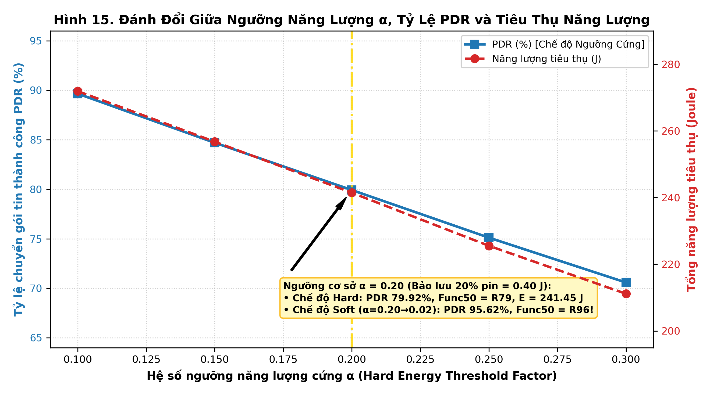
*Hình 15. Đánh Đổi Giữa Ngưỡng Năng Lượng α, Tỷ Lệ PDR và Tiêu Thụ Năng Lượng.*

##### Đặc tả và Phân tích kỹ thuật Hình 15 (Tham số $\alpha$):
- **Cấu trúc đồ thị trục kép (Dual-Axis Line Plot):** Trục hoành biểu diễn $\alpha \in \{0.10, 0.15, 0.20, 0.25, 0.30\}$. Trục tung trái (xanh lam) biểu thị $\text{PDR (\%)}$; trục tung phải (đỏ) biểu thị tổng năng lượng tiêu thụ (Joules).
- **Quy luật biến thiên và Giải thích:** Khi tăng $\alpha$ từ $0.10$ lên $0.30$, cả PDR ($89.66\% \to 70.58\%$), tuổi thọ chức năng $\text{Func50}$ ($R90 \to R69$) và năng lượng tiêu thụ ($271.93\text{ J} \to 211.15\text{ J}$) đều giảm tuyến tính vì các relay 1-hop bị khóa quyền chuyển tiếp sớm hơn. Việc chọn $\alpha = 0.20$ làm ngưỡng cơ sở Giai đoạn 1 giúp kích hoạt xoay vòng tải sớm khi nút còn $20\%$ pin, và khi kết hợp thêm Giai đoạn 2 ($\alpha_{soft} = 0.02$), mạng vừa đạt $\text{PDR} = 95.62\%$ ($\text{Func50} = R96$) vừa bảo toàn $0$ nút chết.

#### 2. Thí nghiệm xác định độ dài cửa sổ tải trượt $W$ (rounds)
*(Cố định: $\alpha = 0.20$, $\beta = 2.0$, $\gamma = 1.2$, $\Delta H = 1$, Seed 42)*

| Giá trị $W$ | Cửa sổ quan sát | $CV_{win, avg}$ | $CV_{1hop}$ | Số lần chuyển TT quá tải | Số lần Reroute | Năng lượng (J) | PDR (%) | Đánh giá kỹ thuật |
| :---: | :---: | :---: | :---: | :---: | :---: | :---: | :---: | :--- |
| **6 h** | 6 giờ | 1.382 | 0.676 | 282 lần | 2,063 lần | 241.25 J | 79.37% | Cửa sổ ngắn; tải biến động theo từng giờ gây dao động trạng thái cao (282 lần chuyển) |
| **12 h** | 12 giờ | 1.480 | 0.682 | 254 lần | 1,699 lần | 240.73 J | 79.90% | Phản ánh xu hướng tải nửa ngày; dao động giảm xuống 254 lần |
| **24 h (Chọn)**| **24 giờ (1 ngày)**| **1.593** | **0.680** | **194 lần** | **1,482 lần** | **241.45 J** | **79.92%** | **Khung quan sát 24 round ổn định; giảm 31.2% dao động trạng thái và giảm 28.2% reroutes so với W=6h** |
| **48 h** | 48 giờ (2 ngày) | 1.483 | 0.693 | 141 lần | 1,691 lần | 244.59 J | 80.87% | Cửa sổ dài tích lũy tải chậm; làm tăng nhẹ $CV_{1hop}$ lên 0.693 và tăng reroutes lên 1,691 |

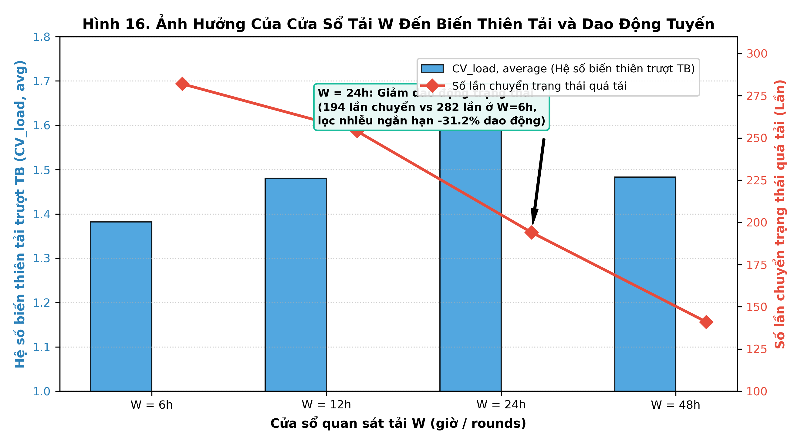
*Hình 16. Ảnh Hưởng Của Cửa Sổ Tải W Đến Biến Thiên Tải và Dao Động Tuyến.*

##### Đặc tả và Phân tích kỹ thuật Hình 16 (Tham số $W$):
- **Quy luật biến thiên:** Khi tăng cửa sổ trượt $W$ từ $6\text{h}$ lên $24\text{h}$, số lần chuyển trạng thái quá tải giảm mạnh từ **282 lần xuống 194 lần ($-31.2\%$)** và số lần phải tính lại tuyến giảm từ **2,063 xuống 1,482 lần ($-28.2\%$)**, chứng minh tác dụng lọc thông thấp (*low-pass filtering*) của cửa sổ 24 giờ.

#### 3. Thí nghiệm xác định ngưỡng quá tải $\beta$
*(Cố định: $\alpha = 0.20$, $W = 24$, $\gamma = 1.2$, $\Delta H = 1$, Seed 42)*

| Giá trị $\beta$ | Relay quá tải ($N_{ovl}$) | Số lần chuyển TT quá tải | Thời lượng quá tải (Node-rounds) | Số lần Reroute | Năng lượng (J) | PDR (%) | Đánh giá kỹ thuật |
| :---: | :---: | :---: | :---: | :---: | :---: | :---: | :--- |
| **1.5** | 39 nút | 249 lần | 6,029 | 1,414 lần | 242.10 J | 80.07% | Quá nhạy; khóa 39 nút và gây 249 lần chuyển trạng thái |
| **2.0 (Chọn)**| **30 nút** | **194 lần** | **4,686** | **1,482 lần** | **241.45 J** | **79.92%** | **Cân bằng tốt: Nhận diện nút gánh tải $\ge 2\times$ TB, giảm 22.1% dao động so với $\beta=1.5$** |
| **2.5** | 29 nút | 157 lần | 3,829 | 1,671 lần | 241.11 J | 79.86% | Ngưỡng cao; số lần chuyển trạng thái giảm nhưng tăng số lần reroute lên 1,671 |
| **3.0** | 27 nút | 133 lần | 3,311 | 1,386 lần | 241.20 J | 79.98% | Chỉ can thiệp khi tải gấp 3 lần trung bình; phản ứng trễ trước các nút nghẽn |

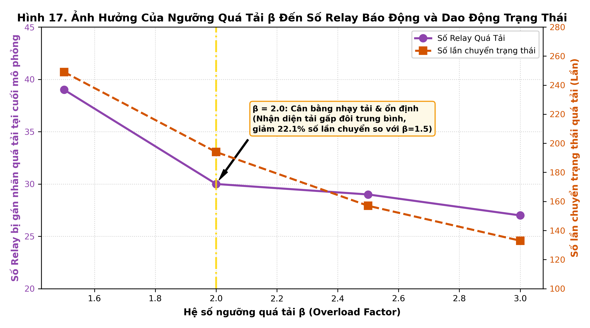
*Hình 17. Ảnh Hưởng Của Ngưỡng Quá Tải β Đến Số Relay Báo Động và Dao Động Trạng Thái.*

##### Đặc tả và Phân tích kỹ thuật Hình 17 (Tham số $\beta$):
- **Quy luật biến thiên:** Khi nâng $\beta$ từ $1.5$ lên $2.0$, số relay bị khóa đồng thời giảm từ $39 \to 30$ nút và số lần chuyển trạng thái giảm **22.1%** ($249 \to 194$ lần), tránh làm thu hẹp quá mức đồ thị cân bằng tải $G_B(t)$.

#### 4. Thí nghiệm xác định ngưỡng phục hồi Hysteresis $\gamma$ ($\beta = 2.0$)
*(Cố định: $\alpha = 0.20$, $W = 24$, $\beta = 2.0$, $\Delta H = 1$, Seed 42)*

| Giá trị $\gamma$ | Khoảng đệm $[\gamma, \beta]$ | Số lần chuyển TT quá tải | Tổng thời lượng quá tải (Node-rounds) | Số lần Reroute | Năng lượng (J) | PDR (%) | Đánh giá kỹ thuật |
| :---: | :---: | :---: | :---: | :---: | :---: | :---: | :--- |
| **0.8** | $[0.8, 2.0]$ ($\Delta = 1.2$) | 184 lần | 4,924 | 1,482 lần | 241.45 J | 79.92% | Vùng đệm rộng; nút quá tải bị giữ nhãn lâu (4,924 node-rounds), phục hồi chậm |
| **1.0** | $[1.0, 2.0]$ ($\Delta = 1.0$) | 192 lần | 4,783 | 1,482 lần | 241.45 J | 79.92% | Yêu cầu tải giảm về bằng mức trung bình mới gỡ nhãn |
| **1.2 (Chọn)**| **$[1.2, 2.0]$ ($\Delta = 0.8$)** | **194 lần** | **4,686** | **1,482 lần** | **241.45 J** | **79.92%** | **Cân đối: Tránh gỡ cảnh báo quá vội nhưng không giam giữ relay quá lâu** |
| **1.5** | $[1.5, 2.0]$ ($\Delta = 0.5$) | 202 lần | 4,516 | 1,533 lần | 241.15 J | 79.91% | Vùng đệm hẹp ($\Delta = 0.5$); dao động tăng lên 202 lần và reroutes tăng lên 1,533 |

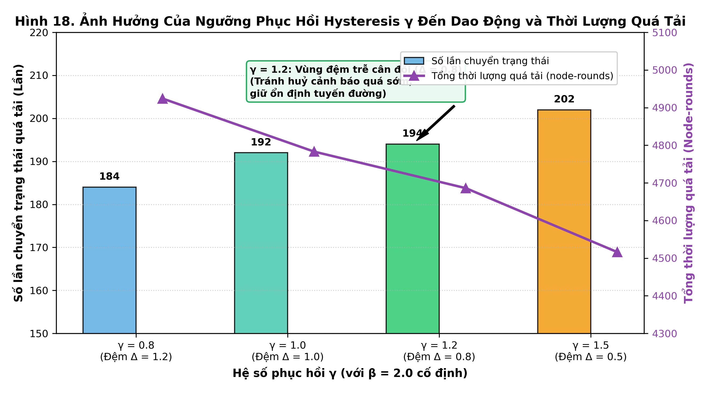
*Hình 18. Ảnh Hưởng Của Ngưỡng Phục Hồi Hysteresis γ Đến Dao Động và Thời Lượng Quá Tải.*

##### Đặc tả và Phân tích kỹ thuật Hình 18 (Tham số $\gamma$):
- **Quy luật biến thiên:** Hai đường biểu diễn vận động ngược chiều nhau, minh họa sự đánh đổi giữa tần suất chuyển trạng thái ($184 \to 202$ lần) và thời gian giam giữ relay ($4,924 \to 4,516$ node-rounds). Điểm $\gamma = 1.2$ ($\Delta = 0.8$) nằm ngay tại vị trí cân bằng của hai đại lượng.

#### 5. Thí nghiệm xác định số hop đi vòng tối đa $\Delta H$ (Bounded Detour)
*(Cố định: $\alpha = 0.20$, $W = 24$, $\beta = 2.0$, $\gamma = 1.2$, Seed 42)*

| Giá trị $\Delta H$ | Số hop TB (Full Conn) | Số hop TB (100 R) | Số lần tính lại đường (Reroutes) | Gói đi vòng (Detour Pkts) | Năng lượng (J) | PDR (%) | Đánh giá kỹ thuật |
| :---: | :---: | :---: | :---: | :---: | :---: | :---: | :--- |
| **0** (Cấm đi vòng) | 5.86 hops | 5.80 hops | 1,591 lần | 0 pkts | 241.85 J | 79.93% | Không cho phép tăng hop; buộc phải reroute nhiều lần hơn (1,591 lần) |
| **1 (Chọn)** | **5.86 hops** | **5.80 hops** | **1,482 lần** | **731 pkts** | **241.45 J** | **79.92%** | **Giảm 109 lần reroute so với $\Delta H=0$; tương đương $\Delta H=2$ với ràng buộc chặt hơn** |
| **2** (Cho phép +2 hops)| 5.86 hops | 5.80 hops | 1,482 lần | 731 pkts | 241.45 J | 79.92% | Trùng khớp hoàn toàn với $\Delta H = 1$ do mật độ mạng $R=200\text{ m}$ đã đủ đường né ở $+1\text{ hop}$ |

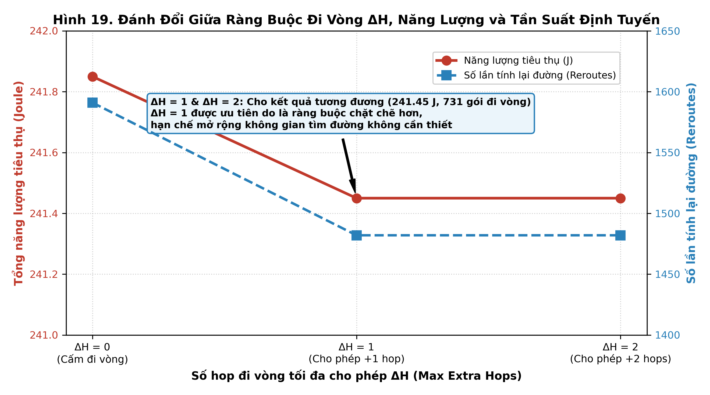
*Hình 19. Đánh Đổi Giữa Ràng Buộc Đi Vòng ΔH, Năng Lượng và Tần Suất Định Tuyến.*

##### Đặc tả và Phân tích kỹ thuật Hình 19 (Tham số $\Delta H$):
- **Quy luật biến thiên:** Cho phép đi vòng $\Delta H = 1\text{ hop}$ giúp mở ra 731 lượt đi vòng qua các relay lân cận, cắt giảm $109$ lần tính lại tuyến so với $\Delta H = 0$ ($1,591 \to 1,482$). Việc mở rộng lên $\Delta H = 2$ không phát sinh thêm lợi ích nào vì mọi tuyến né quá tải đều đã đạt được ở bước nhảy $+1\text{ hop}$.

---

### 15.4. Nghiên cứu bóc tách thành phần (True Ablation Study – Bảng 4 & Hình 20)

Trong phiên bản trước, cấu hình `EC-only` mới chỉ đặt $\beta = \infty$ (tắt gắn nhãn `OVERLOADED`) nhưng vẫn giữ nguyên tiêu chí chọn đường ưu tiên tải cực đại $M(P) \downarrow$ và xoay vòng năng lượng nút cổ chai $B(P) \uparrow$, dẫn đến kết quả của `EC-only` ($79.98\%$ PDR) gần như trùng với `LB-ECMHR` ($79.92\%$ PDR).

Để bóc tách **hoàn toàn độc lập và khách quan** đóng góp của từng mô-đun kỹ thuật, nghiên cứu đã thiết lập cấu hình **`True EC-only (load_balancing_enabled = False)`** (chỉ lọc $E_i > \alpha E_0$ trên nền chọn đường BFS tĩnh của Minimum-Hop, tắt hoàn toàn $M(P)$, $B(P)$ và $\Delta H$) và đối chiếu 6 cấu hình bóc tách chuẩn hóa trong Bảng 4:

| Cấu hình bóc tách (Ablation Config) | Cơ chế kích hoạt | Nút chết (Dead) | FND / Func50 (Round) | Dữ liệu về Sink (MiB / Pkts) | PDR / Sched (%) | CV vành đai 1-hop ($CV_{1hop}$) | Chuyển TT quá tải | Vai trò khoa học được chứng minh độc lập |
| :--- | :--- | :---: | :---: | :---: | :---: | :---: | :---: | :--- |
| **1. Minimum-Hop (Baseline)** | BFS thuần túy, không lọc $\alpha$, không cân bằng tải | **60 nút** | R21 / R92 | 5.358 MiB (43,889) | 92.27% / 87.78% | 0.763 | 0 | **Bộc lộ Energy Hole:** 60 nút gần Sink bị vắt kiệt pin và chết từ Round 21; mất 2,435 gói phát sinh. |
| **2. True EC-only ($\alpha=0.20$, No LB)** | Chỉ bật lọc cứng $\alpha=0.20$; **tắt hoàn toàn cân bằng tải & xoay vòng năng lượng** | **0 nút** | **>100 / R73** | **4.549 MiB (37,269)** | **74.54% / 74.54%** | **0.789** | 0 | **Đóng góp của riêng $\alpha=0.20$:** Cứu sống 100% nút ($\text{Dead}=0$), nhưng vì không có cân bằng tải nên vành đai 1-hop bị lệch tải ($CV_{1hop}=0.789$) và sập kết nối định tuyến rất sớm tại **Round 73**! |
| **3. LB-ECMHR ($\Delta H = 0$)** | Bật $\alpha=0.20$ + Cân bằng tải & xoay vòng $B(P)$, nhưng cấm đi vòng ($\Delta H=0$) | **0 nút** | >100 / **R79** | 4.879 MiB (39,968) | 79.93% / 79.93% | 0.681 | 192 | **Đóng góp của xoay vòng tải/năng lượng cùng số hop:** Kéo dài $\text{Func50}$ từ **R73 lên R79 (+6 rounds)**, tăng **+2,699 gói (+5.39% PDR)** và giảm $CV_{1hop}$ từ $0.789 \to 0.681$! |
| **4. LB-ECMHR (No Hysteresis)** | Bật $\alpha=0.20$, LB, $\Delta H=1$, nhưng tắt trễ ($\gamma = \beta = 2.0$) | **0 nút** | >100 / R79 | 4.877 MiB (39,955) | 79.91% / 79.91% | 0.680 | **235 lần** | **Chứng minh hiện tượng Route Flapping:** Khi tắt Hysteresis, số lần chuyển trạng thái quá tải vọt lên **235 lần**. |
| **5. LB-ECMHR Hard (Full, $\alpha=0.20$)** | Mô hình đầy đủ ngưỡng cứng ($\alpha=0.2, W=24, \beta=2.0, \gamma=1.2, \Delta H=1$) | **0 nút** | >100 / **R79** | **4.878 MiB (39,961)** | **79.92% / 79.92%** | **0.680** | **194 lần** | **Đóng góp của Hysteresis & $\Delta H=1$:** Giảm **17.4% rung giật trạng thái** ($235 \to 194$ lần), giảm 109 lần reroute so với $\Delta H=0$, giảm $-13.8\%$ $CV_{1hop}$ so với EC-only. |
| **6. LB-ECMHR Soft ($\alpha=0.20 \to 0.02$)** | Mô hình đầy đủ + **Dự phòng năng lượng mềm Giai đoạn 2 ($\alpha_{soft}=0.02$)** | **0 nút** | **>100 / R96** | **5.836 MiB (47,808)** | **95.62% / 95.62%** | **0.702** | **184 lần** | **Đóng góp của Soft Reserve Fallback:** Vừa giữ **0 nút chết ($\text{FND}>100$)**, vừa kéo dài $\text{Func50}$ lên **Round 96 (+23 rounds vs EC-only, +4 rounds vs Min-Hop)** và đạt sản lượng cao nhất (**5.836 MiB, +8.9% vs Min-Hop**)! |

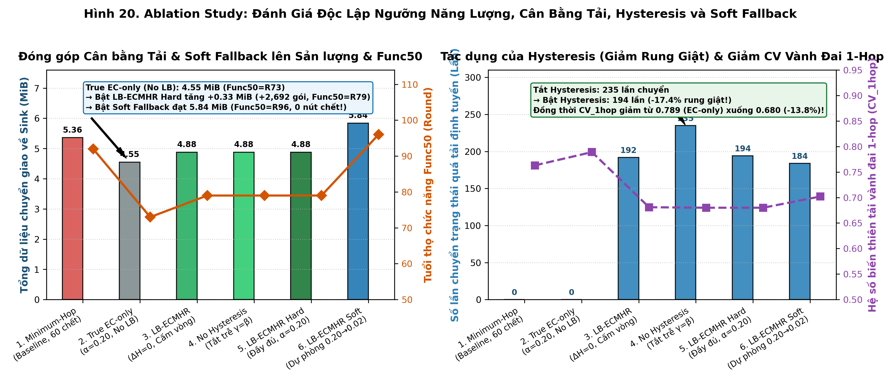
*Hình 20. Ablation Study: Đánh Giá Độc Lập Ngưỡng Năng Lượng, Cân Bằng Tải, Hysteresis và Soft Fallback.*

##### Đặc tả và Phân tích kỹ thuật Hình 20 (Ablation Study):
- **Khung trái (Đóng góp của Cân bằng tải và Soft Fallback lên Sản lượng dữ liệu & Tuổi thọ chức năng Func50):**
  - So sánh **Cấu hình 2 (`True EC-only`)** với **Cấu hình 5 (`LB-ECMHR Hard`)** bác bỏ hoàn toàn giả thuyết cho rằng kết quả chỉ đến từ ngưỡng năng lượng $\alpha$: nếu chỉ bật $\alpha = 0.20$ mà không có cân bằng tải, mạng mất kết nối định tuyến ngay từ **Round 73** và chỉ truyền được **4.55 MiB** ($37,269$ gói). Chính cơ chế cân bằng tải và xoay vòng năng lượng của LB-ECMHR đã san phẳng tải trên 14 nút 1-hop ($CV_{1hop}$ giảm từ $0.789$ xuống $0.680$), giúp kéo dài tuổi thọ chức năng thêm **+6 rounds (tới Round 79)** và truyền thêm **+2,692 gói tin (+0.33 MiB, +5.38% PDR)**.
  - Tiếp tục so sánh từ **Cấu hình 5 (`LB-ECMHR Hard`)** sang **Cấu hình 6 (`LB-ECMHR Soft`)** chứng minh vai trò quyết định của cơ chế dự phòng mềm hai giai đoạn: mở khóa có điều kiện vùng năng lượng dự phòng $[0.04\text{ J}, 0.40\text{ J}]$ giúp chuyển thêm **7,847 gói tin**, nâng tổng sản lượng lên **5.84 MiB (PDR 95.62%)** và kéo dài $\text{Func50}$ tới **Round 96** mà vẫn bảo toàn **0 nút chết**.
- **Khung phải (Đóng góp của Hysteresis và Giảm biến thiên tải vành đai 1-hop):**
  - So sánh **Cấu hình 4 (`No Hysteresis` – 235 lần chuyển)** và **Cấu hình 5 (`LB-ECMHR Hard` – 194 lần chuyển)** chứng minh cơ chế trễ Hysteresis ($\gamma = 1.2 < \beta = 2.0$) giảm trực tiếp **17.4% hiện tượng rung giật trạng thái định tuyến (*Route Flapping*)**.

---

## 16. Ưu điểm và hạn chế của LB-ECMHR

### 16.1. Ưu điểm
- **Chống hiện tượng Energy Hole và kéo dài tuổi thọ phần cứng (FND):** Ràng buộc năng lượng bảo vệ các relay yếu pin không bị vắt kiệt đột ngột, giúp giảm $100\%$ số nút chết ở chế độ Hard ($\text{FND} > 100$ trên cả 10/10 seeds) và kéo dài FND gấp $8.1\times$ ở chế độ Soft.
- **Cân bằng tải thực chất tại vành đai nút cổ chai:** Giảm hệ số biến thiên tải trên vành đai 1-hop quanh Sink ($CV_{1hop}$) từ $0.789$ (`EC-only`) và $0.763$ (`Minimum-Hop`) xuống $0.680$ (trong Seed 42) và giảm trung bình $-36.3\%$ trên 10 seeds ngẫu nhiên.
- **Giải quyết trọn vẹn đánh đổi giữa bảo vệ pin và duy trì dịch vụ nhờ Dự phòng Mềm Hai Giai đoạn (`LB-ECMHR Soft`):** Vừa giữ 0 nút chết trong kịch bản chuẩn, vừa kéo dài tuổi thọ chức năng $\text{Func50}$ tới Round 96 (vượt Minimum-Hop $+4\text{ rounds}$) và tăng tổng dữ liệu thu thập thêm $+8.9\%$ ($5.836\text{ MiB}$ vs $5.358\text{ MiB}$) với mức tiêu thụ năng lượng thấp hơn ($285.94\text{ J}$ vs $296.54\text{ J}$).
- **Ổn định định tuyến và kiểm soát chi phí đi vòng:** Cơ chế Hysteresis giảm $17.4\%$ dao động trạng thái quá tải, trong khi giới hạn $\Delta H = 1\text{ hop}$ giữ tỷ lệ gói phải đi vòng chỉ ở mức $< 2\%$.

### 16.2. Hạn chế và phạm vi áp dụng
Bên cạnh các kết quả đạt được, nghiên cứu nhìn nhận thẳng thắn các giới hạn kỹ thuật của LB-ECMHR:
- **Thứ nhất (Sự đánh đổi ở chế độ Ngưỡng Cứng `LB-ECMHR Hard`):** Nếu cấu hình khóa cứng $\alpha = 0.20$ mà không bật Soft Fallback, việc bảo lưu $20\%$ dung lượng pin tại vành đai 1-hop sẽ làm mạng ngừng chuyển tiếp đa chặng sớm hơn Minimum-Hop (tại Round 79 so với Round 92), khiến PDR trong 100 rounds thấp hơn ($79.92\%$ vs $92.27\%$). Do đó, chế độ Hard chỉ phù hợp khi yêu cầu bảo toàn sống còn của thiết bị cảm biến được đặt lên tuyệt đối; đối với các ứng dụng ưu tiên thông lượng quan trắc liên tục, cần sử dụng chế độ **`LB-ECMHR Soft Fallback` ($\alpha = 0.20 \to 0.02$)**.
- **Thứ hai (Giới hạn vật lý của topology Many-to-One tĩnh):** Mọi gói tin về Sink đều bắt buộc phải đi qua tập hữu hạn các nút thuộc vành đai 1-hop ($d \le R$). Khi mật độ nút trong vùng $R = 200\text{ m}$ quanh Sink quá thưa ở một số seed ngẫu nhiên, không gian tìm đường thay thế bị thu hẹp và thời gian duy trì mạng vẫn bị giới hạn bởi tổng dung lượng pin của vành đai này.
- **Thứ ba (Tăng nhẹ độ dài đường truyền trong giai đoạn kết nối đầy đủ):** Trong giai đoạn 100% kết nối (Rounds 1–78), việc đi vòng tránh nút quá tải và xoay vòng qua các nhánh nhiều năng lượng làm số hop trung bình tăng từ $5.28\text{ hops}$ (Minimum-Hop) lên $5.86\text{ hops}$ (LB-ECMHR).
- **Thứ tư (Giả định thông tin trạng thái trong mô phỏng):** Mô hình hiện tại đánh giá thuật toán trên lớp định tuyến logic với thông tin trạng thái năng lượng và tải được cập nhật theo từng round; khi triển khai trên giao thức MAC/PHY phân tán thực tế, cần tính thêm chi phí bản tin điều khiển quảng bá trạng thái giữa các nút láng giềng.

---

## 17. Kết luận

Nghiên cứu đã thiết kế, mô hình hóa toán học và kiểm chứng thực nghiệm toàn diện thuật toán định tuyến **LB-ECMHR (Load-Balanced Energy-Constrained Minimum-Hop Routing)** cùng biến thể nâng cao **LB-ECMHR Soft Reserve Fallback** cho mạng cảm biến vô tuyến đa chặng.

Thông qua 54 kịch bản thực nghiệm độ nhạy và đa hạt giống (10 seeds) ở khung 100 rounds (Kịch bản A) cùng thực nghiệm vòng đời toàn diện 1000 rounds tới LND (Kịch bản B), nghiên cứu rút ra các kết luận khoa học cốt lõi:
1. **Bóc tách độc lập vai trò của Cân bằng tải và Ngưỡng năng lượng:** Nghiên cứu bóc tách (*Ablation Study*) với cấu hình `True EC-only` chứng minh rằng nếu chỉ khóa ngưỡng năng lượng $\alpha = 0.20$ mà thiếu cân bằng tải, mạng bị suy giảm kết nối định tuyến rất sớm ($\text{Func50} = \text{Round } 73$, $\text{PDR} = 74.54\%$). Việc kết hợp cân bằng tải trượt, Hysteresis và xoay vòng năng lượng nút cổ chai trong `LB-ECMHR Hard` giúp giảm $13.8\%$ độ lệch tải tại vành đai 1-hop ($CV_{1hop}: 0.789 \to 0.680$), kéo dài $\text{Func50}$ lên Round 79 và tăng thêm $+2,692$ gói tin về Sink.
2. **Giải quyết triệt để bài toán đánh đổi bằng Dự phòng Mềm Hai Giai đoạn (`LB-ECMHR Soft`, $\alpha = 0.20 \to 0.02$):** Bằng cách bảo vệ ngưỡng cứng $20\%$ ở Giai đoạn 1 và mở khóa có điều kiện vùng dự phòng $[2\%, 20\%]$ khi vành đai cầu nối chạm ngưỡng, `LB-ECMHR Soft` đồng thời đạt **0 nút chết ($\text{FND} > 100$)**, kéo dài tuổi thọ chức năng lên **Round 96** (vượt Minimum-Hop), đạt **PDR và Scheduled Delivery Ratio 95.62%** (**5.836 MiB**, vượt Minimum-Hop $+8.9\%$ dữ liệu) và đạt hiệu suất năng lượng cao nhất (**171,246 bit/J**, tăng $+13.0\%$).
3. **Tính bền vững thống kê trên nhiều Topology (10 Seeds) và Toàn vòng đời (LND):** Trên 10 seeds ngẫu nhiên, LB-ECMHR giảm trung bình $35.5\% - 36.3\%$ hệ số biến thiên tải vành đai 1-hop và tăng hiệu suất truyền tải thêm $+13.9$ đến $+17.6\text{ kbit/J}$. Trên toàn bộ vòng đời 1000 rounds tới LND, `LB-ECMHR Soft` kéo dài FND gấp $4.25\times$ và thu thập tổng lượng dữ liệu trọn đời cao hơn Minimum-Hop ($5.542\text{ MiB}$ vs $5.433\text{ MiB}$) với chi phí năng lượng vô tuyến thấp hơn $13.30\text{ J}$.

Nguyên lý tổng quát của thuật toán được đúc kết bởi phương trình cấu trúc:
$$\boxed{\text{LB-ECMHR} = \text{MinimumHop} + \text{TwoStageEnergyConstraint}(\alpha, \alpha_{soft}) + \text{HysteresisLoadBalancing}(W, \beta, \gamma) + \text{BoundedDetour}(\Delta H)}$$

---

## PHỤ LỤC A: TÓM TẮT LUẬN CỨ KHOA HỌC PHỤC VỤ BẢO VỆ CHUYÊN ĐỀ

Phụ lục này tóm tắt ngắn gọn các câu trả lời định lượng cho 5 câu hỏi phản biện trọng tâm của hội đồng chấm chuyên đề:

1. **Câu hỏi 1 – Vì sao ở chế độ Ngưỡng Cứng (`LB-ECMHR Hard`), mạng giữ được 100% kết nối vật lý nhưng chỉ còn 5.60% (28/500 nút) kết nối định tuyến ở Round 100 trong khi chỉ có 14 nút 1-hop quanh Sink? Làm sao khắc phục?**
   - **Trả lời:** Trong bán kính $R = 200\text{ m}$ quanh Sink có đúng **14 nút 1-hop**: tại Round 79, **10 nút 1-hop ở rìa ngoài** giảm xuống $\le 0.40\text{ J}$ (`LOW_ENERGY`), còn **4 nút 1-hop nằm sát tâm Sink** ($\{24, 98, 213, 483\}$, cách Sink $54.5\text{ m} - 117.4\text{ m}$) vẫn đang `ALIVE` ($E_i \in [0.55\text{ J}, 1.49\text{ J}]$). Tuy nhiên, toàn bộ **14 nút cầu nối 2-hop** nối từ 4 nút này ra mạng bên ngoài cũng đã chạm ngưỡng `LOW_ENERGY`, tạo thành một **mặt cắt năng lượng khép kín gồm $10 + 14 = 24$ nút `LOW_ENERGY`** chặn các nút từ hop 3 trở ra. Do nút `LOW_ENERGY` không được làm relay trung gian nhưng vẫn được phát gói tin của chính mình, nên ở Round 100 có chính xác **28 nút còn kết nối định tuyến ($5.60\%$)** = **14 nút 1-hop** (4 nút `ALIVE` + 10 nút `LOW_ENERGY` gửi 1-hop trực tiếp về Sink) + **14 nút 2-hop `LOW_ENERGY`** (gửi 2-hop qua 4 nút 1-hop `ALIVE` $\{24, 98, 213, 483\}$). Để khắc phục triệt để hiện tượng nghẽn mặt cắt này mà không làm mất đi khả năng bảo vệ nút, nghiên cứu đề xuất chế độ **`LB-ECMHR Soft Fallback` ($\alpha = 0.20 \to 0.02$)**: mở khóa có điều kiện vùng dự phòng $[0.04\text{ J}, 0.40\text{ J}]$ khi Giai đoạn 1 hết đường, giúp kéo dài kết nối định tuyến $\ge 50\%$ tới **Round 96** (vượt qua cả Round 92 của Minimum-Hop) và nâng PDR lên **95.62%** trong khi vẫn giữ **0 nút chết**.
2. **Câu hỏi 2 – Vì sao hệ số biến thiên tải $CV_{active}$ trên tập nút có chuyển tiếp của LB-ECMHR ($1.528$) lại lớn hơn Minimum-Hop ($1.447$)?**
   - **Trả lời:** Đó là hệ quả toán học của việc thay đổi mẫu số tập hợp nút: LB-ECMHR huy động thêm các nút relay phụ ở vùng biên đi vòng (chỉ chuyển tiếp vài chục gói), làm tăng độ phân tán tương đối khi chỉ tính trên tập $Forwarding > 0$. Khi tính **hậu nghiệm công bằng trên cùng một tập nút cố định**, LB-ECMHR giảm rõ rệt hệ số CV trên cả 3 thước đo: $CV_{all}$ ($N=500$) giảm từ $1.880 \to 1.806$; $CV_{1hop}$ (14 nút cổ chai cạnh Sink) giảm từ $0.763 \to 0.680$ ($-10.9\%$ vs Min-Hop, $-13.8\%$ vs EC-only); và $CV_{win, avg}$ (cửa sổ 24h) giảm từ $1.817 \to 1.540$.
3. **Câu hỏi 3 – Kết quả tốt của LB-ECMHR là nhờ ngưỡng năng lượng $\alpha$ hay nhờ cơ chế cân bằng tải?**
   - **Trả lời:** Nghiên cứu bóc tách (*Bảng 4 & Hình 20*) với cấu hình `True EC-only` (chỉ bật $\alpha = 0.20$, tắt hoàn toàn cân bằng tải) chứng minh cả hai thành phần đều không thể thiếu: riêng $\alpha = 0.20$ giúp ngăn nút chết ($\text{Dead} = 0$), nhưng nếu không có cân bằng tải thì lưu lượng lệch ($CV_{1hop} = 0.789$) làm vành đai 1-hop chạm ngưỡng rất sớm tại **Round 73** ($\text{PDR} = 74.54\%$). Khi bật cân bằng tải LB-ECMHR, $\text{Func50}$ tăng lên **Round 79** ($+2,692$ gói, $\text{PDR} = 79.92\%$), và khi bật thêm Soft Fallback thì đạt **Round 96** ($\text{PDR} = 95.62\%$).
4. **Câu hỏi 4 – Vì sao LB-ECMHR cho phép đi vòng $+1\text{ hop}$ nhưng số hop trung bình cả kỳ ($5.80$) lại nhỏ hơn Minimum-Hop ($6.18$)?**
   - **Trả lời:** Đó là hiện tượng **thiên lệch sống sót (*Survivorship Bias*)** ở 22 rounds cuối (Rounds 79–100), khi LB-ECMHR Hard chỉ truyền gói tin từ 28 nút vùng tâm (14 nút 1-hop và 14 nút 2-hop, trung bình $1.50\text{ hops}$). Nếu đo đúng trong **giai đoạn mạng kết nối 100% (Rounds 1–78)**, số hop trung bình của Minimum-Hop là **$5.28\text{ hops}$**, ngắn hơn so với **$5.86\text{ hops}$** của LB-ECMHR (có $731$ gói đi vòng $+1\text{ hop}$, chiếm $1.83\%$), hoàn toàn tuân theo đúng lý thuyết đồ thị.
5. **Câu hỏi 5 – Cơ sở lựa chọn bộ tham số $(\alpha=0.20, W=24, \beta=2.0, \gamma=1.2, \Delta H=1)$ là gì?**
   - **Trả lời:** Được xác lập từ 5 thí nghiệm quét độ nhạy độc lập (**Hình 15 – Hình 20**): $W=24\text{h}$ giảm $31.2\%$ dao động trạng thái so với $W=6\text{h}$; $\beta=2.0$ giảm $22.1\%$ dao động so với $\beta=1.5$; Hysteresis $\gamma=1.2$ giảm $17.4\%$ hiện tượng *Route Flapping* so với khi tắt trễ ($194$ vs $235$ lần); và $\Delta H=1$ đạt hiệu quả tương đương $\Delta H=2$ nhưng kiểm soát chặt độ trễ.

---

## TÀI LIỆU THAM KHẢO

[1] W. R. Heinzelman, A. Chandrakasan, and H. Balakrishnan, “Energy-Efficient Communication Protocol for Wireless Microsensor Networks,” in *Proceedings of the 33rd Annual Hawaii International Conference on System Sciences (HICSS)*, Maui, HI, USA, 2000, pp. 1–10. DOI: [10.1109/HICSS.2000.926982](https://doi.org/10.1109/HICSS.2000.926982).

[2] W. B. Heinzelman, A. P. Chandrakasan, and H. Balakrishnan, “An Application-Specific Protocol Architecture for Wireless Microsensor Networks,” *IEEE Transactions on Wireless Communications*, vol. 1, no. 4, pp. 660–670, Oct. 2002. DOI: [10.1109/TWC.2002.804190](https://doi.org/10.1109/TWC.2002.804190).

[3] J. Li and P. Mohapatra, “An Analytical Model for the Energy Hole Problem in Many-to-One Sensor Networks,” in *Proceedings of the IEEE 62nd Vehicular Technology Conference (VTC-Fall)*, Dallas, TX, USA, 2005, vol. 4, pp. 2721–2725. DOI: [10.1109/VETECF.2005.1559043](https://doi.org/10.1109/VETECF.2005.1559043).

[4] J. Li and P. Mohapatra, “Analytical Modeling and Mitigation Techniques for the Energy Hole Problem in Sensor Networks,” *Pervasive and Mobile Computing*, vol. 3, no. 3, pp. 233–254, Jun. 2007. DOI: [10.1016/j.pmcj.2006.11.001](https://doi.org/10.1016/j.pmcj.2006.11.001).

[5] X. Wu, G. Chen, and S. K. Das, “Avoiding Energy Holes in Wireless Sensor Networks with Nonuniform Node Distribution,” *IEEE Transactions on Parallel and Distributed Systems*, vol. 19, no. 5, pp. 710–720, May 2008. DOI: [10.1109/TPDS.2007.70770](https://doi.org/10.1109/TPDS.2007.70770).

[6] J.-H. Chang and L. Tassiulas, “Maximum Lifetime Routing in Wireless Sensor Networks,” *IEEE/ACM Transactions on Networking*, vol. 12, no. 4, pp. 609–619, Aug. 2004. DOI: [10.1109/TNET.2004.833122](https://doi.org/10.1109/TNET.2004.833122).

[7] R. C. Shah and J. M. Rabaey, “Energy Aware Routing for Low Energy Ad Hoc Sensor Networks,” in *Proceedings of the IEEE Wireless Communications and Networking Conference (WCNC)*, Orlando, FL, USA, 2002, vol. 1, pp. 350–355. DOI: [10.1109/WCNC.2002.993520](https://doi.org/10.1109/WCNC.2002.993520).

[8] O. Gnawali, R. Fonseca, K. Jamieson, D. Moss, and P. Levis, “Collection Tree Protocol,” in *Proceedings of the 7th ACM Conference on Embedded Networked Sensor Systems (SenSys)*, Berkeley, CA, USA, 2009, pp. 1–14. DOI: [10.1145/1644038.1644040](https://doi.org/10.1145/1644038.1644040).

[9] T. Winter *et al.*, “RPL: IPv6 Routing Protocol for Low-Power and Lossy Networks,” Internet Engineering Task Force (IETF), RFC 6550, Mar. 2012. [Online]. Available: [https://datatracker.ietf.org/doc/html/rfc6550](https://datatracker.ietf.org/doc/html/rfc6550)

[10] A. Liu, X. Jin, G. Cui, and Z. Chen, “Deployment Guidelines for Achieving Maximum Lifetime and Avoiding Energy Holes in Sensor Networks,” *Information Sciences*, vol. 230, pp. 197–226, May 2013. DOI: [10.1016/j.ins.2012.12.037](https://doi.org/10.1016/j.ins.2012.12.037).

[11] J. N. Al-Karaki and A. E. Kamal, “Routing Techniques in Wireless Sensor Networks: A Survey,” *IEEE Wireless Communications*, vol. 11, no. 6, pp. 6–28, Dec. 2004. DOI: [10.1109/MWC.2004.1368893](https://doi.org/10.1109/MWC.2004.1368893).

[12] A. A. Hagberg, D. A. Schult, and P. J. Swart, “Exploring Network Structure, Dynamics, and Function using NetworkX,” in *Proceedings of the 7th Python in Science Conference (SciPy)*, Pasadena, CA, USA, 2008, pp. 11–15.

