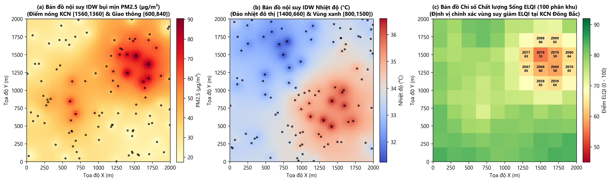
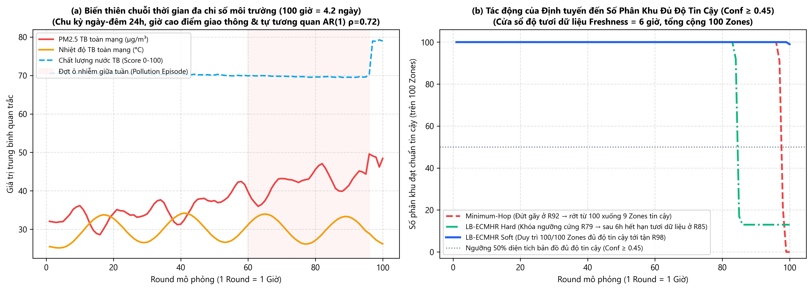

# BÁO CÁO CHUYÊN ĐỀ
# MÔ HÌNH HÓA DỮ LIỆU MÔI TRƯỜNG KHÔNG GIAN - THỜI GIAN, NỘI SUY BẢN ĐỒ NHIỆT IDW VÀ ĐÁNH GIÁ CHỈ SỐ CHẤT LƯỢNG SỐNG (ELQI) TRONG MẠNG WSN

---

## 1. Đặt vấn đề và Mục tiêu của Phân hệ Môi trường

Mục đích cuối cùng của mạng cảm biến vô tuyến (WSN) trong bài toán quan trắc đô thị và sinh thái không chỉ dừng lại ở việc truyền các gói tin qua mạng đa chặng, mà là **tái tạo chính xác bức tranh chất lượng môi trường theo không gian và thời gian** tại trạm trung tâm (Sink) để phục vụ cảnh báo sớm và hỗ trợ ra quyết định.

Trong hệ thống `WSN Simulator`, phân hệ Dữ liệu & Phân tích Môi trường (`data/` và `environment/`) được thiết kế nhằm giải quyết 4 bài toán cốt lõi:
1. **Mô hình hóa trường vật lý môi trường thực tế (*Spatio-Temporal Environmental Field Generation*):** Sinh dữ liệu đa chỉ số (`temperature`, `humidity`, `pm25`, `wind`, `water_quality`) có tính phân hóa không gian (khu công nghiệp, trục giao thông, đảo nhiệt đô thị, vùng cây xanh), biến thiên chu kỳ ngày-đêm 24 giờ, chu kỳ tuần 7 ngày, đợt ô nhiễm cực đoan (*Pollution Episode*) và quá trình tự tương quan bậc nhất $\text{AR}(1)$.
2. **Nội suy không gian và phân vùng quản lý (*IDW Spatial Interpolation & Grid Zoning*):** Tái tạo bản đồ nhiệt liên tục độ phân giải $70 \times 70$ và quy hoạch vùng triển khai $2000 \times 2000\text{ m}$ thành **100 phân khu quản lý (`Z001` – `Z100`, mỗi phân khu $200 \times 200\text{ m}$)** bằng thuật toán nghịch đảo khoảng cách có trọng số (**IDW – Inverse Distance Weighting**).
3. **Tổng hợp Chỉ số Chất lượng Môi trường Sống (*ELQI – Environmental Living Quality Index*):** Chuẩn hóa 5 đại lượng vật lý khác đơn vị về thang điểm $[0, 100]$ và tích hợp có trọng số cùng **Độ tin cậy dữ liệu đa thành phần (*Data Confidence Score*)** để chống báo động giả khi mạng bị rớt gói hoặc dữ liệu quá hạn (*Stale Data*).
4. **Đánh giá tác động trực tiếp của định tuyến mạng đến chất lượng dịch vụ quan trắc:** Chứng minh định lượng cách thức thuật toán định tuyến `LB-ECMHR (Hard & Soft Reserve Fallback)` duy trì độ phủ bản đồ môi trường tin cậy vượt trội so với `Minimum-Hop`.

---

## 2. Mô hình Toán học Sinh Dữ liệu Môi trường Không gian – Thời gian (`data/generator.py`)

### 2.1. Phân bổ 5 nhóm cảm biến chuyên biệt
Toàn mạng gồm $N = 500$ nút cảm biến được phân bổ đồng đều vào 5 loại chỉ số quan trắc (100 nút/loại), sử dụng bộ sinh số ngẫu nhiên độc lập (`seed_offset = 10000`) để không làm thay đổi vị trí vật lý của các nút mạng:

| Loại cảm biến (`sensor_type`) | Số lượng nút | Đơn vị đo | Miền giá trị vật lý (`bounds`) | Nhiễu cảm biến chuẩn ($\sigma$) |
| :--- | :---: | :---: | :---: | :---: |
| **Nhiệt độ (`temperature`)** | 100 nút | $^\circ\text{C}$ | $[18.0, 45.0]\,^\circ\text{C}$ | $0.30\,^\circ\text{C}$ |
| **Độ ẩm không khí (`humidity`)** | 100 nút | $\%$ | $[20.0, 100.0]\,\%$ | $0.80\,\%$ |
| **Bụi mịn (`pm25`)** | 100 nút | $\mu\text{g/m}^3$ | $[0.0, 200.0]\,\mu\text{g/m}^3$ | $2.50\,\mu\text{g/m}^3$ |
| **Tốc độ gió (`wind`)** | 100 nút | $\text{m/s}$ | $[0.0, 15.0]\,\text{m/s}$ | $0.25\,\text{m/s}$ |
| **Chất lượng nước (`water_quality`)** | 100 nút | $\text{score}$ | $[0.0, 100.0]\,\text{điểm}$ | $1.00\,\text{điểm}$ |

### 2.2. Trường tiềm ẩn không gian 2 chiều (2D Gaussian Spatial Latent Fields)
Với mỗi cảm biến tại tọa độ chuẩn hóa $(u, v) = (x / 2000, y / 2000) \in [0, 1]^2$, giá trị nền không gian được tổng hợp từ các nhân Gaussian 2 chiều:
$$G(u, v; c_x, c_y, s_x, s_y) = \exp\left(-\frac{1}{2}\left[\left(\frac{u - c_x}{s_x}\right)^2 + \left(\frac{v - c_y}{s_y}\right)^2\right]\right)$$

Các vùng đặc trưng địa lý được mô hình hóa trên bản đồ $2000 \times 2000\text{ m}$ gồm:
- **Khu công nghiệp phát thải chính (`industrial`):** Tâm tại $(0.78, 0.68) \equiv (1560\text{ m}, 1360\text{ m})$, bán kính lan tỏa $(s_x, s_y) = (0.15, 0.16)$ – làm tăng mạnh nồng độ bụi mịn $\text{PM}_{2.5}$, tăng nhiệt độ và làm giảm chất lượng nước.
- **Trục giao thông mật độ cao (`traffic`):** Tâm tại $(0.30, 0.42) \equiv (600\text{ m}, 840\text{ m})$, $(s_x, s_y) = (0.13, 0.17)$ – gây đỉnh phát thải $\text{PM}_{2.5}$ theo giờ cao điểm sáng/chiều.
- **Đảo nhiệt đô thị (`urban`):** Tâm tại $(0.70, 0.33) \equiv (1400\text{ m}, 660\text{ m})$, $(s_x, s_y) = (0.20, 0.17)$ – làm tăng nhiệt độ nền $+3.5^\circ\text{C}$ và giảm độ ẩm $-8\%$.
- **Vùng công viên cây xanh & mặt nước (`green`):** Tâm tại $(0.40, 0.75) \equiv (800\text{ m}, 1500\text{ m})$, $(s_x, s_y) = (0.22, 0.18)$ – điều hòa vi khí hậu (giảm nhiệt độ $-2.0^\circ\text{C}$, tăng độ ẩm $+12\%$).
- **Nguồn gây ô nhiễm nước (`water_pollution`):** Cực đại của hai điểm xả thải tại $(1600\text{ m}, 1440\text{ m})$ và $(400\text{ m}, 1600\text{ m})$.

### 2.3. Biến thiên chu kỳ thời gian và Quá trình tự hồi quy bậc nhất $\text{AR}(1)$
Mỗi round mô phỏng tương ứng với **1 giờ thực tế** ($\Delta t = 60\text{ phút}$). Tại giờ trong ngày $h = (r - 1) \bmod 24$ và số ngày trôi qua $d = (r - 1) / 24$:
- **Chu kỳ nhiệt độ ngày-đêm:** $C_{temp}(h) = \sin\left(\frac{2\pi(h - 8)}{24}\right)$ (đạt cực tiểu lúc 02:00 sáng và cực đại lúc 14:00 chiều).
- **Chu kỳ giao thông giờ cao điểm:** $C_{traffic}(h) = \max\left\{\exp\left(-\frac{d_{24}(h, 8)^2}{2 \cdot 2.0^2}\right), \exp\left(-\frac{d_{24}(h, 18)^2}{2 \cdot 2.5^2}\right)\right\}$ (đỉnh cao điểm lúc 08:00 sáng và 18:00 chiều).
- **Đợt ô nhiễm giữa tuần (*Pollution Episode*):** $E_{poll}(d) = \exp\left(-\frac{((d \bmod 7) - 3.5)^2}{2 \cdot 1.15^2}\right)$ (tăng cao vào ngày thứ 3 – thứ 4 của tuần, tức khoảng Rounds 60 – 96).

Để phản ánh quán tính vật lý của khí quyển và nguồn nước (giá trị giờ hiện tại không nhảy ngẫu nhiên độc lập mà phụ thuộc chặt vào giờ liền trước), trạng thái môi trường thực $X_i(r)$ tại nút $i$ tuân theo quá trình **Tự hồi quy bậc nhất $\text{AR}(1)$** với hệ số tương quan thời gian $\rho = 0.72$:
$$X_i(r) = \rho X_i(r - 1) + (1 - \rho)\,\mu_i(r) + \eta_{process, i}(r), \quad \eta_{process, i}(r) \sim \mathcal{N}\big(0, (0.35\sigma)^2\big)$$
Giá trị đo thực tế của cảm biến $Y_i(r)$ trước khi đóng gói vào Packet là:
$$Y_i(r) = \text{clip}\Big(X_i(r) + \eta_{meas, i}(r),\; Y_{\min}, Y_{\max}\Big), \quad \eta_{meas, i}(r) \sim \mathcal{N}\big(0, (0.65\sigma)^2\big)$$

---

## 3. Nội suy Không gian IDW, Chỉ số ELQI và Độ tin cậy Dữ liệu (`environment/`)

### 3.1. Thuật toán nội suy nghịch đảo khoảng cách IDW (`environment/interpolation.py`)
Do mỗi loại cảm biến chỉ có 100 nút phân bố rải rác trên diện tích $4\text{ km}^2$, Sink sử dụng thuật toán **IDW (Inverse Distance Weighting)** bậc $p = 2.0$ để ước lượng giá trị chỉ số $k$ tại tâm của 100 phân khu (`Z001` – `Z100`, kích thước $200 \times 200\text{ m}$) cũng như trên lưới bản đồ nhiệt $70 \times 70$:
$$\hat{Z}_k(x, y, t) = \frac{\sum_{i \in \mathcal{S}_k(t)} w_i(x, y)\, Y_i(t_i)}{\sum_{i \in \mathcal{S}_k(t)} w_i(x, y)}, \quad w_i(x, y) = \frac{1}{\max\big(d((x, y), (x_i, y_i)), \epsilon\big)^p}$$
trong đó $\mathcal{S}_k(t)$ là tập các nút cảm biến loại $k$ có bản tin nhận thành công tại Sink trong cửa sổ độ tươi dữ liệu ($t - t_i \le \Delta r_{fresh} = 6\text{ rounds}$).

*Hình 1. Kết quả nội suy không gian tại Round 66 (18:00 chiều trong đợt cao điểm ô nhiễm): (a) Bản đồ nhiệt IDW nồng độ bụi mịn PM2.5; (b) Bản đồ nhiệt IDW Nhiệt độ; (c) Bản đồ Chỉ số Chất lượng Môi trường Sống ELQI trên 100 phân khu quản lý (`Z001`–`Z100`).*

### 3.2. Chuẩn hóa Điểm thành phần và Công thức tổng hợp ELQI (`environment/scoring.py`, `living_quality.py`)
Mỗi giá trị ước lượng $\hat{Z}_k$ tại phân khu được quy đổi về thang điểm chuẩn hóa $S_k \in [0, 100]$:
1. **Nhóm chỉ số có miền tối ưu (`temperature`, `humidity`, `wind` – Phương pháp `optimal_range`):** Đạt **100 điểm** khi nằm trong miền lý tưởng $[I_{\min}, I_{\max}]$ (ví dụ Nhiệt độ $22 - 30^\circ\text{C}$, Độ ẩm $40 - 70\%$, Gió $0.5 - 5.0\text{ m/s}$) và giảm tuyến tính về **0 điểm** khi chạm ngưỡng cực hạn $[H_{\min}, H_{\max}]$.
2. **Chỉ số Bụi mịn `pm25` (Phương pháp `breakpoints` tuyến tính từng đoạn theo ngưỡng AQI):**
   - $0 \to 15\,\mu\text{g/m}^3$: $100 \to 90$ điểm; $15 \to 35\,\mu\text{g/m}^3$: $90 \to 70$ điểm; $35 \to 55\,\mu\text{g/m}^3$: $70 \to 50$ điểm; $55 \to 100\,\mu\text{g/m}^3$: $50 \to 20$ điểm; $100 \to 200\,\mu\text{g/m}^3$: $20 \to 0$ điểm.
3. **Chỉ số Chất lượng nước `water_quality`:** Sử dụng trực tiếp thang điểm $[0, 100]$.

Khi một phân khu có đủ ít nhất $M_{\min} = 3/5$ loại chỉ số hợp lệ, **Chỉ số Chất lượng Môi trường Sống (ELQI)** được tính theo trung bình có trọng số chuẩn hóa:
$$\text{ELQI}(z, t) = \frac{\sum_{k \in \mathcal{A}(z, t)} W_k \cdot S_k(z, t)}{\sum_{k \in \mathcal{A}(z, t)} W_k}$$
với bộ trọng số ưu tiên sức khỏe cộng đồng:
$$W_{\text{pm25}} = 0.30, \quad W_{\text{water}} = 0.25, \quad W_{\text{temp}} = 0.20, \quad W_{\text{humidity}} = 0.15, \quad W_{\text{wind}} = 0.10 \quad \left(\sum W_k = 1.00\right)$$

Phân loại chất lượng sống theo điểm ELQI:
- **Rất tốt ($\ge 80$)** | **Tốt ($65 – 79.9$)** | **Trung bình ($50 – 64.9$)** | **Kém ($35 – 49.9$, Cảnh báo `WARNING`)** | **Rất kém ($< 35$, Báo động đỏ `CRITICAL`)**.

### 3.3. Mô hình Độ tin cậy Dữ liệu Đa thành phần (`Confidence Score` trong `environment/analyzer.py`)
Điểm đặc sắc của hệ thống là không tính ELQI một cách mù quáng khi mạng mất kết nối, mà gắn kèm cho mỗi phân khu $z$ một **Chỉ số Độ tin cậy Dữ liệu $C(z, t) \in [0, 1]$** kết hợp 3 yếu tố trực tiếp từ tầng mạng WSN:
1. **Độ tin cậy không gian ($C_{spatial}$, trọng số $50\%$):** Phụ thuộc khoảng cách $d_{\min}$ từ tâm phân khu tới cảm biến gần nhất còn gửi được dữ liệu tươi về Sink trong bán kính hỗ trợ $R_{sup} = 450\text{ m}$:
   $$C_{spatial, k}(z, t) = \text{clip}\left(1 - \frac{d_{\min, k}(z, t)}{450\text{ m}},\; 0, 1\right)$$
2. **Độ tươi mới của dữ liệu ($C_{fresh}$, trọng số $25\%$):** Phụ thuộc độ trễ tuổi dữ liệu $\Delta r = t - r_{\text{latest}}$ so với ngưỡng tối đa $\Delta r_{fresh} = 6\text{ giờ}$:
   $$C_{fresh, k}(z, t) = \text{clip}\left(1 - \frac{\Delta r_k(z, t)}{6 + 1},\; 0, 1\right)$$
3. **Tỷ lệ giao gói thành công theo loại cảm biến ($C_{delivery}$, trọng số $25\%$):** Bằng tỷ lệ bản tin nhận được tại Sink trên tổng số bản tin sinh ra trong 6 giờ gần nhất của loại cảm biến $k$.

Độ tin cậy tổng hợp của phân khu $z$:
$$C(z, t) = \left(\frac{1}{5}\sum_{k=1}^{5} \Big[0.50\,C_{spatial, k} + 0.25\,C_{fresh, k} + 0.25\,C_{delivery, k}\Big]\right) \times \frac{|\mathcal{A}(z, t)|}{5}$$
Nếu $C(z, t) < 0.45$ (`low_confidence_threshold`), phân khu bị đánh dấu **Độ tin cậy dữ liệu thấp (`DATA Alert`)** để cảnh báo người vận hành rằng mạng cảm biến tại khu vực đó đang bị mất kết nối hoặc dữ liệu đã cũ quá 6 giờ.

---

## 4. Kết quả Thực nghiệm: Mối liên hệ trực tiếp giữa Định tuyến LB-ECMHR và Chất lượng Quan trắc Môi trường

Thực nghiệm chạy đồng thời 3 mô hình định tuyến (`Minimum-Hop`, `LB-ECMHR Hard`, `LB-ECMHR Soft`) trên kịch bản chuẩn 100 giờ (100 rounds, gói tin 128B, $R = 200\text{ m}, E_0 = 2.0\text{ J}$) cho thấy sự khác biệt rõ rệt về khả năng duy trì bản đồ quan trắc môi trường tại Sink:

*Hình 2. (a) Biến thiên chuỗi thời gian thực tế của PM2.5, Nhiệt độ và Chất lượng nước qua 100 giờ (4.2 ngày); (b) So sánh số lượng phân khu đạt chuẩn tin cậy ($C(z, t) \ge 0.45$ trên 100 phân khu) giữa Minimum-Hop, LB-ECMHR Hard và LB-ECMHR Soft.*

### Bảng đối chứng chất lượng dữ liệu môi trường thu nhận tại Sink (100 Rounds):

| Chỉ số đánh giá Chất lượng Quan trắc Môi trường | Minimum-Hop | LB-ECMHR Hard ($\alpha = 0.20$) | LB-ECMHR Soft ($\alpha = 0.20 \to 0.02$) | Phân tích ý nghĩa thực tiễn |
| :--- | :---: | :---: | :---: | :--- |
| **Tổng số bản tin môi trường thu được tại Sink** | 43,891 bản tin | 39,961 bản tin | **47,808 bản tin** | **LB-Soft thu nhiều hơn Min-Hop +3,917 bản tin (+8.9%)** |
| **Độ tin cậy bản đồ TB tại Round 78 ($C_{avg}$)** | 87.3% (100/100 Zones) | **88.3% (100/100 Zones)** | **88.3% (100/100 Zones)** | Giai đoạn đầu cả 3 mô hình đều phủ kín 100 phân khu |
| **Độ tin cậy bản đồ TB tại Round 86 ($C_{avg}$)** | 87.1% (100/100 Zones) | 32.0% (13/100 Zones) | **88.3% (100/100 Zones)** | Ở R86 (sau 6h kể từ R79), LB-Hard hết hạn dữ liệu tươi vùng biên |
| **Độ tin cậy bản đồ TB tại Round 95 ($C_{avg}$)** | 63.8% (Đang suy giảm) | 32.0% (13/100 Zones) | **88.3% (100/100 Zones)** | Min-Hop bắt đầu mất dữ liệu tươi sau khi đứt mạng ở R92 |
| **Độ tin cậy bản đồ TB tại Round 100 ($C_{avg}$)** | **10.6% (0/100 Zones)** | 32.0% (13/100 Zones) | **55.1% (99/100 Zones)** | **LB-Soft duy trì 99/100 phân khu tin cậy đến cuối kỳ!** |
| **Số phân khu bị mất dữ liệu (`DATA Alert`) ở R100** | **100 / 100 Zones (Mù hoàn toàn)** | 87 / 100 Zones (Chỉ còn vùng tâm) | **1 / 100 Zone** | Khẳng định giá trị của cơ chế Dự phòng Mềm Hai Giai đoạn |

### Phân tích chuyên sâu:
1. **Khả năng phát hiện chính xác các điểm nóng ô nhiễm (Hình 1 & Hình 2a):**
   - Tại Round 24 (điều kiện bình thường), điểm ELQI trung bình toàn vùng đạt **$82.79$ điểm** (`Rất tốt`: 69 phân khu, `Tốt`: 31 phân khu).
   - Tại Round 66 (18:00 chiều ngày thứ 3, trùng với đỉnh giao thông chiều và đợt ô nhiễm giữa tuần), nồng độ bụi mịn $\text{PM}_{2.5}$ tại khu công nghiệp Đông Bắc $(1560, 1360)$ tăng vọt lên trên $115\,\mu\text{g/m}^3$, kéo điểm ELQI trung bình toàn bản đồ giảm xuống **$76.24$ điểm** và làm xuất hiện **9 phân khu suy giảm xuống mức `Trung bình` ($\text{ELQI} \in [55.36, 64.80]$ tại các ô `Z068, Z069, Z078, Z079, Z088`)**.
2. **Sự sụp đổ bản đồ môi trường của `Minimum-Hop` ở cuối kỳ (Hình 2b):**
   - Trong `Minimum-Hop`, khi nút cầu nối cuối cùng chết tại Round 92, toàn bộ vùng ngoài mất kết nối. Trong 6 giờ tiếp theo (Rounds 93–98), bộ phân tích tại Sink vẫn tạm thời duy trì ước lượng nhờ dữ liệu cũ lưu trong cửa sổ độ tươi (`freshness_max_rounds = 6`). Tuy nhiên đến **Round 99–100**, toàn bộ dữ liệu vùng ngoài quá hạn 6 giờ, làm độ tin cậy rơi thẳng đứng xuống **$10.6\%$** và **0/100 phân khu đạt ngưỡng tin cậy** (hệ thống giám sát bị "mù" hoàn toàn).
3. **Sự vượt trội của `LB-ECMHR Soft Reserve Fallback`:**
   - Ở `LB-ECMHR Hard`, việc khóa cứng ngưỡng $20\%$ tại Round 79 khiến sau 6 giờ (từ Round 85 trở đi), chỉ còn **13/100 phân khu gần tâm Sink** giữ được dữ liệu tươi từ 28 nút vùng tâm.
   - Khi kích hoạt **`LB-ECMHR Soft` ($\alpha = 0.20 \to 0.02$)**, mạng duy trì kết nối đa chặng tới tận Round 96. Nhờ cửa sổ độ tươi 6 giờ, tính đến hết **Round 100**, bản đồ môi trường tại Sink vẫn giữ được **99/100 phân khu đạt chuẩn tin cậy ($C(z, 100) \ge 0.45$)** trong khi **không có bất kỳ nút cảm biến nào bị chết (`Dead = 0`)**.
4. **Sự phối hợp với Mô-đun Mã hóa `AES-128-CCM-8`:**
   - Mọi bản tin đo môi trường trước khi được nạp vào `EnvironmentalDataCollector.record_received()` đều phải vượt qua bước kiểm tra thẻ xác thực 8-byte tại Sink (`crypto_verified = True`). Nếu kẻ tấn công giả mạo bản tin $\text{PM}_{2.5}$ cao giả tạo để gây báo động giả (`CRITICAL Alert`), gói tin sẽ bị chặn ngay tại tầng Sink với mã lỗi `CRYPTO_AUTH_FAILED`, bảo vệ tuyệt đối độ chính xác của bản đồ ELQI.

