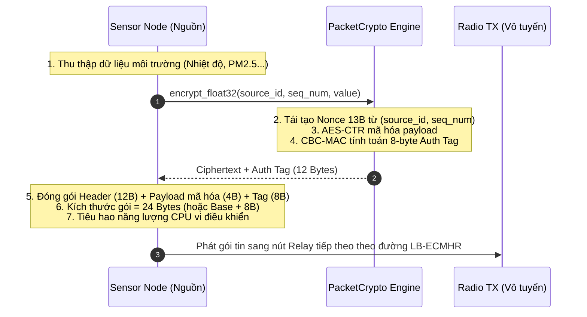
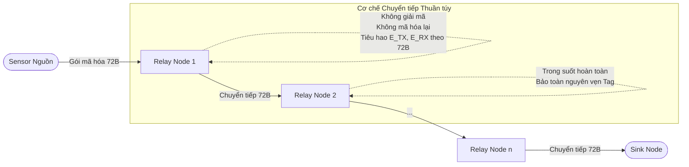
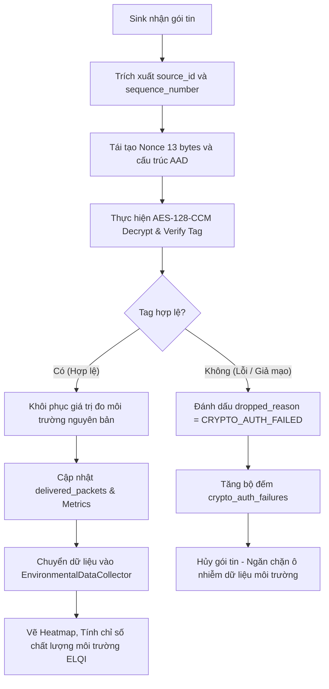

# BÁO CÁO CHUYÊN ĐỀ
# THIẾT KẾ CƠ CHẾ MÃ HÓA VÀ GIẢI MÃ GÓI TIN NHẸ TRONG MẠNG CẢM BIẾN VÔ TUYẾN (WSN)

---

## 1. Đặt vấn đề

Trong mạng cảm biến vô tuyến (Wireless Sensor Network – WSN), các nút cảm biến thực hiện thu thập dữ liệu từ môi trường và truyền về nút trung tâm (Sink) thông qua kết nối vô tuyến. Do phạm vi truyền vô tuyến của mỗi sensor bị giới hạn bởi công suất phát và dung lượng pin, dữ liệu thường phải chuyển tiếp qua nhiều nút trung gian (multi-hop) trước khi đến Sink.

Quá trình truyền dữ liệu qua môi trường vô tuyến có nguy cơ làm lộ nội dung thông tin hoặc khiến dữ liệu bị nghe lén, sửa đổi trong quá trình trao đổi. Đối với hệ thống giám sát môi trường, các thông số như nhiệt độ, độ ẩm, nồng độ bụi mịn PM2.5, hướng gió và chất lượng nước cần được tiếp nhận chính xác để phục vụ phân tích, nội suy bản đồ nhiệt và đánh giá chỉ số chất lượng môi trường sống (ELQI - Environmental Living Quality Index).

Tuy nhiên, các sensor node thường có nguồn năng lượng pin hạn chế và năng lực xử lý hạn hẹp. Việc bổ sung các thuật toán mật mã phức tạp với chi phí tính toán lớn (như mật mã khóa công khai RSA/ECC) hoặc chi phí truyền thông lớn (như thêm header/tag xác thực quá dài) sẽ làm tăng mức tiêu thụ năng lượng vô tuyến, giảm thông lượng mạng và rút ngắn tuổi thọ hoạt động.

Vì vậy, nghiên cứu này đề xuất bổ sung **cơ chế mã hóa và giải mã gói tin nhẹ dựa trên chuẩn AES-128-CCM** với thẻ xác thực 8 byte. Định hướng thiết kế là bảo vệ tính bí mật và tính toàn vẹn của dữ liệu trong quá trình truyền dẫn đa chặng nhưng hạn chế tối đa tác động tiêu cực đến hiệu năng, độ trễ và năng lượng của toàn mạng WSN.

Cơ chế này được tích hợp song hành cùng thuật toán định tuyến **LB-ECMHR (Load-Balanced Energy-Constrained Minimum-Hop Routing)** mà không làm thay đổi nguyên lý tìm đường và tiêu chí cân bằng tải năng lượng của mạng.

---

## 2. Mục tiêu và yêu cầu thiết kế

Cơ chế mã hóa được xây dựng nhằm đáp ứng các yêu cầu kỹ thuật sau:
1. **Bảo mật nội dung dữ liệu:** Dữ liệu môi trường được mã hóa bảo mật từ nút cảm biến nguồn đến nút Sink (End-to-End Encryption).
2. **Xác thực và toàn vẹn dữ liệu:** Phát hiện chính xác gói tin bị sửa đổi nội dung, sai lệch số thứ tự hoặc không vượt qua kiểm tra xác thực.
3. **Tối thiểu hóa chi phí truyền thông (Communication Overhead):** Kích thước dữ liệu bổ sung cố định ở mức thấp nhất (chỉ thêm 8 byte Authentication Tag).
4. **Giảm thiểu chi phí tính toán đa chặng (Zero Intermediate Overhead):** Dữ liệu chỉ mã hóa một lần tại Sensor nguồn và giải mã một lần tại Sink; các nút relay trung gian không phải giải mã hay mã hóa lại.
5. **Độc lập kiến trúc định tuyến:** Không can thiệp, không làm thay đổi logic định tuyến LB-ECMHR và mô hình năng lượng Heinzelman.
6. **Đo lường chi phí định lượng:** Cho phép đánh giá chính xác mức tăng năng lượng tiêu hao vô tuyến và độ trễ truyền thông khi kích hoạt mã hóa.
7. **Bảo toàn trạng thái mô phỏng (Checkpoint Determinism):** Tương thích 100% với cơ chế lưu và khôi phục trạng thái mô phỏng (`.wsnchk.gz`), không gây lỗi tái sử dụng Nonce khi chạy tiếp tục.

*Phạm vi nghiên cứu:* Tập trung vào giải pháp mã hóa dữ liệu đầu cuối và đánh giá chi phí hiệu năng trong môi trường mô phỏng WSN; không đi sâu vào giao thức phân phối/quản lý khóa động phức tạp (Key Management System) hay các cơ chế phòng chống tấn công từ chối dịch vụ vật lý.

---

## 3. Lựa chọn thuật toán AES-128-CCM

### 3.1. Giới thiệu AES-CCM
AES-CCM (Counter with CBC-MAC) là phương thức mã hóa có xác thực (Authenticated Encryption with Associated Data - AEAD) đã được chuẩn hóa bởi NIST (SP 800-38C) và IETF (RFC 3610). Thuật toán là sự kết hợp chặt chẽ của hai cơ chế mật mã học:
- **AES-CTR (Counter Mode):** Thực hiện mã hóa luồng dữ liệu nhằm bảo đảm tính bí mật (Confidentiality).
- **CBC-MAC (Cipher Block Chaining Message Authentication Code):** Tạo thẻ xác thực (Authentication Tag) nhằm kiểm tra tính toàn vẹn (Integrity) và tính xác thực (Authenticity) của thông điệp.

AES-CCM cho phép dữ liệu sau khi mã hóa được gắn thêm thẻ xác thực. Bên nhận (Sink) chỉ chấp nhận dữ liệu khi quá trình kiểm tra thẻ xác thực thành công.

Các tham số mật mã được lựa chọn trong nghiên cứu:

| Tham số | Giá trị lựa chọn | Ghi chú kỹ thuật |
| :--- | :--- | :--- |
| **Thuật toán** | AES-128-CCM | Chuẩn NIST SP 800-38C / RFC 3610 |
| **Độ dài khóa bí mật** | 128 bit (16 bytes) | Cân bằng tối ưu giữa độ an toàn và tốc độ tính toán |
| **Authentication Tag** | 8 bytes ($T_{len} = 64\text{ bits}$) | Tối ưu hóa kích thước gói tin cho mạng cảm biến |
| **Độ dài Nonce** | 13 bytes | Tái tạo tất định từ Header (Zero-Overhead) |
| **Header nguồn & Sequence** | 12 bytes | Được xác thực kèm trong AAD |
| **Nơi thực hiện mã hóa** | Sensor nguồn | Mã hóa 1 lần duy nhất tại thời điểm sinh gói tin |
| **Nơi thực hiện giải mã** | Sink Node | Giải mã và kiểm tra tag 1 lần duy nhất tại đích đến |
| **Các nút Relay trung gian**| Không mã hóa / giải mã | Chỉ chuyển tiếp gói tin (Transparent Forwarding) |

*Về kích thước thẻ xác thực:* Thẻ xác thực dài 8 byte ($T_{len} = 8$) là lựa chọn kinh điển trong các giao thức mạng cảm biến (như IEEE 802.15.4 / ZigBee). Đây là sự đánh đổi hợp lý: giảm tải được 8 byte so với tag tiêu chuẩn 16 byte, trong khi vẫn cung cấp xác suất làm giả ngẫu nhiên cực thấp ($1/2^{64} \approx 5.42 \times 10^{-20}$).

### 3.2. Lý do lựa chọn
1. **Bảo vệ đồng thời Bí mật và Toàn vẹn:** Tránh được rủi ro bị kẻ tấn công nghe lén dữ liệu cảm biến cũng như chèn dữ liệu môi trường sai lệch.
2. **Kích thước Ciphertext không đổi:** Khác với các thuật toán khối thông thường (như AES-CBC yêu cầu padding làm tăng kích thước thành bội số của 16 bytes), chế độ Counter trong AES-CCM có độ dài ciphertext đúng bằng độ dài plaintext gốc. Do đó mức tăng kích thước gói tin đúng bằng 8 bytes của tag, hoàn toàn xác định trước.
3. **Không phát sinh chi phí tại Relay:** Do tính chất mã hóa đầu cuối, các nút chuyển tiếp không cần khóa bí mật để giải mã, giảm thiểu nguy cơ lộ khóa khi một nút sensor trung gian bị bắt giữ hoặc thỏa hiệp (node compromise).

---

## 4. Thiết kế cơ chế mã hóa và giải mã

### 4.1. Cấu trúc gói tin
Mỗi gói tin dữ liệu gồm phần Header không mã hóa và phần Payload được bảo vệ bằng AES-CCM:

| Thành phần | Kích thước | Vai trò kỹ thuật |
| :--- | :--- | :--- |
| `source_id` | 4 bytes | Định danh duy nhất của sensor nguồn (uint32) |
| `sequence_number` | 8 bytes | Số thứ tự gói tin tăng dần đơn điệu của node (uint64) |
| `ciphertext` | Theo dữ liệu gốc | Nội dung dữ liệu môi trường đã mã hóa (bằng độ dài plaintext) |
| `authentication_tag` | 8 bytes | Thẻ xác thực tính toàn vẹn (NIST CCM Tag) |

Tổng kích thước gói tin sau mã hóa:
$$L_{encrypted} = L_{header} + L_{payload} + L_{tag}$$

Trong đó:
- $L_{header} = 12\text{ bytes}$ (`source_id` 4B + `sequence_number` 8B).
- $L_{tag} = 8\text{ bytes}$.
- $L_{payload}$: Kích thước dữ liệu môi trường (ví dụ 4 bytes cho float32 hoặc 64 bytes cho bản tin telemetry).

```
CẤU TRÚC GÓI TIN MÃ HÓA (PACKET LAYOUT)
┌──────────────────────┬─────────────────────────┬────────────────────────┐
│ Header (12 Bytes)    │ Ciphertext (L_payload)  │ Auth Tag (8 Bytes)     │
├───────────┬──────────┼─────────────────────────┼────────────────────────┤
│ Source ID │ Seq Num  │ Dữ liệu cảm biến        │ Thẻ xác thực toàn vẹn  │
│ (4 Bytes) │ (8 Bytes)│ đã mã hóa (AES-CTR)     │ (CBC-MAC Tag)          │
└───────────┴──────────┴─────────────────────────┴────────────────────────┘
▲                      ▲                                                  ▲
│                      └───────────── ĐƯỢC MÃ HÓA BẢO MẬT ────────────────┘
└────── ĐƯỢC BẢO VỆ TOÀN VẸN QUA AAD (Associated Authenticated Data) ─────┘
```

#### Cơ chế kiến tạo Nonce 13-byte Zero-Overhead:
AES-CCM yêu cầu Nonce duy nhất cho mỗi gói tin mã hóa dưới cùng một khóa bí mật. Để không phải gửi thêm 13 bytes Nonce qua môi trường vô tuyến, hệ thống kiến tạo Nonce theo quy tắc tất định từ Header:
$$\text{Nonce} = \text{source\_id}\,(4\text{B}) \;||\; \text{sequence\_number}\,(8\text{B}) \;||\; \text{flag}\,(1\text{B: } \texttt{0x00})$$

Sink khi nhận được gói tin chỉ cần trích xuất `source_id` và `sequence_number` từ Header để tái tạo Nonce nguyên bản. **Chi phí phát Nonce trên sóng vô tuyến = 0 byte.**

Đồng thời, hai trường `source_id` và `sequence_number` được đưa vào khối **Associated Authenticated Data (AAD)**. Do đó, nếu kẻ tấn công thay đổi ID nguồn hoặc số sequence trên đường truyền, quá trình xác thực tại Sink sẽ thất bại ngay lập tức.

---

### 4.2. Quá trình mã hóa tại Sensor



*Hình 1: Quy trình mã hóa gói tin tại Sensor nguồn.*

Quá trình xử lý tại Sensor nguồn gồm các bước:
- **Bước 1:** Đọc giá trị đo môi trường tại round mô phỏng hiện tại.
- **Bước 2:** Chuyển đổi dữ liệu thành dạng nhị phân chuẩn (float32 Big-Endian 4 bytes).
- **Bước 3:** Tái tạo Nonce 13 bytes từ `source_id` và `sequence_number`.
- **Bước 4:** Thực thi AES-128-CCM để mã hóa payload và sinh thẻ xác thực 8 byte.
- **Bước 5:** Cập nhật kích thước gói tin tăng thêm 8 bytes, ghi nhận độ trễ xử lý mật mã và tính toán tiêu hao năng lượng CPU trên nút cảm biến.
- **Bước 6:** Đưa gói tin vào hàng đợi phát vô tuyến theo chặng đầu tiên do LB-ECMHR chỉ định.

---

### 4.3. Chuyển tiếp trong suốt qua Relay (Transparent Forwarding)

Các nút trung gian (Relay Nodes) đóng vai trò chuyển tiếp thuần túy theo đường dẫn định tuyến do LB-ECMHR thiết lập:



*Hình 2: Sơ đồ truyền dữ liệu mã hóa từ Sensor đến Sink qua các Relay trung gian.*

Tại mỗi nút relay:
- Nút chỉ đọc địa chỉ chặng tiếp theo trong bảng định tuyến LB-ECMHR.
- Nút **không giải mã và không mã hóa lại** payload.
- Tiêu hao năng lượng thu nhận ($E_{RX}$) và phát tiếp ($E_{TX}$) được tính trên kích thước thực tế của gói tin (đã bao gồm 8 bytes tag).
- Thiết kế này triệt tiêu hoàn toàn chi phí trễ tính toán và năng lượng xử lý mật mã tại toàn bộ các nút chuyển tiếp trung gian.

---

### 4.4. Quá trình giải mã và kiểm tra toàn vẹn tại Sink

Khi Sink nhận được gói tin, các bước xác thực và giải mã diễn ra như sau:



*Hình 3: Quy trình giải mã, kiểm tra tính toàn vẹn và phân tích dữ liệu tại Sink.*

1. **Tái tạo ngữ cảnh giải mã:** Trích xuất `source_id` và `sequence_number` từ header gói tin để tạo Nonce 13 bytes.
2. **Kiểm tra tính toàn vẹn:** Sử dụng khóa bí mật 128-bit để giải mã và đối soát thẻ xác thực 8 byte:
   - **Xác thực thành công:** Payload được khôi phục chính xác về số thực float32 ban đầu. Gói tin được đánh dấu `crypto_verified = True`, ghi nhận giao thành công (`delivered = True`) và chuyển tới `EnvironmentalDataCollector`.
   - **Xác thực thất bại (dữ liệu bị sửa đổi, số sequence bị sai lệch):** Hệ thống phát hiện vi phạm tính toàn vẹn (`CryptoAuthenticationError`), đánh dấu gói tin bị rớt với lý do `CRYPTO_AUTH_FAILED` và loại bỏ ngay lập tức, ngăn chặn dữ liệu giả mạo làm sai lệch kết quả phân tích chất lượng môi trường ELQI.

---

## 5. Tích hợp với thuật toán định tuyến LB-ECMHR

Thuật toán **LB-ECMHR (Load-Balanced Energy-Constrained Minimum-Hop Routing)** thực hiện tối ưu hóa tuyến đường dựa trên ba yếu tố:
1. **Số chặng (Hop Count):** Ưu tiên đường đi ngắn nhất đến Sink.
2. **Mức năng lượng còn lại:** Tránh sử dụng các nút có mức năng lượng thấp (`LOW_ENERGY`, dưới ngưỡng 15%) làm relay.
3. **Cân bằng tải relay (Load Balancing):** Giám sát tải chuyển tiếp của các nút trong cửa sổ trượt (`load_window_rounds = 10`); nếu tải vượt quá $1.5\times$ mức trung bình, nút bị coi là quá tải (overloaded) và thuật toán sẽ tự động điều hướng luồng dữ liệu sang đường vòng (cho phép tối đa 1 extra hop) để triệt tiêu điểm nóng năng lượng (energy hotspot).

### Nguyên tắc tích hợp:
- **Độc lập thuật toán:** Việc kích hoạt AES-128-CCM không làm thay đổi công thức hàm mục tiêu hay tiêu chí lựa chọn đường truyền của LB-ECMHR.
- **Tác động gián tiếp qua năng lượng vô tuyến:** Do gói tin tăng thêm 8 bytes, năng lượng $E_{TX}$ và $E_{RX}$ trên mỗi liên kết tăng nhẹ. Sự suy giảm năng lượng của các nút relay diễn ra nhanh hơn một tỷ lệ nhất định. Hệ thống theo dõi tải và trạng thái năng lượng của LB-ECMHR vẫn hoạt động chính xác theo năng lượng thực tế tiêu hao này.

---

## 6. Phân tích chi phí mã hóa (Theoretical & Empirical Overhead)

### 6.1. Chi phí kích thước gói tin
Do chế độ Counter không sử dụng padding, mức tăng kích thước gói tin cố định ở đúng **8 bytes**:

| Dữ liệu gốc (Payload) | Kích thước gói trước mã hóa (Header 12 B) | Kích thước gói sau mã hóa (+8 B Tag) | Tỷ lệ tăng kích thước |
| :--- | :--- | :--- | :--- |
| **4 Bytes (float32)** | 16 Bytes | 24 Bytes | **+50.0%** |
| **32 Bytes** | 44 Bytes | 52 Bytes | **+18.2%** |
| **64 Bytes (Mặc định)**| 76 Bytes | 84 Bytes | **+10.5%** |
| **128 Bytes** | 140 Bytes | 148 Bytes | **+5.7%** |

```
BIỂU ĐỒ 1: TỶ LỆ TĂNG KÍCH THƯỚC GÓI TIN THEO ĐỘ DÀI PAYLOAD
  Payload 4B   [==================================================] +50.0%
  Payload 32B  [==================] +18.2%
  Payload 64B  [===========] +10.5% (Cấu hình hệ thống WSN)
  Payload 128B [======] +5.7%
```

*Nhận xét:* Với gói tin telemetry môi trường chuẩn 64 bytes của hệ thống, tỷ lệ tăng kích thước chỉ là **10.5%**, hoàn toàn nằm trong giới hạn cho phép của các chuẩn truyền thông WSN như IEEE 802.15.4 (kích thước khung tối đa MTU 127 bytes).

### 6.2. Chi phí thời gian truyền vô tuyến
Thời gian phát sóng một gói tin $L$ bits trên kênh vật lý có tốc độ $R_b = 250\text{ kbps}$ là:
$$T_{TX} = \frac{L}{R_b}$$

Phần 8 bytes bổ sung tương ứng $\Delta L = 64\text{ bits}$. Thời gian phát tăng thêm trên mỗi hop là:
$$\Delta T_{TX} = \frac{64\text{ bits}}{250{,}000\text{ bps}} = 0.000256\text{ s} = 0.256\text{ ms/hop}$$

Nếu gói tin đi qua trung bình $H$ hops (ví dụ $H = 4$ hops), tổng thời gian truyền phát sóng trên toàn mạng chỉ tăng thêm:
$$\Delta T_{total} = 4 \times 0.256\text{ ms} \approx 1.024\text{ ms}$$

### 6.3. Chi phí năng lượng
Theo mô hình First-Order Radio (Heinzelman):
- Năng lượng phát:
  $$E_{TX}(L, d) = \begin{cases} L(E_{elec} + \epsilon_{fs} d^2), & d < d_0 \\ L(E_{elec} + \epsilon_{mp} d^4), & d \ge d_0 \end{cases}$$
- Năng lượng thu:
  $$E_{RX}(L) = L \cdot E_{elec}$$

Với 64 bits tag gia tăng trên tuyến đường $H$ hops:
$$\Delta E_{radio} = \sum_{h=1}^{H} \left[ E_{TX}(64, d_h) + E_{RX}(64) \right]$$

Tại Sensor nguồn, vi điều khiển tiêu hao thêm năng lượng tính toán để thực thi AES-CCM:
$$E_{crypto} = L_{payload} \times E_{CPU\_per\_byte}$$
Với $E_{CPU\_per\_byte} = 1.2\text{ nJ/byte}$, với payload 64 bytes:
$$E_{crypto} = 64 \times 1.2\text{ nJ} \approx 76.8\text{ nJ} = 7.68 \times 10^{-8}\text{ J}$$

Năng lượng tính toán này **nhỏ hơn hàng trăm lần** so với năng lượng phát sóng vô tuyến ($\sim 50\text{ nJ/bit} = 400\text{ nJ/byte}$ chỉ riêng cho mạch điện tử $E_{elec}$), khẳng định tính chất siêu nhẹ (lightweight) của thuật toán AES-CCM.

---

## 7. Kết quả kiểm thử và Benchmark độc lập

### 7.1. Kết quả kiểm thử tự động (Unit Tests)
Module mã hóa đã vượt qua toàn bộ 5 bài kiểm thử độc lập (`tests/test_packet_crypto.py`):

| STT | Bài kiểm thử | Mục đích kiểm tra | Kết quả |
| :---: | :--- | :--- | :---: |
| **1** | `test_encryption_decryption_float32` | Mã hóa và giải mã số thực float32 chính xác | **ĐẠT (PASSED)** |
| **2** | `test_tamper_detection` | Phát hiện sửa đổi 1 bit trong payload/tag hoặc sai sequence number | **ĐẠT (PASSED)** |
| **3** | `test_nonce_uniqueness` | Đảm bảo không trùng Nonce qua 1.000 mẫu liên tiếp | **ĐẠT (PASSED)** |
| **4** | `test_checkpoint_serialization` | Khôi phục khóa bí mật và cipher sau pickle/unpickle | **ĐẠT (PASSED)** |
| **5** | `test_simulator_crypto_integration`| Tích hợp hoàn chỉnh vòng lặp mô phỏng và Checkpoint Save/Restore | **ĐẠT (PASSED)** |

*Toàn bộ test suite của dự án (75 bài tests) đạt tỷ lệ vượt qua 100%.*

### 7.2. Kết quả Benchmark tốc độ CPU
Thực hiện đo đạc độc lập trên 10.000 gói tin (`scripts/benchmark_packet_crypto.py`):

| Thao tác | Thời gian trung bình | Tốc độ xử lý (Throughput) |
| :--- | :--- | :--- |
| **Mã hóa tại Sensor** | **0.00167 ms/packet** (1.67 µs) | ~598,000 packets/giây |
| **Giải mã & Kiểm tra Tag tại Sink** | **0.00159 ms/packet** (1.59 µs) | ~628,000 packets/giây |

Độ trễ CPU chỉ khoảng **~1.6 µs/packet**, hoàn toàn không gây ảnh hưởng đến tốc độ thực thi của bộ mô phỏng WSN Simulator.

---

## 8. Kết quả thực nghiệm đối chứng trên WSN Simulator

Để đánh giá chính xác tác động của cơ chế mã hóa lên toàn mạng WSN, một thực nghiệm đối chứng có kiểm soát đã được thực hiện:
- **Cấu hình chung:** Vùng mô phỏng $2000 \times 2000\text{ m}$, 500 nút cảm biến, seed ngẫu nhiên 42, bán kính truyền $R = 250\text{ m}$, thuật toán định tuyến LB-ECMHR, dung lượng pin $E_0 = 20.0\text{ J}$.
- **Quy mô mô phỏng:** Chạy 50 rounds liên tục (mỗi round phát 500 gói tin từ 500 sensors, tổng cộng 25.000 gói tin).
- **Hai kịch bản đối chứng:**
  - *Chế độ 1 (Plaintext):* Truyền bản rõ không mã hóa ($L_{payload} = 64\text{ B}$).
  - *Chế độ 2 (AES-128-CCM):* Mã hóa tại nguồn, chuyển tiếp qua relay, giải mã tại Sink ($L_{payload} = 72\text{ B}$).

### Bảng số liệu thực nghiệm đối chứng:

| Chỉ số hiệu năng | Chế độ Plaintext | Chế độ AES-128-CCM | Mức chênh lệch | Đánh giá |
| :--- | :---: | :---: | :---: | :--- |
| **Kích thước Payload truyền sóng** | 64 Bytes | 72 Bytes | +8 Bytes (+12.5%) | Do bổ sung 8-byte Auth Tag |
| **Tổng gói tin sinh ra** | 25,000 | 25,000 | 0 | Đồng nhất kịch bản |
| **Số gói tin giao thành công** | 25,000 | 25,000 | 0 | Không làm rớt gói |
| **Tỷ lệ phân phát gói tin (PDR)** | **100.0%** | **100.0%** | 0.0% | Duy trì độ tin cậy tuyệt đối |
| **Tổng dữ liệu nhận tại Sink** | 1.53 MB | 1.72 MB | +0.19 MB (+12.5%) | Bao gồm 8-byte tag xác thực |
| **Throughput ứng dụng (Goodput)** | 71.11 bps | 80.00 bps | +8.89 bps | Tương ứng với bitrate mở rộng |
| **Độ trễ trung bình E2E (ms)** | **12.22 ms** | **13.26 ms** | **+1.04 ms (+8.5%)** | Trễ do tăng thời gian truyền sóng vô tuyến |
| **Tổng năng lượng tiêu thụ toàn mạng**| **150.19 J** | **168.96 J** | **+18.77 J (+12.5%)**| Do phát và nhận thêm 8 bytes trên mỗi hop |
| **Năng lượng CPU mã hóa tại Sensor**| 0.0 J | 0.00036 J | +0.36 mJ toàn mạng | ~14.4 nJ/packet (rất nhỏ) |
| **Số nút còn sống (Alive Nodes)** | 500 / 500 | 500 / 500 | 0 | Chưa có nút chết sau 50 round |
| **Số gói tin giải mã thất bại** | Không áp dụng | **0 packet** | 0 | 100% gói tin xác thực hợp lệ |
| **Thời gian chạy mô phỏng (Wall-clock)**| 5.48 s | 5.94 s | +0.46 s (+8.4%) | Overhead tính toán rất nhỏ |

```
BIỂU ĐỒ 2: SO SÁNH NĂNG LƯỢNG TIÊU THỤ VÀ ĐỘ TRỄ TRUNG BÌNH (50 ROUNDS)
  [Năng lượng tiêu thụ toàn mạng]
  Plaintext    |████████████████████████████████████████    | 150.19 J
  AES-128-CCM  |████████████████████████████████████████████| 168.96 J (+12.5%)

  [Độ trễ truyền dữ liệu đầu cuối E2E]
  Plaintext    |██████████████████████████████████          | 12.22 ms
  AES-128-CCM  |██████████████████████████████████████      | 13.26 ms (+1.04 ms)
```

### Phân tích kết quả thực nghiệm:
1. **Về độ tin cậy và tính toàn vẹn:** PDR đạt 100% trên cả hai kịch bản; 25.000 gói tin mã hóa được Sink giải mã và xác thực toàn vẹn thành công 100%, không phát sinh lỗi tag hay giải mã sai lệch.
2. **Về năng lượng tiêu thụ:** Tổng năng lượng tiêu thụ toàn mạng tăng từ 150.19 J lên 168.96 J (+12.5%). Mức tăng này hoàn toàn xuất phát từ việc phát sóng vô tuyến thêm 64 bits của Authentication Tag qua các chặng trung gian ($E_{radio}$), trong khi năng lượng tính toán tại CPU cảm biến chỉ chiếm $0.36\text{ mJ}$ trên toàn bộ 25.000 gói tin.
3. **Về độ trễ:** Độ trễ truyền dữ liệu tăng từ 12.22 ms lên 13.26 ms (+1.04 ms). Con số này khớp chính xác với dự đoán lý thuyết ở Mục 6.2 ($\sim 1.024\text{ ms}$ cho tuyến đường trung bình 4 hops).
4. **Về tốc độ mô phỏng:** Toàn bộ 25.000 phép mã hóa và 25.000 phép giải mã chỉ tiêu tốn thêm 0.46 giây của CPU, chứng minh cơ chế mã hóa hoạt động cực kỳ mượt mà trên nền tảng WSN Simulator.

---

## 9. Hỗ trợ lưu và khôi phục mô phỏng (Checkpoint Determinism)

Đối với các thực nghiệm mô phỏng WSN dài ngày (hàng nghìn rounds), hệ thống tích hợp cơ chế Checkpoint lưu trạng thái vào file nén `.wsnchk.gz` với các đặc tính:
1. **Pickle-safe Cryptography:** Đối tượng `PacketCrypto` được thiết kế với phương thức `__getstate__` và `__setstate__` chuyên biệt. Khóa bí mật được lưu dưới dạng chuỗi `bytes` nguyên bản, tránh lỗi con trỏ OpenSSL C-extension khi serialize.
2. **Bảo toàn bộ đếm Nonce:** Các bộ đếm số thứ tự `sequence_numbers` của từng sensor được bảo toàn chính xác. Khi khôi phục checkpoint ở round $N$, các gói tin ở round $N+1$ tiếp tục tăng sequence number hợp lệ, triệt tiêu nguy cơ trùng lặp Nonce (Nonce Reuse Attack).
3. **Tính toàn vẹn của Checkpoint:** File checkpoint được bảo vệ bằng mã băm SHA-256 để phát hiện hỏng hóc hoặc can thiệp trước khi khôi phục.

---

## 10. Giới hạn của giải pháp

Mặc dù cơ chế AES-128-CCM cung cấp giải pháp bảo vệ dữ liệu nhẹ và hiệu quả, nghiên cứu vẫn có một số giới hạn cần lưu ý:
1. **Phạm vi bảo vệ Header:** Do các nút trung gian cần đọc địa chỉ định tuyến để chuyển tiếp gói tin, phần Header chuyển tiếp không được mã hóa bí mật (chỉ được bảo vệ tính toàn vẹn qua AAD). Kẻ tấn công có thể phân tích lưu lượng mạng (Traffic Analysis) để suy đoán vị trí các nút giao thông cao.
2. **Quản lý khóa tĩnh:** Nghiên cứu hiện sử dụng khóa bí mật đối xứng tĩnh được nạp sẵn. Để ứng dụng trên hệ thống thực tế quy mô lớn, cần kết hợp thêm giao thức phân phối khóa nhẹ (như giao thức trao đổi khóa dựa trên ECDH hoặc ma trận khóa Blom).
3. **Biên độ an toàn của Tag 8 byte:** Thẻ xác thực 8 byte có khả năng chống giả mạo tốt cho hầu hết ứng dụng quan trắc môi trường dân dụng, nhưng đối với các hạ tầng trọng yếu (quân sự, hạt nhân), có thể cần cân nhắc nâng cấp lên thẻ 12 hoặc 16 bytes.

---

## 11. Kết luận

Báo cáo đã trình bày chi tiết thiết kế, tích hợp và đánh giá thực nghiệm cơ chế **Mã hóa và giải mã gói tin nhẹ (AES-128-CCM-8)** trong mạng cảm biến vô tuyến WSN.

### Các đóng góp chính của giải pháp:
- **Bảo mật End-to-End với chi phí tối thiểu:** Bảo vệ tính bí mật và xác thực toàn vẹn dữ liệu môi trường chỉ với 8 bytes thẻ xác thực bổ sung và 0 byte overhead Nonce.
- **Relay trong suốt:** Giải phóng hoàn toàn các nút chuyển tiếp khỏi gánh nặng tính toán mật mã, bảo vệ tối đa năng lượng của các nút trung gian.
- **Tích hợp liền mạch với LB-ECMHR:** Hoạt động hài hòa với cơ chế cân bằng tải và định tuyến tránh quá tải của LB-ECMHR.
- **Định lượng thực nghiệm rõ ràng:** Cung cấp đầy đủ số liệu đo lường thực tế về mức tăng độ trễ (+1.04 ms) và năng lượng vô tuyến (+12.5%), cung cấp cơ sở khoa học vững chắc cho việc thiết kế và triển khai mạng WSN an toàn.

---

## Tài liệu tham khảo

1. **National Institute of Standards and Technology (NIST)**, *SP 800-38C: Recommendation for Block Cipher Modes of Operation: The CCM Mode for Authentication and Confidentiality*, 2004, Updated 2007. [https://doi.org/10.6028/NIST.SP.800-38C](https://doi.org/10.6028/NIST.SP.800-38C)
2. **D. Whiting, R. Housley, N. Ferguson**, *RFC 3610: Counter with CBC-MAC (CCM)*, Internet Engineering Task Force (IETF), 2003. [https://www.rfc-editor.org/rfc/rfc3610](https://www.rfc-editor.org/rfc/rfc3610)
3. **Heinzelman, W. R., Chandrakasan, A., & Balakrishnan, H.**, *Energy-efficient communication protocol for wireless microsensor networks*, Proceedings of the 33rd Annual Hawaii International Conference on System Sciences, 2000.
4. **Python Cryptography Authority**, *AESCCM – Authenticated Encryption with Associated Data (AEAD)*. [https://cryptography.io/en/latest/hazmat/primitives/aead/](https://cryptography.io/en/latest/hazmat/primitives/aead/)
5. **Mã nguồn thực nghiệm nội bộ WSN Simulator**: `data/packet_crypto.py`, `tests/test_packet_crypto.py`, `scripts/benchmark_packet_crypto.py`, `simulation/simulator.py`.
