# BÁO CÁO TIẾN ĐỘ THỰC HIỆN ĐỀ TÀI
**Tên đề tài:** Nghiên cứu, Thiết kế Thuật toán Định tuyến Cân bằng Tải Ràng buộc Năng lượng (LB-ECMHR), Kết hợp Cơ chế Mã hóa Gói tin Nhẹ (AES-128-CCM) và Phân tích Chất lượng Môi trường Sống (ELQI) trong Mạng Cảm biến Vô tuyến (WSN)

**Tiến độ tổng thể ước tính:** **~78%** *(Đã hoàn thành xây dựng mô hình cốt lõi và thực nghiệm cơ sở cho cả 3 phân hệ Định tuyến – Mã hóa – Môi trường; đang trong giai đoạn tinh chỉnh tham số thích nghi, mở rộng kịch bản tiêm lỗi và hoàn thiện tích hợp cuối kỳ).*

---

## 1. Bảng tổng hợp tiến độ các hạng mục công việc

| STT | Phân hệ / Hạng mục công việc | Trạng thái | Tiến độ | Kết quả đã đạt được & Nội dung đang tiếp tục thực hiện |
| :---: | :--- | :---: | :---: | :--- |
| **1** | **Mô hình mạng WSN & Định tuyến đối chứng (Minimum-Hop)** | Đã hoàn thành cơ bản | **90%** | Đã cài đặt xong đồ thị mạng 500 nút, mô hình năng lượng vô tuyến bậc nhất Heinzelman và thuật toán BFS Minimum-Hop trong `simulation/simulator.py`. Đang rà soát thêm các trường hợp biên. |
| **2** | **Thiết kế & cài đặt thuật toán định tuyến LB-ECMHR** | Đang tinh chỉnh | **80%** | Đã cài đặt cơ chế lọc ngưỡng năng lượng ($\alpha$), cân bằng tải cửa sổ trượt ($W$), trễ kép Hysteresis ($\beta, \gamma$) và cơ chế dự phòng mềm hai giai đoạn ($\alpha \to \alpha_{soft}$). Đang tiếp tục tinh chỉnh trọng số thích nghi trên nhiều mật độ mạng. |
| **3** | **Thực nghiệm đánh giá hiệu năng định tuyến & trực quan hóa** | Đang thực hiện | **75%** | Đã chạy thực nghiệm 100 rounds, 1000 rounds (LND) và vẽ bộ biểu đồ phân tích tuổi thọ, kết nối, phân bố tải relay. Đang tiếp tục đối chiếu sâu hơn trên tập 10 seeds ngẫu nhiên và phân tích mặt cắt năng lượng vùng gần Sink. |
| **4** | **Thiết kế & tích hợp cơ chế mã hóa gói tin nhẹ (AES-128-CCM-8)** | Đang thực hiện | **75%** | Đã cài đặt mô-đun `data/packet_crypto.py` (AES-128-CCM, Nonce 13B Zero-Overhead, AAD 12B) và tích hợp vào luồng truyền gói tin. Đang mở rộng thêm kịch bản mô phỏng tấn công sửa đổi gói tin. |
| **5** | **Mô hình hóa dữ liệu môi trường, Nội suy IDW & Chỉ số ELQI** | Đang thực hiện | **80%** | Đã cài đặt bộ sinh dữ liệu 5 chỉ số (`data/generator.py`), nội suy không gian IDW $70 \times 70$, quy hoạch 100 phân khu (`Z001`–`Z100`), tính điểm ELQI và độ tin cậy dữ liệu (`environment/`). Đang tinh chỉnh ngưỡng cảnh báo suy giảm dài hạn. |
| **6** | **Kiểm thử tự động (Unit Tests) & Tổng hợp báo cáo cuối kỳ** | Đang thực hiện | **65%** | Đã viết các bài test cốt lõi cho bộ định tuyến, mã hóa và môi trường (`tests/`), hoàn thiện bản thảo báo cáo từng phần. Chưa chốt bản báo cáo cuối cùng để chờ bổ sung thêm số liệu tinh chỉnh. |

---

## 2. Tiến độ chi tiết Phần 1: Thuật toán định tuyến LB-ECMHR

### 2.1. Mô hình mạng và nguyên lý thuật toán đã triển khai (Tiến độ: ~80% – 85%)
1. **Không gian mạng và bài toán điểm nóng năng lượng (Energy Hotspot):**
   - Triển khai mạng gồm $N = 500$ nút cảm biến phân bố trên vùng $2000 \times 2000\text{ m}$, nút `SINK` đặt tại tâm $(1000, 1000)$, bán kính truyền thông $R = 200\text{ m}$, năng lượng khởi tạo $E_0 = 2.0\text{ J/node}$.
   - Trong mô hình thu thập dữ liệu tập trung (*Many-to-One*), toàn bộ lưu lượng từ 500 nút đều hội tụ về **14 nút cảm biến nằm trong vành đai 1-hop quanh Sink ($d \le 200\text{ m}$)**, gây ra nguy cơ cạn kiệt pin cục bộ nếu chỉ đi theo đường ngắn nhất.

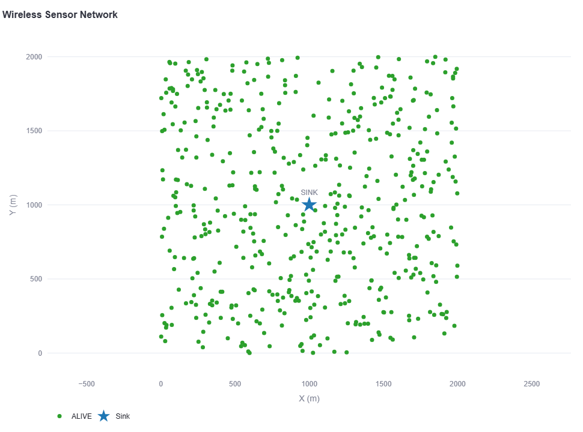
*Hình 1. Không gian triển khai mạng WSN 500 nút cảm biến (Seed 42) và nút trung tâm Sink tại tọa độ (1000, 1000).*

2. **Các cơ chế cốt lõi của LB-ECMHR đã cài đặt trong bộ mô phỏng:**
   - **Ràng buộc năng lượng hai giai đoạn ($\alpha = 0.20 \to \alpha_{soft} = 0.02$):**
     - *Giai đoạn 1 (Ngưỡng cứng $\alpha = 0.20, E_{th} = 0.40\text{ J}$):* Bảo vệ các nút có năng lượng $\le 20\%$ (`LOW_ENERGY`), không cho làm relay trung gian khi mạng vẫn còn đường đi qua các nút `ALIVE` ($E_i > 0.40\text{ J}$). Nút `LOW_ENERGY` vẫn được tự phát gói tin của chính mình.
     - *Giai đoạn 2 (Dự phòng mềm $\alpha_{soft} = 0.02, E_{th,soft} = 0.04\text{ J}$):* Khi mặt cắt cầu nối quanh Sink đều chạm ngưỡng `LOW_ENERGY` (khiến Giai đoạn 1 không còn đường đa chặng), thuật toán mở khóa có điều kiện vùng năng lượng dự phòng $[0.04\text{ J}, 0.40\text{ J}]$ và xoay vòng theo năng lượng nút cổ chai $\max B(P) = \min_{r \in P} E_r(t)$ để duy trì dịch vụ quan trắc mà vẫn giữ nút không bị chết.
   - **Cân bằng tải cửa sổ trượt ($W = 24\text{ rounds}$) kết hợp trễ kép Hysteresis ($\beta = 2.0, \gamma = 1.2$) và đi vòng giới hạn ($\Delta H = 1\text{ hop}$):** Phát hiện sớm các relay quá tải để điều hướng luồng dữ liệu đi vòng tối đa $+1\text{ hop}$ qua các nhánh lân cận còn nhiều năng lượng.

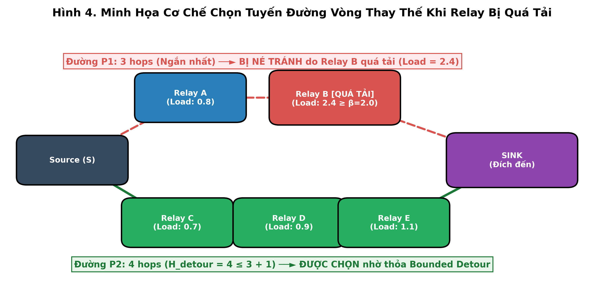
*Hình 2. Minh họa cơ chế tránh nút quá tải và đi vòng có giới hạn ($\Delta H = 1\text{ hop}$) của LB-ECMHR so với Minimum-Hop.*

---

### 2.2. Kết quả thực nghiệm định tuyến bước đầu và các biểu đồ đã xây dựng (Tiến độ: ~75%)

#### a) Nhóm kết quả về Tuổi thọ mạng (FND), Số nút sống và Tiêu thụ năng lượng (100 Rounds)
- **Về khả năng bảo vệ nút mạng:** Thuật toán đối chứng `Minimum-Hop` xuất hiện nút chết đầu tiên rất sớm tại **Round 21 (`FND = 21`)** và có tới **60 nút chết (12% mạng)** sau 100 rounds. Ngược lại, các biến thể của `LB-ECMHR` bảo toàn **500/500 nút sống (`0 nút chết`, `FND > 100`)** trong toàn bộ 100 rounds đầu tiên.
- **Về hiệu suất năng lượng:** `LB-ECMHR Hard` tiêu thụ $241.34\text{ J}$ (tiết kiệm $18.6\%$ so với $296.54\text{ J}$ của `Minimum-Hop`), trong khi `LB-ECMHR Soft` tiêu thụ $285.94\text{ J}$ nhưng đạt hiệu suất truyền tải cao nhất (**$171,246\text{ bit/J}$**, tăng $+13.0\%$ so với `Minimum-Hop`).

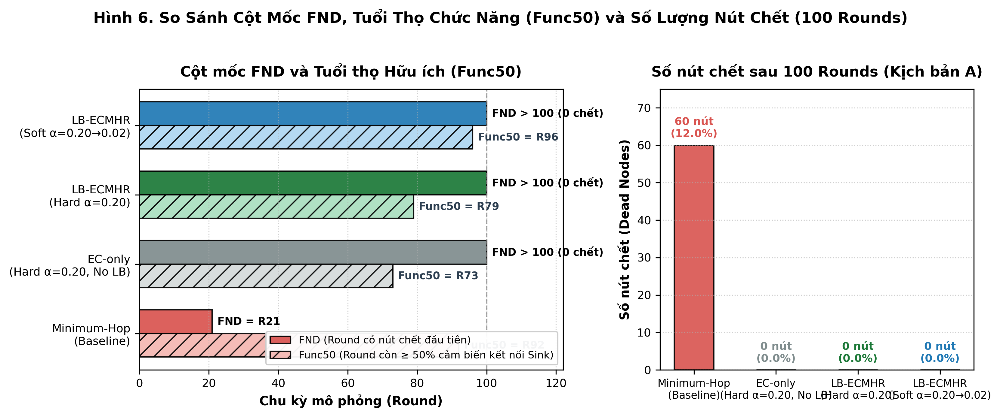
*Hình 3. So sánh thời điểm nút chết đầu tiên (FND), tuổi thọ chức năng (Func50) và tổng số nút chết sau 100 rounds.*

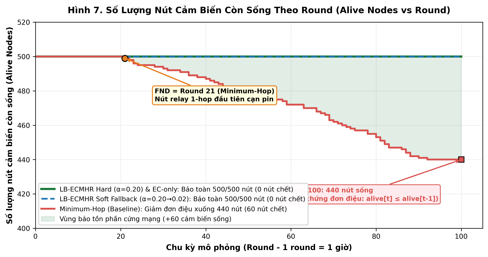
*Hình 4. Đường cong số lượng nút cảm biến còn sống (`Alive Nodes`) qua 100 rounds (đảm bảo tính đơn điệu chặt).*

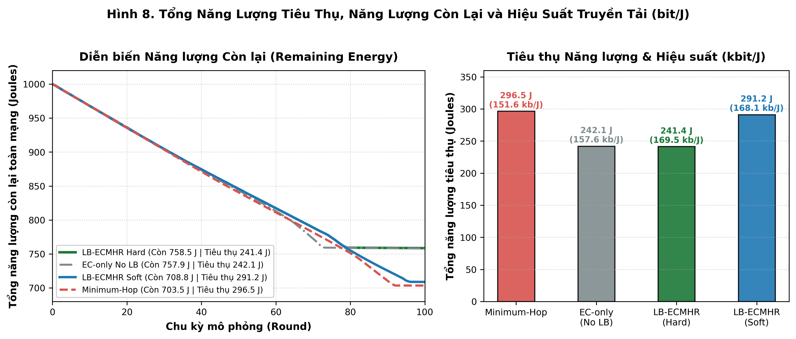
*Hình 5. Biến thiên tổng năng lượng còn lại của toàn mạng và so sánh hiệu suất năng lượng (bit/J).*

#### b) Nhóm kết quả về Kết nối Vật lý ($C_{physical}$) vs Kết nối Định tuyến ($C_{routing}$) và Cân bằng tải Relay
- **Phân tích tách biệt hai chỉ số kết nối:**
  - Cả 3 cấu hình có ngưỡng bảo vệ năng lượng đều giữ **kết nối vật lý $C_{physical}(t) = 100\%$** suốt 100 rounds.
  - Ở chế độ `LB-ECMHR Hard` ($\alpha = 0.20$), tại Round 79, **10 nút 1-hop rìa ngoài** cùng **14 nút cầu nối 2-hop** chạm ngưỡng $0.40\text{ J}$ tạo thành mặt cắt năng lượng khép kín gồm 24 nút `LOW_ENERGY`, làm kết nối định tuyến $C_{routing}(t)$ giảm xuống còn $5.60\%$ ($28/500$ nút, gồm 14 nút 1-hop và 14 nút 2-hop gửi qua 4 nút 1-hop sát tâm đang `ALIVE`).
  - Khi kích hoạt chế độ **`LB-ECMHR Soft` ($\alpha = 0.20 \to 0.02$)**, kết nối định tuyến $C_{routing}(t) \ge 50\%$ được kéo dài tới **Round 96** (vượt qua mốc Round 92 của `Minimum-Hop`).
- **Phân bố tải chuyển tiếp (Relay Load CV):** Khi đo công bằng trên cùng tập cố định 14 nút thuộc vành đai 1-hop quanh Sink ($CV_{1hop}$), `LB-ECMHR` giảm độ lệch tải từ **$0.763$ (`Minimum-Hop`) và $0.789$ (`EC-only`) xuống còn $0.680$ (giảm $10.9\% - 13.8\%$)**, đồng thời giảm đỉnh tải cực đại từ $7,490$ gói xuống $6,586$ gói ($-12.1\%$).

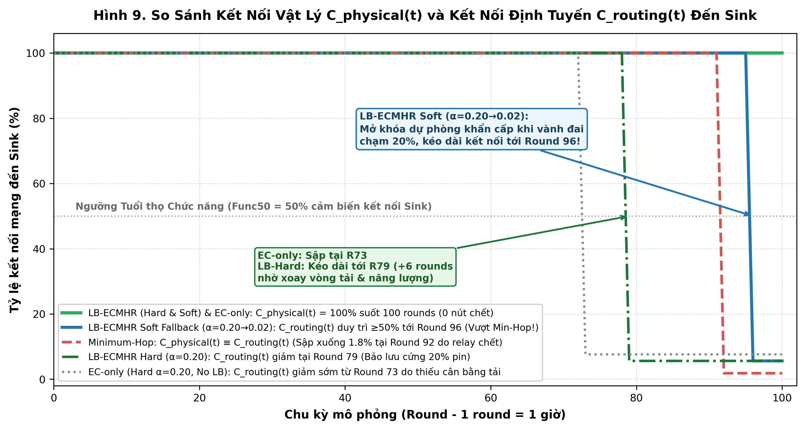
*Hình 6. So sánh Tỷ lệ Kết nối Vật lý $C_{physical}(t)$ và Kết nối Định tuyến $C_{routing}(t)$ đến Sink qua 100 rounds.*

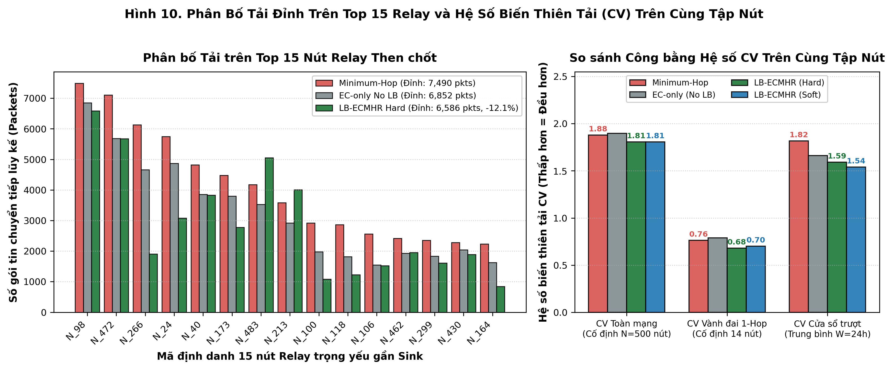
*Hình 7. Phân bố tải chuyển tiếp trên Top 15 nút relay nặng tải nhất và so sánh Hệ số biến thiên tải CV trên cùng tập nút cố định.*

#### c) Nhóm kết quả về Dung lượng dữ liệu, Nguyên nhân mất gói, Ablation Study và Vòng đời LND (1000 Rounds)
- **Tổng lượng dữ liệu và PDR:** `LB-ECMHR Soft` chuyển thành công **47,808 / 50,000 gói tin ($\text{PDR} = 95.62\%$, đạt $5.836\text{ MiB}$)**, cao hơn $+8.9\%$ so với `Minimum-Hop` ($5.358\text{ MiB}$) và gấp $4.35\times$ lượng dữ liệu thu thập an toàn trước khi có nút chết đầu tiên.
- **Kịch bản dài hạn 1000 Rounds tới LND:** `LB-ECMHR Soft` kéo dài FND từ Round 20 lên **Round 85 ($4.25\times$)** và đạt tổng dữ liệu trọn đời cao hơn `Minimum-Hop` ($5.542\text{ MiB}$ vs $5.433\text{ MiB}$).

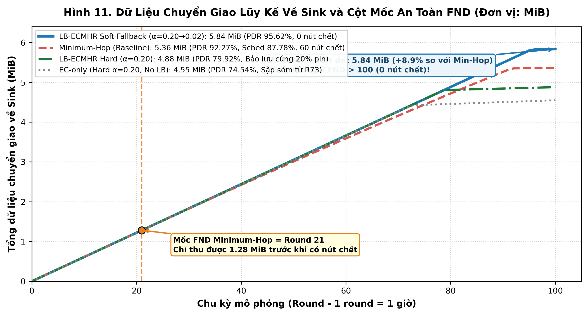
*Hình 8. Tổng lượng dữ liệu truyền về Sink (MiB) và phân loại chi tiết nguyên nhân hủy gói tin.*

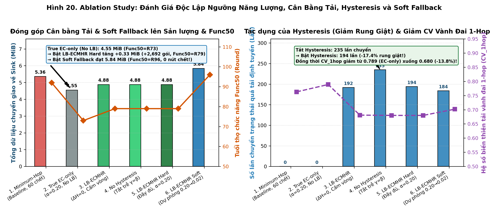
*Hình 9. Kết quả Ablation Study bóc tách vai trò của từng thành phần trong LB-ECMHR.*

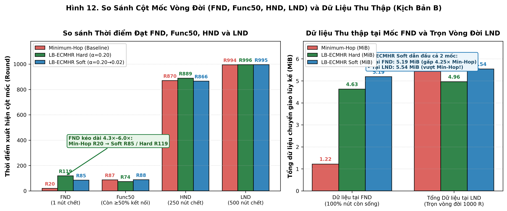
*Hình 10. So sánh các cột mốc tuổi thọ mạng (FND, Func50, LND) trong thực nghiệm vòng đời 1000 rounds.*

---

## 3. Tiến độ chi tiết Phần 2: Cơ chế Mã hóa và Giải mã Gói tin Nhẹ (AES-128-CCM)

### 3.1. Kiến trúc bảo mật nhẹ đã thiết kế và cài đặt (Tiến độ: ~75%)
1. **Lựa chọn chuẩn mã hóa có xác thực AES-128-CCM-8 (`data/packet_crypto.py`):**
   - Kết hợp **AES-128-CTR** (mã hóa bảo mật payload, không cần padding nên không làm phình kích thước bản mã) và **CBC-MAC** (tạo thẻ xác thực toàn vẹn `Authentication Tag` 8 bytes theo chuẩn NIST SP 800-38C / IEEE 802.15.4).
   - **Mã hóa Đầu-Cuối (*End-to-End*) & Chuyển tiếp Trong suốt (*Transparent Forwarding*):** Gói tin chỉ mã hóa **1 lần tại Sensor nguồn** và giải mã/kiểm tra tag **1 lần tại Sink**; các nút **Relay trung gian chỉ đọc Header định tuyến để chuyển tiếp**, triệt tiêu 100% chi phí CPU mật mã tại các nút trung gian.
2. **Cấu trúc Nonce 13-byte tất định (*Zero-Overhead Nonce*):**
   - Thay vì truyền thêm 13 bytes Nonce trên sóng vô tuyến, hệ thống tái tạo Nonce tất định từ Header gói tin:
     $$\text{Nonce (13B)} = \text{source\_id (4B)} \;||\; \text{sequence\_number (8B)} \;||\; \text{flag (1B: } \texttt{0x00}\text{)}$$
   - Đồng thời đưa `source_id` và `sequence_number` vào khối dữ liệu xác thực đi kèm **AAD (*Associated Authenticated Data*)**, vừa chống sửa đổi Header và tấn công phát lại (*Replay Attack*), vừa **giữ chi phí truyền Nonce bằng 0 byte**.

### 3.2. Kết quả thực nghiệm đối chứng chi phí mã hóa (Plaintext vs AES-128-CCM-8)

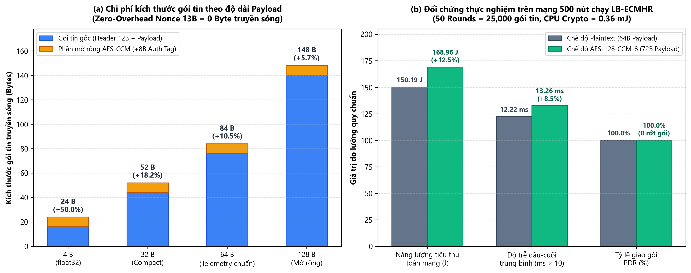
*Hình 11. (a) Tỷ lệ tăng kích thước gói tin theo độ dài Payload khi gắn 8-byte Auth Tag; (b) Đối chứng thực nghiệm Năng lượng tiêu thụ, Độ trễ đầu-cuối và PDR giữa chế độ Plaintext và AES-128-CCM-8 trên mạng 500 nút.*

| Chỉ số hiệu năng (50 Rounds = 25,000 gói) | Chế độ Plaintext (Không mã hóa) | Chế độ Bật mã hóa AES-128-CCM-8 | Mức chênh lệch (Overhead) | Nhận xét kỹ thuật bước đầu |
| :--- | :---: | :---: | :---: | :--- |
| **Kích thước Payload truyền sóng** | 64 Bytes | 72 Bytes | **+8 Bytes (+12.5%)** | Chỉ tăng đúng 8 bytes của Auth Tag |
| **Tỷ lệ phân phát gói tin (PDR)** | 100.0% | 100.0% | **0.0%** | Không gây rớt gói, xác thực hợp lệ 100% |
| **Thời gian CPU xử lý 1 gói tin** | — | **1.67 µs (Mã hóa) / 1.59 µs (Giải mã)** | **~3.26 µs/gói** | Tốc độ ~600,000 gói/giây, không gây nghẽn |
| **Độ trễ trung bình đầu-cuối (E2E)** | 12.22 ms | 13.26 ms | **+1.04 ms (+8.5%)** | Do phát thêm 64 bits qua trung bình ~4 hops |
| **Tổng năng lượng vô tuyến tiêu thụ** | 150.19 J | 168.96 J | **+18.77 J (+12.5%)** | Tăng tỷ lệ thuận với 8 bytes tag phát sóng |
| **Năng lượng CPU mã hóa toàn mạng** | 0.0 J | 0.00036 J (0.36 mJ) | **~14.4 nJ/packet** | Nhỏ hơn hàng nghìn lần so với năng lượng radio |

---

## 4. Tiến độ chi tiết Phần 3: Mô hình hóa Dữ liệu Môi trường, Nội suy Không gian IDW & Chỉ số Chất lượng Sống (ELQI)

### 4.1. Các mô-đun dữ liệu và phân tích môi trường đã triển khai (Tiến độ: ~80%)
1. **Bộ sinh trường dữ liệu môi trường Không gian – Thời gian (`data/generator.py`):**
   - Phân bổ 500 cảm biến thành 5 nhóm chuyên biệt (100 nút/nhóm): **Nhiệt độ (`temperature`, $^\circ\text{C}$)**, **Độ ẩm (`humidity`, $\% $)**, **Bụi mịn (`pm25`, $\mu\text{g/m}^3$)**, **Tốc độ gió (`wind`, $\text{m/s}$)** và **Chất lượng nước (`water_quality`, điểm $0-100$)**.
   - Kết hợp **trường tiềm ẩn Gaussian 2D** (mô phỏng khu công nghiệp tại $(1560, 1360)$, trục giao thông tại $(600, 840)$, đảo nhiệt đô thị tại $(1400, 660)$ và vùng cây xanh tại $(800, 1500)$) với **chu kỳ ngày-đêm 24h**, **đỉnh giao thông sáng/chiều (08h & 18h)**, **đợt ô nhiễm giữa tuần (*Pollution Episode*)** và **quá trình tự hồi quy bậc nhất $\text{AR}(1)$ ($\rho = 0.72$)**.
2. **Nội suy Không gian IDW, Phân vùng quản lý và Chỉ số ELQI (`environment/`):**
   - Quy hoạch vùng $2000 \times 2000\text{ m}$ thành **100 phân khu (`Z001` – `Z100`, mỗi ô $200 \times 200\text{ m}$)** và lưới bản đồ nhiệt $70 \times 70$ bằng nội suy **IDW (Inverse Distance Weighting, bậc $p = 2.0$)** từ các bản tin tươi (tuổi dữ liệu $\le 6\text{ giờ}$).
   - Tính **Chỉ số Chất lượng Môi trường Sống (`ELQI`)** theo trọng số:
     $$\text{ELQI} = 0.30\,S_{\text{pm25}} + 0.25\,S_{\text{water}} + 0.20\,S_{\text{temp}} + 0.15\,S_{\text{humidity}} + 0.10\,S_{\text{wind}}$$
   - Tính **Độ tin cậy dữ liệu phân khu (`Confidence Score`)** kết hợp 50% độ phủ không gian ($R_{sup} = 450\text{ m}$), 25% độ tươi dữ liệu ($\Delta r_{fresh} = 6\text{h}$) và 25% tỷ lệ giao gói thành công. Nếu $C(z, t) < 0.45$, phân khu được gắn cảnh báo `DATA: Độ tin cậy dữ liệu thấp`.

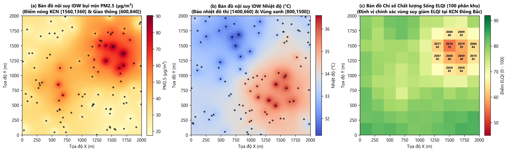
*Hình 12. Kết quả nội suy không gian tại Round 66 (18:00 chiều trong đợt cao điểm ô nhiễm): (a) Bản đồ nhiệt IDW nồng độ bụi mịn PM2.5; (b) Bản đồ nhiệt IDW Nhiệt độ; (c) Bản đồ Chỉ số Chất lượng Môi trường Sống ELQI trên 100 phân khu (`Z001`–`Z100`).*

### 4.2. Kết quả đánh giá tác động của Định tuyến LB-ECMHR đến Chất lượng Quan trắc Môi trường (Tiến độ: ~75%)

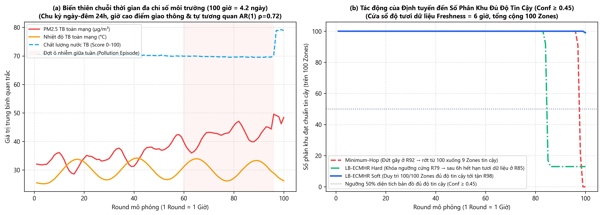
*Hình 13. (a) Biến thiên chuỗi thời gian thực tế của PM2.5, Nhiệt độ và Chất lượng nước qua 100 giờ; (b) So sánh số lượng phân khu đạt chuẩn tin cậy ($C(z, t) \ge 0.45$ trên 100 phân khu) giữa Minimum-Hop, LB-ECMHR Hard và LB-ECMHR Soft.*

| Chỉ số Chất lượng Quan trắc Môi trường | Minimum-Hop | LB-ECMHR Hard ($\alpha = 0.20$) | LB-ECMHR Soft ($\alpha = 0.20 \to 0.02$) | Đánh giá kết quả thực nghiệm |
| :--- | :---: | :---: | :---: | :--- |
| **Tổng bản tin môi trường thu được tại Sink** | 43,891 bản tin | 39,961 bản tin | **47,808 bản tin** | **LB-Soft thu nhiều hơn Min-Hop +3,917 bản tin (+8.9%)** |
| **Số phân khu đủ độ tin cậy ở Round 78** | 100 / 100 Zones | **100 / 100 Zones** | **100 / 100 Zones** | Cả 3 mô hình phủ kín 100% diện tích ($4\text{ km}^2$) |
| **Số phân khu đủ độ tin cậy ở Round 86** | 100 / 100 Zones | 13 / 100 Zones | **100 / 100 Zones** | LB-Hard hết hạn dữ liệu tươi vùng biên sau 6h kể từ R79 |
| **Số phân khu đủ độ tin cậy ở Round 100** | **0 / 100 Zones (Mù 100%)** | 13 / 100 Zones | **99 / 100 Zones** | **LB-Soft giữ được 99% bản đồ môi trường tin cậy đến cuối kỳ** |
| **Độ tin cậy bản đồ TB tại Round 100 ($C_{avg}$)** | 10.6% | 32.0% | **55.1%** | Min-Hop sụp đổ hoàn toàn sau khi đứt mạng ở Round 92 |

---

## 5. Các hạn chế đang rà soát và Kế hoạch thực hiện trong giai đoạn tiếp theo (~22% khối lượng còn lại)

1. **Về phần Thuật toán định tuyến LB-ECMHR (còn ~15% – 20%):**
   - Khảo sát cơ chế tự động điều chỉnh ngưỡng dự phòng mềm $\alpha_{soft}$ theo mật độ nút thực tế trong vành đai 1-hop.
   - Bổ sung phân tích ảnh hưởng của bán kính truyền $R$ và phân bố nút không đồng đều (Non-uniform Topology) đến thời điểm xuất hiện mặt cắt năng lượng.
2. **Về phần Cơ chế mã hóa gói tin nhẹ AES-128-CCM (còn ~25%):**
   - Xây dựng kịch bản mô phỏng tiêm lỗi / tấn công sửa đổi gói tin trên đường truyền (*Packet Tampering & Replay Injection*) với tỷ lệ tấn công $1\% - 10\%$ để thống kê trực quan số gói bị chặn bởi mã lỗi `CRYPTO_AUTH_FAILED` trước khi nạp vào bộ tính `ELQI`.
3. **Về phần Phân tích dữ liệu môi trường & ELQI (còn ~20%):**
   - Đánh giá sai số nội suy bình phương trung bình căn (**RMSE – Root Mean Square Error**) giữa trường môi trường thực $X(x, y, t)$ và bản đồ nội suy $\hat{Z}(x, y, t)$ tại Sink khi mạng bị suy giảm kết nối.
4. **Về phần Kiểm thử tích hợp và Tài liệu báo cáo (còn ~30%):**
   - Đồng bộ hóa toàn bộ thuật ngữ, ký hiệu toán học và danh mục hình vẽ giữa 3 chuyên đề (Định tuyến – Mã hóa – Môi trường) trước khi chốt báo cáo tổng hợp cuối kỳ.
